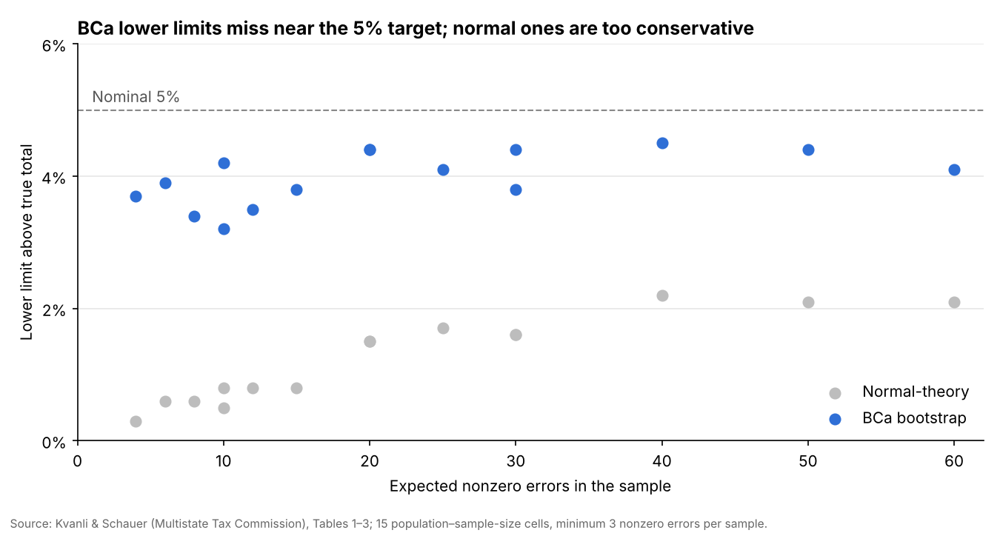

**Affiliation:** [to be completed by the author]. **Corresponding author:** andrewcistola@pm.me

**Running title:** Comparative accuracy of improper payment estimation methods: a review

**Companion study:** Cistola A (2026). *Comparative Accuracy of Improper Payment Estimation Methods in Federal Health Programs: A Monte Carlo Evaluation of Analytic Estimators and Bootstrap Simulation* (this repository, [`manuscripts/`](../manuscripts/)).

## Abstract

**Background.** The Payment Integrity Information Act of 2019 requires statistically valid improper payment estimates, with confidence intervals, for federal programs at risk of significant improper payments. The Centers for Medicare & Medicaid Services (CMS) produces five such estimates: Medicare Part C, Medicare Part D, Medicaid and CHIP (PERM), the Marketplace advance premium tax credit (EIPM), and Medicare fee-for-service (CERT). Each estimate projects audited errors from a probability sample using either design-based analytic estimators (expansion, ratio, or regression) or simulation that reruns the payment rules.

**Objective.** The purpose of this review is to describe what is known about the comparative accuracy of the available methods for estimating improper payments in federal health programs. In this review, accuracy has two parts:

- point accuracy;
- interval accuracy (coverage at the nominal level and, after that, width).

**Methods.** This study is a narrative review of two bodies of work:

- public statute, OMB guidance, and CMS, HHS, GAO, and OIG methodology documents for the five programs and for contract-level RADV audits;
- the statistical, audit-sampling and survey-bootstrap literature on interval accuracy for skewed, zero-inflated payment errors.

**Findings.** All five programs use stratified probability samples and ratio-type estimators. Part D alone publicly describes a simulation-based interval, while the others document or imply normal-theory intervals. Interval accuracy depends mainly on two factors (as opposed to the name of the method):

- the skew of the error distribution;
- the number of nonzero errors in the sample.

Normal-theory intervals are conservative at low error rates and liberal at high ones. Second-order bootstrap intervals (BCa and bootstrap-*t*) correct much of the low-error failure. No published study has compared these methods against a known truth in the designs CMS uses (risk-score, drug-benefit, eligibility, APTC, or national claims estimates).

**Conclusions.** The comparative accuracy of improper payment estimation methods in federal health programs is largely untested, and the methods in production rest on assumptions that the evidence calls into question. This review sets out a research agenda for design-based Monte Carlo validation against synthetic populations, scored on the metric that matches the use of each estimate.

**Keywords:** improper payments; payment integrity; survey sampling; bootstrap; confidence intervals; Medicare; Medicaid; audit sampling

## 1. Introduction

Every improper payment estimate in a federal health program does three things:

1. draws a probability sample of payments;
2. establishes the payment error of each sampled unit through review;
3. projects the errors to the program with an uncertainty statement.

These estimates matter. The five CMS measurements reported more than $90 billion in improper payments for FY 2025, and their confidence intervals are audited by Inspectors General. In addition, in some settings the estimates become financial determinations (for example, Medicare Advantage contract recoveries and, beginning in FY 2030, Medicaid federal match disallowances above a 3% eligibility error rate).

The purpose of this review is to answer the question: **what is known about the comparative accuracy of the available methods for estimating improper payments in federal health programs?** This review defines accuracy as in the companion Monte Carlo study:

- **Point accuracy:** how close the estimate is to the true improper payment.
- **Interval accuracy:** whether the 95% interval contains the truth in about 95% of repeated audits (coverage) and, among intervals that do, how narrow the interval is (width).

The review is organized around three questions:

1. **Terminology and practice.** What are the estimation and extrapolation techniques, and how does each program deploy them?
2. **Evidence.** What does the literature say about the accuracy and limitations of each technique?
3. **Fit.** Where would simulation and bootstrap methods help or hurt in each program, and how should their accuracy be tested?

Two inferential targets run through every section and should be kept apart:

- **The national improper payment rate** reported under the Payment Integrity Information Act, which is a program-level ratio with a two-sided confidence interval.
- **The contract- or entity-level recovery amount** (for example, a RADV extrapolation against a Medicare Advantage contract). In this setting, the estimate becomes a legal demand and is usually taken at a lower confidence bound.

A method adequate for the first can still be inadequate for the second, because coverage failures in one tail matter more than overall width.

## 2. Review approach

This study is a narrative review (as opposed to a systematic review). Two bodies of evidence were searched and read in full where available:

1. **Program sources.** Primary public sources on the design and estimation of each program, including statute and OMB guidance; CMS program pages, error-rate findings, methodology documents, and manuals; OMB information-collection supporting statements; GAO and OIG reports; and court records on RADV extrapolation.
2. **Methods literature.** Statistical, audit-sampling and survey-methods literature on the accuracy of estimators and intervals for skewed and zero-inflated payment errors, including finite-population and survey bootstraps.

Sources were identified by targeted searches, from the references of key papers (especially Edwards, Liu and Delage 2023; Kvanli and Schauer; Mashreghi, Haziza and Léger 2016), and from CMS methodology documents. Program facts are taken only from public documents current to October 2026, and anything that would require non-public contractor methodology plans is flagged as unknown. This review covers the PIIA national rate as its primary target and RADV recovery as context. Sixty-six sources are annotated in the reference list.

## 3. Regulatory and institutional background

Every estimate in scope exists because the Payment Integrity Information Act of 2019 (PIIA) requires a statistically valid improper payment estimate for programs at risk of significant improper payments, and Appendix C to Office of Management and Budget (OMB) Circular A-123 ([M-21-19](https://www.whitehouse.gov/wp-content/uploads/2021/03/M-21-19.pdf), March 2021) sets the rules. Payments are "significant" above $10 million and 1.5% of outlays, or above $100 million outright ([summary of the FY 2025 CMS release](https://www.mychesco.com/a/news/national/cms-reports-billions-in-improper-payments-but-says-most-are-paperwork-errors/)).

**What Appendix C requires.** Each program files a Sampling and Estimation Methodology Plan (S&EMP) with OMB (Phase 2). Appendix C also defines the *unknown payment*: one the agency cannot classify as proper or improper because documentation is insufficient. Inspectors General review the plans annually, and interval accuracy is an audited item. For example, the Department of Education Office of Inspector General (OIG) has repeatedly found estimates unreliable because nonrandom sampling made the confidence intervals inaccurate ([ED OIG, FY 2025 review](https://www.oversight.gov/reports/audit/us-department-educations-compliance-payment-integrity-information-reporting-6)). This precedent matters here because a change in interval method is something an OIG can test.

**Precision targets.** Medicare FFS (CERT) designs for at least a 95% confidence interval of ±3 percentage points ([CMS CERT overview](https://www.cms.gov/files/document/introduction-comprehensive-error-rate-testing-cert-program.pdf)). PERM's older statutory target was a 90% interval of ±2.5 points nationally, and CMS adds its own state-level goal of 95% ±3 points ([MACPAC](https://www.macpac.gov/subtopic/payment-error-rate-measurement-perm/)).

**Who does the work.** The Payment Accuracy and Reporting Group (PARG) in CMS's Office of Financial Management runs improper payment measurement for Medicare FFS, Parts C and D, Medicaid, CHIP, and APTC, across 11 contracts and about $115 million a year ([PARG director bio](https://aga.digitellinc.com/b/sp/chrissy-fowler-9771)). One boundary is important to note. The national Part C measure is a PARG product, but *contract-specific* RADV recovery audits are planned and extrapolated by CMS's Center for Program Integrity ([PY 2019 RADV methods](https://www.cms.gov/files/document/payment-year-2019-radv-audits-methods-and-instructions-6-26-25.pdf)). The two share review machinery but not inferential goals.

**FY 2025 results** (HHS AFR, reported November 2025; [CMS fact sheet](https://cms.gov/newsroom/fact-sheets/fiscal-year-2025-improper-payments-fact-sheet)):

| Program | Measure | FY 2025 rate | Improper $ | Data year |
| --- | --- | --- | --- | --- |
| Medicare Part C | Part C IPM | 6.09% | $23.67B | CY 2023 |
| Medicare Part D | Part D IPM | 4.00% (95% CI 3.57–4.46%) | $4.23B | CY 2023 |
| Medicaid | PERM | 6.12% | $37.39B | rolling 3 cycles |
| CHIP | PERM | 7.05% | $1.37B | rolling 3 cycles |
| Marketplace APTC (FFE only) | EIPM | 0.89% | $657.46M | CY 2023 |
| Medicare FFS | CERT | 6.55% (95% CI 5.9–7.2%) | $28.83B | Jul 2023–Jun 2024 claims |

HHS was not fully PIIA-compliant for FY 2025 ([PaymentAccuracy.gov](https://paymentaccuracy.gov/agency/HHS)). State-based Exchange APTC is not yet measured, and HHS plans to start no earlier than January 1, 2027 ([EIPM background](https://cms.gov/data-research/monitoring-programs/improper-payment-measurement-programs/exchange-improper-payment-measurement-eipm/program-background)).

## 4. Terminology of error estimation and extrapolation

Every measure in scope does the same three things: draw a probability sample, establish a payment error for each sampled unit through review, and then project ("extrapolate") to the frame and attach an uncertainty statement. The programs differ in the estimator, the variance method, and what the interval is *used for*. These three choices determine which method is most accurate in each setting.

### Sampling and review vocabulary

| Term | Meaning | Where it appears |
| --- | --- | --- |
| Universe / target population | All payments the estimate is meant to describe | PERM universe of federally matched payments; Part C payments subject to risk adjustment |
| Sampling frame | The list sampled from; an extrapolation describes the frame only | RADV PY 2019+ frames restricted to enrollees a prediction model ranks as high-risk |
| Sampling unit | What is drawn: claim, PDE, beneficiary, application, enrollee | Enrollee (Part C, RADV); beneficiary (Part D since FY 2025); application (EIPM); payment (PERM) |
| Stratum / certainty stratum | Disjoint subgroups sampled separately; a take-all stratum reviews every unit | Risk-score terciles (Part C, 2012 RADV); payment strata within quarter (PERM) |
| Payment error *y* | Paid minus amount supported by documentation; positive = over, negative = under | Every program |
| Gross vs net error | Gross sums absolute over- and underpayments; net nets them | PIIA reporting uses gross; recovery uses net overpayment |
| Unknown / insufficient documentation | Payment that cannot be classified; CMS programs count it as improper | 75% of Part D sampled errors in FY 2025; a subset of Part C overpayments |
| Taint | Error as a share of the payment, *y*/*x* | Audit literature; MUS bounds |
| All-or-nothing error | Unit is either fully in error or fully correct | Common in Medicare FFS investigations; missing-record errors in all programs |

### Estimators

The **expansion (mean-per-unit, Horvitz–Thompson) estimator** weights each sampled error by the inverse of its selection probability. This is the estimator used by 2012 RADV and PIM Chapter 8 contractors.

$$
\hat T = \sum_{h=1}^{L} \frac{N_h}{n_h} \sum_{i \in s_h} y_{hi}, \qquad \hat V(\hat T) = \sum_{h=1}^{L} N_h^2 \left(1 - \frac{n_h}{N_h}\right) \frac{s_h^2}{n_h}
$$

The **ratio estimator** divides projected improper dollars by projected paid dollars. Improper payment *rates* (PERM, Part C, Part D, APTC) are ratios, so their variance comes from linearization or replication (as opposed to the simple formula above). Current RADV (PY 2019 onward) estimates the mean change in risk score and then multiplies it by the summed county rates of the frame, which is effectively a ratio-type estimator.

$$
\hat R = \frac{\sum_h \frac{N_h}{n_h} \sum_{i \in s_h} y_{hi}}{\sum_h \frac{N_h}{n_h} \sum_{i \in s_h} x_{hi}}
$$

**Difference and regression estimators** use the known paid amount *x* as an auxiliary variable. These estimators are standard in audit sampling but are not documented in the public PARG methods. **Composite estimators** combine separately estimated components. For example, the PERM overall rate is claims rate plus eligibility rate minus an overlap term, and the national rate rolls three state cycles together.

### Variance and interval methods

| Method | How the interval is formed | Known weakness in audit data |
| --- | --- | --- |
| Normal / *t* with analytic SE | Estimate ± critical value × SE; *z* or *t* with *n*−1, *n*−*L* or Satterthwaite df | Assumes near-symmetric sampling distribution; fails under strong skew, many zeros, small *n* |
| Taylor linearization | Delta-method SE for ratios, then normal interval | Same normality assumption; unstable when the denominator is small or variable |
| Jackknife (JK1, JKn), BRR | Replicate weights drop or reweight PSUs | BRR needs 2 PSUs per stratum; jackknife is poor for non-smooth statistics |
| Naive iid bootstrap | Resample *n* units with replacement, recompute | Ignores FPC and strata; overstates variance when sampling fraction is large |
| Survey bootstraps (McCarthy–Snowden, Rao–Wu rescaling, mirror-match, pseudo-population) | Resample within strata with rescaled weights to reproduce design variance | Need ≥2 units per stratum; odd behavior with tiny strata |
| Percentile / basic interval | Quantiles of the bootstrap distribution | Too narrow for small *n*; inherits skew but not bias |
| Bootstrap-*t* | Studentize each replicate, invert its quantiles | Sensitive to unstable SE estimates in replicates |
| BCa | Percentiles shifted for bias (*z*₀) and skewness (acceleration *a*) | Best second-order accuracy in theory; acceleration noisy at very small *n* |
| Empirical likelihood | Profile likelihood ratio under a nonparametric model | Promising for zero-inflated means; untested at error rates above 40% |
| MUS / hypergeometric bounds | Bounds built from the count and size of errors | Conservative by design; minimal recovery when errors are frequent |

The BCa lower limit replaces the nominal α with an adjusted level read off the bootstrap distribution:

$$
\alpha_{\mathrm{BCa}} = \Phi\!\left( \hat z_0 + \frac{\hat z_0 + z_{\alpha}}{1 - \hat a\,(\hat z_0 + z_{\alpha})} \right), \qquad \mathrm{LB} = \hat\theta^{*}_{(\alpha_{\mathrm{BCa}})}
$$

### Simulation-based estimation

A third family of methods simulates (as opposed to projects). In **audit-finding bootstrap simulation**, the audit findings are assigned at random to the unaudited units of the whole population, the program's payment function is rerun, and the process is repeated many times. The findings are which HCCs failed, which drug claims were wrong and by how much, and which applications were ineligible. The estimate and interval are read from the distribution of simulated improper payments.

This method is attractive for three reasons:

- **Nonlinear payments.** The simulation reruns the actual payment rules (for example, Part D benefit phases, risk-score hierarchies, and the APTC schedule).
- **Every measure at once.** One set of iterations produces over-, under-, gross, and net payments, along with any subgroup.
- **Traceability.** Every simulated dollar can be traced to an audited finding.

This method differs from the survey bootstraps in the table above in one important way: the audit itself is not resampled. Two versions are possible:

- **Fixed rates:** The error rates estimated from the audit are reused in every iteration.
- **Parametric rates:** The rates are redrawn from their sampling distribution (for example, binomial) before each iteration, which represents the uncertainty of the audit itself (Efron and Tibshirani 1993, ch. 6).

Whether the interval from either version holds its nominal coverage is an empirical question addressed in Sections 6 and 8.

### Decision quantities and performance language

- **Lower confidence bound (LB).** PIM Chapter 8 recovers the lower limit of a *one-sided* 90% interval; the 2012 RADV method used the lower limit of a *two-sided* 99% interval (one-sided 99.5%); PY 2019–2021 RADV use a 90% interval's lower limit only as a gate and recover the point estimate. A two-sided 90% interval's lower limit is a one-sided 95% bound, a frequent source of confusion in appeals.
- **Coverage and one-sided non-coverage.** The share of repeated samples in which the interval (or bound) contains the true total. For recovery, the operative metric is how often LB exceeds the truth, nominally 10% for a one-sided 90% bound.
- **Viability and recovery percent.** Edwards et al. call a design "viable" if it achieves at least 89% coverage at every tested error rate, and measure efficiency as average recovery as a share of the true overpayment.
- **Monte Carlo vs bootstrap.** *Monte Carlo* here means simulating from a model or a synthetic population (used to validate designs and to propagate component uncertainty). *Bootstrap* means resampling the observed sample. CMS's Part D documents use "simulation" for both the benefit re-adjudication and the interval iterations, so the word alone does not indicate which is meant.

## 5. How each program measures improper payments

Only one of the five PIIA measures (Part D) publicly describes a simulation-based interval, while the others document (or imply) analytic normal-theory intervals. RADV is the outlier in terms of stakes, with small samples, a one-sided decision rule, and money changing hands on the result.

| Program | Sampling unit and design | Sample size | Estimator | Interval (public record) | What the interval decides |
| --- | --- | --- | --- | --- | --- |
| Part C IPM (PARG) | Enrollee; stratified random sample, historically high/medium/low risk-score strata | Not stated in public results; contractor reports up to \~7,000 medical records a year | Enrollee payment error projected to Part C payments subject to risk adjustment | Not stated in the FY 2025 results document | PIIA rate only |
| RADV, 2012 notice (CPI) | Enrollee; three equal risk-score terciles | 201 (67 per stratum) | Stratified expansion | Two-sided 99%, *z* = 2.575 | Recover the lower bound, less an FFS adjuster |
| RADV, PY 2019 (CPI) | Enrollee; SRS from a frame of the top decile by CPI's improper-payment prediction models | 35 | Mean change in risk score × Σ county rates | One-sided, *z* = 1.645, with FPC | Recover point estimate if the bound is above 0 |
| RADV, PY 2021 (CPI) | Same, frame widened to the top quartile | 35, 50, 100 or 200 by contract-size stratum | Same; Taylor linearization for partial-year enrollees | One-sided, *t* with *n*−1 df | Extrapolation designed; collection currently sample-only |
| Part D IPM (PARG) | Beneficiary (random selection since FY 2025; cohort before); PDEs validated against prescriptions | Not stated publicly | Corrected PDEs re-run through a benefit simulation to get payment error | Simulation-based 95% interval, asymmetric | PIIA rate only |
| PERM (PARG) | Two phases: states rotate in 3 cycles; within state, quarterly stratified samples of FFS claims and MC payments; eligibility cases attached to sampled payments | Set per state from expenditures and prior error; national target 95% ±3 pts | Stratified ratio (projected improper ÷ projected paid); claims + eligibility − overlap; 3-cycle rolling national rate | Analytic stratified ratio variance per the OMB supporting statement | PIIA rate; state CAPs; from FY 2030, disallowance above 3% eligibility error |
| EIPM, APTC (PARG) | FFE application; stratified random sample (strata not public) | \~2,000 | Projected APTC in error ÷ APTC paid | 95%; margin of error ±0.54 points (FY 2025) | PIIA rate only |
| CERT, Medicare FFS (PARG) | Claim; stratified random sample by claim type (Part A IPPS, Part A excluding IPPS, Part B, DMEPOS), then about 100 service-level strata per type (type-of-bill strata for Part A excluding IPPS) | About 37,500–50,000 reviewed (37,651 in FY 2025) | Weighted projection; reduces nationally to the separate ratio estimator; contractor clusters weighted by expenditure share | 95%, designed for ±3 points | PIIA rate; MAC recoupment of sampled overpayments |

### Medicare Part C: national measure and contract audits

The Part C IPM verifies that HCCs submitted for payment are supported in the medical record for a sampled enrollee, computes the enrollee-level payment error, and projects this error to the Part C population subject to risk adjustment ([CMS Part C IPM](https://www.cms.gov/data-research/monitoring-programs/improper-payment-measurement-programs/medicare-part-c-ipm)). The FY 2025 rate was 6.09% ($23.67B gross, $19.20B net) on a $388.72B denominator, and missing documentation was only 0.22% of expenditures ([FY 2025 results](https://www.cms.gov/files/document/fy-2025-medicare-part-c-error-rate-findings-results.pdf)). Two definitional changes affected the series. "Spontaneous" additional HCCs were removed from the underpayment calculation beginning in CY 2020, and ESRD and hospice enrollees entered the sample beginning in FY 2024.

Contract-specific RADV has gone through four statistical regimes in fourteen years:

| Payment year (document date) | Frame | *n* | Interval | Recovery rule |
| --- | --- | --- | --- | --- |
| PY 2021 ([May 29, 2026](https://www.cms.gov/files/document/radv-payment-year-2021-audit-methods-instructions.pdf)) | Top quartile by prediction model | 35–200 by contract size | 90%, *t*(*n*−1) | Collect sampled enrollees only; extrapolation reserved |
| PY 2019 ([June 25, 2025](https://www.cms.gov/files/document/payment-year-2019-radv-audits-methods-and-instructions-6-26-25.pdf)) | Top decile by prediction model | 35 | 90%, *z* | Point estimate if bound > 0 |
| PY 2018 (2025, per [Marshall](https://media.thinkbrg.com/wp-content/uploads/2025/09/15151442/TMarshall-AHLA-CMS-2025.pdf)) | Prediction models plus chart-review contracts | Not stated | 90% | Lower bound |
| PY 2011+ ([Feb 24, 2012](https://www.cms.gov/files/document/radvfinalmethodology02242012pdf)) | All RADV-eligible enrollees | 201 | 99% two-sided, *z* | Lower bound less FFS adjuster |

The legal basis for these audits is unsettled. The 2023 RADV rule (no FFS adjuster; extrapolation from PY 2018) was vacated in *Humana v. Becerra* on September 25, 2025 ([Milliman](https://www.milliman.com/en/insight/federal-court-vacates-2023-rule-cms-radv-audits)). The government appealed, and a Fifth Circuit panel heard argument on October 5, 2026, and appeared skeptical of the government's position ([STAT](https://www.statnews.com/2026/10/05/humana-medicare-advantage-radv-audits-lawsuit-hearing/)). Meanwhile, CMS plans to audit all \~550 eligible contracts a year ([CMS RADV fact sheet](https://www.cms.gov/files/document/cpi-radvfact-sheet.pdf)). Regardless of the court's decision, the estimator and bound will likely be argued over contract by contract, which is exactly where coverage evidence matters.

### Medicare Part D

The Part D IPM samples beneficiaries, requests documentation for their PDEs, corrects gross drug cost where the record does not support the PDE, and runs the corrected PDEs through a simulation of the benefit year so that errors flow through benefit phases and reinsurance ([CMS Part D IPM](https://www.cms.gov/research-statistics-data-systems/improper-payment-measurement-programs/medicare-part-d); [HHS performance plan](https://www.hhs.gov/about/budget/fy2022/performance/performance-plan-goal-5-objective-1/index.html)). The FY 2023 redesign changed the sampling unit, reduced "the number of simulation iterations to align to statistical literature," and aligned the confidence interval to the estimation method ([FY 2023 results](https://www.cms.gov/files/document/fy-2023-medicare-part-d-error-rate-findings-and-results.pdf-0)). In FY 2025, the program moved from cohort to random beneficiary selection.

The published intervals are visibly asymmetric: FY 2023 was $2.63B–$4.17B around $3.35B, and FY 2025 was $3.77B–$4.71B around $4.23B ([FY 2025 results](https://www.cms.gov/files/document/fy-2025-medicare-part-d-error-rate-findings-results.pdf)). This pattern is consistent with what a percentile-type resampling interval on a right-skewed error distribution produces. Public documents do not name the algorithm, so the internal S&EMP is the authority on this point. Missing or invalid documentation was 75% of sampled errors in FY 2025, which makes the error distribution closer to all-or-nothing than to small pricing discrepancies.

### Medicaid and CHIP (PERM)

PERM measures each state once every three years and builds a national rolling rate from the latest three cycles ([PERM Manual, April 2025](https://www.cms.gov/files/document/perm-manual.pdf-2)). Within a state, quarterly claims universes are stratified by payment (five payment strata for managed care in recent cycles) and selected systematically after sorting by paid amount ([OMB supporting statement](https://omb.report/icr/202408-0938-026/doc/145713901.pdf); [RY 2022 kickoff](https://www.cms.gov/files/document/ry-2022-cycle-kick-slides.pdf)). Each component rate is projected improper dollars over projected paid dollars, and the overall rate adds the eligibility rate to the claims rate and subtracts their overlap ([CMS rate calculation](https://www.cms.gov/files/document/perm-error-rate-calculation-presentation.pdf)).

The stakes for state-level estimates changed in 2025. P.L. 119-21 §71106 disallows federal match on eligibility improper payments above a 3% rate starting October 1, 2029, and removes the good-faith waiver ([BPC](https://bipartisanpolicy.org/article/understanding-medicaids-payment-error-rate-measurement-perm-program-and-changes-under-h-r-1/)). A state eligibility rate near 3% now carries a dollar consequence, so its interval behaves like a recovery bound (as opposed to only a reporting statistic). RY 2027 measures eligibility only ([RY 2027 kickoff](https://www.cms.gov/files/document/ry-2027-cycle-3-kick-presentation-part-2.pdf)).

### Marketplace APTC (EIPM)

EIPM reviews a stratified random sample of about 2,000 FFE applications to test whether eligibility determinations and APTC amounts were correct ([EIPM background](https://cms.gov/data-research/monitoring-programs/improper-payment-measurement-programs/exchange-improper-payment-measurement-eipm/program-background); [CMS 2022 release](https://www.cms.gov/newsroom/press-releases/federally-facilitated-exchange-improper-payment-rate-less-1-initial-data-release)). Rates have stayed under 1% (0.62% in the first FY 2022 report; 0.89% in FY 2025, margin of error ±0.54 points). No underpayments were reported for FY 2023–2025. In FY 2025, 0.43 of the 0.89 points were *technically improper* payments, where a required periodic data match was not run. The remainder came from manual errors (for example, income entered incorrectly or documents accepted despite name or date-of-birth discrepancies) ([PaymentAccuracy.gov](https://paymentaccuracy.gov/program/hhs-centers-for-medicare-medicaid-services-cms-advance-premi-155942da)). At this rate, a 2,000-unit sample contains only a few dozen errors, which is the setting in which normal-theory bounds are least reliable. State-based Exchanges come under a separate SEIPM rule (45 CFR 155 Subpart Q) with state-specific sample sizes and a three-year cycle, no earlier than January 1, 2027.

### Medicare fee-for-service (CERT)

CERT reviews a stratified random sample of Medicare FFS claims submitted from July through June, including both paid and denied claims ([CERT introduction](https://www.cms.gov/files/document/introduction-comprehensive-error-rate-testing-cert-program.pdf)).

- **Strata.** The first level is claim type (Part A hospital IPPS, Part A excluding IPPS, Part B, and DMEPOS). Within each type, there are about 100 service-level strata, and Part A excluding IPPS uses two-digit type-of-bill strata, fewer than 20 ([CERT methodology](https://data.cms.gov/sites/default/files/2026-01/CERT%20Methodology.pdf)).
- **Estimator.** A generalized estimator produces national, contractor-cluster, and service-level rates. At the national level it reduces to the separate ratio estimator, with contractor clusters weighted by their share of expenditures.
- **FY 2025 sample.** 49,061 claims were sampled and 37,651 reviewed: IPPS 8,750; Part A excluding IPPS 8,651; Part B 11,600; DMEPOS 8,650.
- **FY 2025 results.** The gross rate was 6.55% (95% CI 5.9–7.2%), with $27.9B in overpayments and $1.0B in underpayments, counted gross ([2025 Supplemental Improper Payment Data](https://www.cms.gov/files/document/nov-2025-medicare-ffs-supplemental-improper-payment-data-2025922.pdf)). By type, the rates ranged from 3.1% (IPPS) to 24.1% (DMEPOS).
- **Error categories.** Insufficient documentation accounted for 53% of improper dollars, medical necessity 15%, no documentation 12%, incorrect coding 11%, and other 8.5%.

Most CERT errors are therefore whole-claim, all-or-nothing errors, with partial errors coming mainly from coding. This is the error setting studied by Edwards, Liu and Delage (2023), but at a national sample size where the central limit theorem has far more to work with than in a 30-claim provider audit.

**Unknown from the public record:**

- the Part C IPM sample size, strata, and interval method;
- Part D's resampling algorithm and number of replicates;
- the PERM national variance formula;
- EIPM's strata;
- CERT's allocation rule and variance method (described in an appendix to the Supplemental Improper Payment Data report).

## 6. Evidence on comparative accuracy

The literature converges on one rule: whether an interval holds its nominal coverage depends mainly on the skew of the error distribution and the number of nonzero errors in the sample (as opposed to the name of the method). Bootstrap intervals correct the low-error, right-skew failure well. However, they have barely been tested in the high-error, all-or-nothing setting that Medicare reviews actually produce.

### Normal-theory intervals

- **The principle of skew.** A right-skewed population produces a conservative lower bound and a liberal upper bound, and a left-skewed population reverses this pattern (Cochran 1977, as applied by [Edwards, Liu & Delage 2023](https://www150.statcan.gc.ca/n1/pub/12-001-x/2023002/article/00001-eng.pdf)). Overpayment populations are a spike at zero plus a payment-shaped tail, so their skew reverses as the error rate rises.
- **Low error rates: too conservative.** With few nonzero errors, normal lower limits sit far below the truth. In Kvanli and Schauer's simulations, the traditional 90% interval's lower limit exceeded the true total in only 0.3–2.3% of samples as opposed to a nominal 5% ([MTC paper](https://www.mtc.gov/wp-content/uploads/2023/04/The-Bootstrap-What-the-Government-Auditor-Should-Know.pdf)). Neter and Loebbecke's 1975 AICPA study of real accounting populations is the classic early demonstration that standard estimators' intervals miss nominal coverage when errors are rare.
- **High error rates: too liberal.** In 166 Medicare integrity samples, more than 76% of payments were in error and the data fit an all-or-nothing model. Under this model, a simple random sample of 30 fell below 90% confidence once the error rate passed 0.6 for two of three test populations, and no stratification algorithm tested was viable for more than about half of 104 populations (Edwards et al. 2023). At very high error rates, the bound can even exceed total payments.
- **Stratification can make it worse.** Payment-based strata create left-skewed overpayment strata at high error rates, and King and Madansky (2013) warn that careless stratification can invalidate the confidence coefficient itself.
- **CMS acknowledges the gap.** PIM Chapter 8 accepts "standard methods" from texts and journals but acknowledges that 90% coverage cannot be guaranteed in every audit ([PIM Ch. 8, §8.4.5](https://www.cms.gov/Regulations-and-Guidance/Guidance/Manuals/Downloads/pim83c08.pdf)).

### Bootstrap intervals

- **Theory.** Percentile intervals are first-order accurate, while BCa and bootstrap-*t* are second-order accurate, correcting for skewness at rate 1/*n* rather than 1/√*n* (Hall 1988; Efron 1987; DiCiccio & Efron 1996). In small samples, the percentile interval is too narrow, and bootstrap-*t* handles skew better (Hesterberg 2015).
- **Audit populations with rare errors.** Kvanli and Schauer found BCa lower limits exceeded the truth in 3.2–4.5% of samples (nominal 5%), much closer than the traditional method, with average lower limits 6–530% higher depending on the expected number of errors. The gain fades after roughly 30 nonzero errors in the sample, at which point both methods agree. On twelve real tax-audit samples, BCa lower limits were 3–548% higher.
- **Survey designs.** Rescaled bootstraps reproduce design variance under stratified sampling (Rao & Wu 1988; Rao, Wu & Yue 1992). Simulation comparisons ranked coverage bootstrap > BRR > jackknife > linearization, with the bootstrap best for one-sided intervals (Kovar, Rao & Wu 1988, as summarized by [Kolenikov 2008](https://www.stata.com/meeting/snasug08/kolenikov_snasug08.pdf)). A naive iid bootstrap ignores the finite population correction and overstates variance ([Mashreghi, Haziza & Léger 2016](https://projecteuclid.org/euclid.ssu/1458047831)).
- **Rare-error refinements.** Helmers (2000) combines a Cornish–Fisher expansion with bootstrap calibration to get upper limits for total error when errors are rare and highly skewed ([Biometrika](https://ir.cwi.nl/pub/2115/2115D.pdf)).
- **Skewed health spending.** The cost-effectiveness literature adopted the nonparametric bootstrap for skewed per-person costs (Barber & Thompson 2000), a close analogue to per-enrollee payment error.

*Source: Kvanli & Schauer (Multistate Tax Commission), Tables 1–3 · 15 population–sample-size cells, minimum 3 nonzero errors per sample.*

Even at 60 expected errors, the normal-theory bound misses less than half as often as it should, so it under-recovers. In contrast, BCa remains slightly conservative throughout. Populations had 2%, 5%, and 10% error rates with exponential error sizes and 5,000 samples per cell.

**Where the bootstrap is expected to fail or is untested:**

1. **Few or no nonzero errors.** If the sample has zero or one error, every resample is degenerate and the bound collapses to zero or to the single error. EIPM-scale error rates and small RADV contracts are at risk.
2. **Bounded, all-or-nothing errors at high rates.** Resampling cannot produce values outside the observed support and inherits the skew of the sample. Whether this corrects the normal bound's liberal behavior at error rates above 0.6 has not been published for Medicare data.
3. **Tiny strata and systematic samples.** Rescaling requires at least two units per stratum, and the sorted systematic selection used by PERM has no exact design-based variance, so any bootstrap treats it as implicitly stratified.
4. **Model-ranked frames.** RADV PY 2019+ frames are chosen by a prediction model, so inference applies only to the frame. A bootstrap inside the frame is valid, but extrapolating its interval beyond the frame is not.
5. **Composite and multi-phase estimators.** Rolling PERM rates and claims-plus-eligibility composites require resampling each phase and component on its own design, and then recombining them. Correlations between components (the overlap term) must be carried through.
6. **Reproducibility.** Tail quantiles need thousands of replicates, and appeals require that the result be replicable, so the seed, replicate count, and Monte Carlo error must be documented as PIM §8.4.4.2 already requires for sample selection.

### Alternatives with published evidence

| Approach | Evidence | Limitation | Sources |
| --- | --- | --- | --- |
| Empirical likelihood | Better-balanced tails than normal-theory for zero-heavy means at low error rates | Untested above 40% error until Liu's 2025 work on Medicare populations | Chen, Chen & Rao 2003; [Liu 2025 (ISI WSC)](https://www.isi-next.org/abstracts/submission/2602/view/) |
| Likelihood methods for zero-inflated means | Standard *t*-intervals unreliable for many-zero populations | Parametric assumptions on the nonzero part | Kvanli, Shen & Deng 1998; Zhou & Tu 2000; Tian 2005 |
| Hypergeometric / minimum-sum / penny sampling | Guaranteed at least nominal coverage if negative errors are rare; never exceeds total payment | Conservative; lower recovery | Edwards et al. 2003; Gilliland & Feng 2010; Edwards et al. 2015 |
| MUS / Stringer-type bounds | Standard in financial audit for low-error overstatement | Conservative; ill-suited to frequent or two-sided errors | NRC Panel 1988 |
| Model-based design testing | Monte Carlo under an all-or-nothing model reveals viability before sampling | Model must match the error process | Edwards et al. 2023 (R `samptest`) |

**The gap this review identifies.** No published study compares the accuracy of the available methods against a known truth in the settings CMS measures:

- RADV-style risk-score extrapolation;
- Part D PDE-to-payment simulation;
- PERM eligibility rates;
- APTC errors;
- the national CERT claims estimate.

This gap applies to analytic, bootstrap, and audit-finding simulation methods alike. The closest evidence comes from Medicare FFS provider audits (high error, all-or-nothing) and tax and accounting audits (low error, right skew). The CMS programs span both settings. In addition, the validity of audit-finding simulation intervals (with or without uncertainty in the rates) has not been tested.

## 7. Fit of simulation and bootstrap methods by program

The case for the bootstrap is strongest where samples are small, errors are skewed, and an interval drives a dollar decision (RADV first, then PERM state eligibility rates, and then EIPM). Part D already relies on simulation, so the question for Part D is validation (as opposed to adoption). Part C IPM gains the least.

| Program | Error regime | What the interval decides | Bootstrap priority | Variant to test first |
| --- | --- | --- | --- | --- |
| RADV contract audits | *n* = 35–200 per contract; high error in a model-targeted frame; discrete HCC-sized jumps; some offsets | Gate for extrapolation; historically the recovery amount | High | Without-replacement (pseudo-population) bootstrap-*t* and BCa on the enrollee-month ratio |
| PERM, state eligibility | Few hundred cases per state; rates around 1–12%; mostly documentation errors | From FY 2030, federal match disallowed above 3% | High | Rescaled bootstrap within payment strata, propagated through the composite |
| EIPM (APTC) | \~2,000 applications; rate under 1%; few dozen errors; right-skewed | PIIA rate; SBE state rates from 2027 | Medium–high | Stratified rescaled bootstrap with BCa; empirical likelihood as comparator |
| Part D IPM | Beneficiary clusters of PDEs; 75% of errors are missing documentation; nonlinear benefit simulation | PIIA rate | Validate existing | Audit the current resampling scheme's coverage under a synthetic population |
| Part C IPM | Large national stratified sample; ratio estimator | PIIA rate | Low | Rao–Wu–Yue replicate weights as a check on linearization |
| CERT | National sample of about 37,500 claims in four claim types; mostly all-or-nothing errors; DMEPOS rate above 20% | PIIA rate (national and by claim type) | Low–medium | Stratified design bootstrap by claim type; check high-error strata (DMEPOS) separately |

### RADV contract audits

**Benefits.**

- At *n* = 35 the normal or *t* bound rests entirely on the CLT for a skewed, discrete variable (change in risk score). Bootstrap-*t* and BCa correct the skewness term the *t* bound ignores.
- The PY 2021 estimator is a ratio over enrollee-months. Resampling enrollees (with all their months and HCCs) produces its variance without the linearization step.
- Resampling can bound the dollar payment error directly, including county-rate weighting (as opposed to bounding the mean risk-score change and multiplying afterward).

**Drawbacks.**

- The decision rule is one-sided: extrapolate if the bound exceeds zero, and then recover the point estimate. What matters is the false-extrapolation rate when the true mean change is at or below zero. At *n* = 35, percentile intervals are known to be too narrow, which would *raise* this rate.
- If the targeted frame yields mostly right-skewed changes (many zeros, some large HCC deletions), a better-calibrated bound can be higher than the *t* bound, as in Kvanli and Schauer. This would shift recoveries upward and would likely invite challenge.
- Inference applies only to the prediction-model frame, and the bootstrap cannot resolve the frame definition or the FFS-adjuster dispute.
- A method change during litigation is itself a legal event, so any bootstrap must be fully replicable from a documented seed.

**Implementation.** Each contract should be treated as SRS without replacement from its frame, using a pseudo-population or rescaled bootstrap so that the FPC is honored when *n*/*N* is large (frames can be as small as 30). Enrollees should be resampled as clusters, the month-weighted mean change and the dollar estimate computed in each replicate, and bootstrap-*t* and BCa bounds formed with at least 5,000 replicates. The probability that the bound exceeds zero should be reported alongside the bound.

### Part C IPM

**Benefits.** Replicate weights give one variance method for gross, net, over- and underpayment rates and for HCC-level or plan-type domains. **Drawbacks.** The national sample is large and stratified, so the CLT should hold, and coverage gains will likely be small. **Implementation.** The recommended approach is a Rao–Wu–Yue rescaled bootstrap within risk strata (resampling *n*ₕ−1 per stratum), with percentile and BCa intervals compared against the current method. This would be useful mainly as a cross-check and for domains.

### Part D IPM

**Benefits.** The estimator is a nonlinear simulation (corrected PDEs re-run through benefit phases and reinsurance), so linearization is impractical, and resampling is the natural variance method. The asymmetric published intervals suggest that this is already the approach.

**Drawbacks and questions to settle.**

- *What is resampled.* Resampling beneficiaries after their payment errors are computed is inexpensive and valid if the simulated error of each beneficiary is fixed. Re-running the benefit simulation inside each replicate is only needed if the simulation itself has stochastic inputs.
- *Replicate count.* The FY 2023 cut in simulation iterations needs a Monte Carlo error target for the 2.5% and 97.5% quantiles (as opposed to only the standard error).
- *Design fidelity.* The FY 2025 switch from cohort to random beneficiary selection should be mirrored in the resampling scheme (strata, FPC).
- *Benefit redesign.* The Inflation Reduction Act's 2025 Part D redesign (including the $2,000 out-of-pocket cap) changes the benefit simulation for payment years from 2025, reported from FY 2027.

**Implementation.** The current method should be validated (as opposed to replaced) by building a synthetic beneficiary population from historical PDE and error data, repeating the full sampling-review-simulation pipeline, and measuring the coverage and tail balance of the current interval against BCa and bootstrap-*t*.

### PERM

**Benefits.**

- The overall rate is a composite (FFS + managed care + eligibility − overlap, at federal share), and the national rate pools three cycles. Replicate weights carry every covariance through without hand-derived formulas.
- Beginning in FY 2030, a state eligibility rate above 3% triggers disallowance. With a few hundred cases per state, a one-sided bound near 3% needs calibrated coverage, and whether the statute's "rate" means the point estimate or a bound is a rulemaking question worth raising.

**Drawbacks.** Systematic selection after sorting by paid amount has no exact variance estimator. In addition, eligibility cases are a second phase attached to sampled payments, difference resolution and appeals change findings after sampling, and the three cycles measure different years.

**Implementation.** Replicate weights should be generated per state at selection time, treating sorted systematic samples as implicitly stratified (paired adjacent units). The eligibility phase should then be resampled within the sampled payments, and each component and the composite computed per replicate. Because states are sampled independently, national replicates come from summing state replicate totals.

### EIPM (APTC)

**Benefits.** At an error rate under 1%, a 2,000-application sample sits squarely in the rare-error setting where normal upper bounds are liberal and lower bounds are conservative, and BCa helps both tails. SBE measurement beginning in 2027 will produce smaller state samples where this matters more.

**Drawbacks.** Strata with zero observed errors produce degenerate resamples, and household-level APTC errors are bounded by the monthly APTC and may be all-or-nothing when eligibility fails.

**Implementation.** The recommended approach is a stratified rescaled bootstrap with BCa and bootstrap-*t*, with strata that have zero or one error flagged and compared against empirical likelihood and a zero-inflated parametric bound.

## 8. Research agenda: validating comparative accuracy

The strongest design is a design-based Monte Carlo study. Such a study would build realistic finite populations for each program, rerun the program's actual sampling design and estimator thousands of times, and score every interval method against the known truth on the metric that matches how the interval is used. This is the approach Edwards et al. use for FFS audits, extended to bootstrap and audit-finding simulation comparators and to the five CMS designs.

### Study pipeline

1. **Build populations.** Unit-level error models are fit to historical review outcomes: HCC-level validation probabilities and hierarchy moves for Part C and RADV; PDE-level documentation failure and pricing discrepancy for Part D; case-level eligibility error for PERM; application-level APTC error for EIPM. These models are imposed on real frame covariates (payments, risk scores, and county rates) to form "plasmode" populations, and stress populations are added on an error-rate grid from 0.01 to 0.95 with right-, left-, and two-spike payment shapes.
2. **Apply the real design.** Frame rules (including the RADV prediction-model frame), strata, sample sizes, and selection mechanics are reproduced (sorted systematic selection for PERM; cohort versus random beneficiary for Part D).
3. **Apply the production estimator.** The production estimator is applied along with plausible alternatives (ratio vs expansion; enrollee-month weighting).
4. **Compute every interval method.** Every interval method (listed below) is computed on each simulated sample.
5. **Score.** Each interval is scored against the population truth, and the process is repeated 10,000 times per scenario cell.
6. **Stress-test.** Results are stress-tested with review measurement error (for example, coder disagreement and overturns on appeal), missing records scored as errors, and frame misspecification.

### Comparators

Current analytic interval (*z* and *t*, Satterthwaite df where stratified); naive bootstrap percentile; design (rescaled or pseudo-population) bootstrap with percentile, basic, bootstrap-*t*, and BCa intervals; calibrated (double) bootstrap; empirical likelihood; and, for RADV, a hypergeometric or minimum-sum bound as a conservative floor.

### Metrics, matched to the interval's use

| Use | Primary metric | Secondary metrics |
| --- | --- | --- |
| PIIA rate reporting (Part C, Part D, PERM national, EIPM) | Two-sided coverage and balance between the two tails | Width relative to point estimate; bias and RMSE of the rate |
| Recovery from a lower bound (2012 RADV, PIM-style) | One-sided exceedance: share of samples where the bound exceeds the truth (target ≤ 10% for a 90% bound) | Average recovery as a share of true overpayment; share of bounds above total payment |
| Extrapolation gate (RADV PY 2019+) | False-extrapolation rate when the true mean change ≤ 0 | Recovery error when the gate opens: point estimate minus truth |
| Threshold test (PERM eligibility vs 3%) | Probability of a state being classified above 3% when its true rate is at or below 3%, and the reverse | Expected disallowance error in dollars |

"Viable" should be defined before running the study (for example, one-sided exceedance within nominal + 2 Monte Carlo standard errors in every scenario cell). With 10,000 replications, the Monte Carlo standard error of a 10% exceedance rate is 0.3 percentage points. Viable methods can then be ranked by recovery or width.

### Scenario grid

| Program | Population source | Sample sizes | Error-rate range to cover |
| --- | --- | --- | --- |
| RADV | Historical RADV and Part C IPM enrollee outcomes on real contract frames | 35, 50, 100, 200; frames down to 30 | Wide: targeted frames may run high |
| Part C IPM | Part C IPM history | Production national size by stratum | Around 4–8% of payments |
| Part D IPM | Historical PDE validation results with benefit simulation | Production size | Around 3–5% of payments; documentation failures dominant |
| PERM | State universes and eligibility review history | Per-state production sizes | 1–15% eligibility; dense near 3% |
| EIPM | FFE application history | \~2,000 total; SBE-sized state samples | 0.2–2% |
| CERT | National claims universe by claim type | \~37,500 reviewed (FY 2025 counts by claim type) | About 3% (IPPS) to 25% (DMEPOS) by claim type |

### Computation

A bootstrap inside a Monte Carlo study multiplies costs: 10,000 outer replications × 5,000 resamples is 5 × 10⁷ estimator evaluations per cell. Three practices keep this tractable: precomputing unit-level errors so that each resample is a weighted sum, generating multinomial or rescaled weights in vectorized blocks, and running cells as independent batch jobs over Parquet-staged populations. The warp-speed method of Giacomini, Politis and White (2013) can screen percentile-type intervals with one resample per outer replication before full runs, but it does not cover BCa.

### Data and access needs

The study would be strongest with:

- **Methodology plans.** The programs' Sampling and Estimation Methodology Plans (sample sizes, strata, interval algorithms, replicate counts) and the PERM statistical contractor's variance specification.
- **Historical review outcomes,** at the unit level, held under appropriate data use terms. These outcomes would be used to calibrate error models.
- **Agreed metrics.** A primary metric for each program, agreed with the reporting and recovery offices.

Without these, a study can still proceed on synthetic populations calibrated to public aggregates, with illustrative strata where the actual strata are not published. This is the approach of the companion Monte Carlo evaluation, which applies this agenda to all five programs.

## 9. Conclusions

The methods CMS uses to estimate improper payments are well established in survey sampling, but their accuracy in these settings is largely untested:

- **Ratio-type analytic estimators** dominate production, with normal-theory intervals.
- **Part D** relies on simulation.

The existing evidence points in a consistent direction. Interval accuracy depends on the skew of the errors and the number of nonzero errors in the sample. Normal-theory intervals are conservative when errors are rare and liberal when they are frequent. Second-order bootstrap intervals correct much of the rare-error failure but have barely been tested where errors are frequent and all-or-nothing.

Audit-finding simulation is attractive for nonlinear payment rules. However, its intervals have never been validated. Because it does not resample the audit, it carries a specific risk of understating uncertainty.

The comparative accuracy of these methods should therefore be established empirically before any of them is relied on for new uses. The appropriate design is a Monte Carlo evaluation against populations with known truth, run under each program's actual design and scored on the metric that matches how the estimate is used. These new uses include smaller audits, state-level PERM disallowances, State-based Exchange measurement, and contract-level recovery.

## References (annotated)

Sixty-six sources in seven groups. Linked entries were opened for this review; unlinked classic references are cited from standard bibliographic records and should be checked against the originals before publication.

### A. Statute, guidance and program methodology

- **Payment Integrity Information Act of 2019**, P.L. 116-117 (March 2, 2020). Replaced IPIA, IPERA and IPERIA; requires statistically valid improper payment estimates. *Use:* the legal standard any interval method must satisfy.
- **OMB (2021). [M-21-19, Appendix C to Circular A-123](https://www.whitehouse.gov/wp-content/uploads/2021/03/M-21-19.pdf).** Defines improper and unknown payments and the Sampling and Estimation Methodology Plan. *Use:* the approval route for changing an interval method.
- **CMS (2026). [Medicare Program Integrity Manual, Ch. 8](https://www.cms.gov/Regulations-and-Guidance/Guidance/Manuals/Downloads/pim83c08.pdf)** (Rev. 13762). Sets the one-sided 90% lower bound as the default demand, admits coverage cannot always be guaranteed, accepts methods from standard texts and journals, and caps demands at total payment. *Use:* the regulatory door for bootstrap bounds in recovery settings.
- **CMS (2012). [Notice of Final Payment Error Calculation Methodology for Part C RADV Contract-Level Audits](https://www.cms.gov/files/document/radvfinalmethodology02242012pdf).** 201 enrollees in three risk-score strata, expansion estimator, two-sided 99% normal bound, FFS adjuster. *Use:* the historical RADV baseline method.
- **CMS (2025). [PY 2019 RADV Audit Methods and Instructions](https://www.cms.gov/files/document/payment-year-2019-radv-audits-methods-and-instructions-6-26-25.pdf).** 35-enrollee SRS from a prediction-model top-decile frame; mean risk-score change with FPC; *z*-based 90% bound as an extrapolation gate; point-estimate recovery. *Use:* the clearest small-sample target for bootstrap testing.
- **CMS (2026). [PY 2021 RADV Audit Methods and Instructions](https://www.cms.gov/files/document/radv-payment-year-2021-audit-methods-instructions.pdf)** (May 29). Top-quartile frame; samples of 35–200 by contract size; *t*(*n*−1) bound; Taylor linearization for partial-year enrollees; sample-only collection pending appeal. *Use:* the current production design.
- **CMS (2025). [RADV Audits Fast Facts](https://www.cms.gov/files/document/cpi-radvfact-sheet.pdf)** (July). All eligible contracts audited from PY 2019; 35–200 enrollees per sample. *Use:* scale of the recovery program.
- **CMS (2023). Medicare Advantage RADV final rule, 88 Fed. Reg. 6643** (February 1). Extrapolation from PY 2018, no FFS adjuster, no specific sampling or extrapolation method adopted. *Use:* the rule vacated in 2025.
- **CMS (2025). [FY 2025 Medicare Part C Error Rate Findings](https://www.cms.gov/files/document/fy-2025-medicare-part-c-error-rate-findings-results.pdf).** 6.09% rate; error composition; definitional changes. *Use:* Part C targets and error mix.
- **CMS (2023, 2025). [FY 2023](https://www.cms.gov/files/document/fy-2023-medicare-part-d-error-rate-findings-and-results.pdf-0) and [FY 2025](https://www.cms.gov/files/document/fy-2025-medicare-part-d-error-rate-findings-results.pdf) Part D Error Rate Findings.** Report 95% intervals and the FY 2023 changes to simulation iterations, sampling unit and interval calculation. *Use:* evidence that Part D already uses simulation-based intervals.
- **CMS (2025). [PERM Manual](https://www.cms.gov/files/document/perm-manual.pdf-2)** (April). Cycles, universes, components, contractor roles, rolling rate. *Use:* PERM design reference.
- **CMS (2024). [PERM Supporting Statement B, OMB ICR](https://omb.report/icr/202408-0938-026/doc/145713901.pdf).** Two-phase design, state strata, systematic selection within payment strata, variance formulas. *Use:* the analytic benchmark a PERM bootstrap must match in the linear case.
- **CMS. [PERM Improper Payment Rate Calculation](https://www.cms.gov/files/document/perm-error-rate-calculation-presentation.pdf).** How component, state, cycle and national rates combine. *Use:* specifies the composite a replicate method must reproduce.
- **CMS (2025). [2025 Medicare Fee-for-Service Supplemental Improper Payment Data](https://www.cms.gov/files/document/nov-2025-medicare-ffs-supplemental-improper-payment-data-2025922.pdf).** CERT sample counts, rates, confidence intervals, overpayments and underpayments by claim type; error categories. *Use:* CERT targets and error mix.
- **CMS (2026). [Medicare FFS CERT Methodology](https://data.cms.gov/sites/default/files/2026-01/CERT%20Methodology.pdf).** Claim-type and service-level stratification; generalized estimator reducing to the separate ratio estimator nationally. *Use:* CERT design reference.
- **CMS. [Introduction to the CERT Program](https://www.cms.gov/files/document/introduction-comprehensive-error-rate-testing-cert-program.pdf).** Four claim-type strata, about 37,500 reviewed claims, ±3-point precision target, documentation timelines. *Use:* CERT design facts.
- **PaymentAccuracy.gov (2026). [HHS CMS Advance Premium Tax Credit](https://paymentaccuracy.gov/program/hhs-centers-for-medicare-medicaid-services-cms-advance-premi-155942da).** FY 2022–2025 APTC results: overpayments, underpayments (none since FY 2023), technically improper payments, margins of error and root causes. *Use:* EIPM targets and error mix.
- **CMS (2026). [EIPM Program Background](https://cms.gov/data-research/monitoring-programs/improper-payment-measurement-programs/exchange-improper-payment-measurement-eipm/program-background).** \~2,000 FFE applications; SBE measurement no earlier than 2027. *Use:* APTC design facts.
- **45 CFR §§155.1600–155.1650 (SEIPM).** State Exchange improper payment measurement: state-specific sample sizes, three-year cycle, appeals. *Use:* the coming small-sample APTC setting.
- **P.L. 119-21 §71106 (2025)**, summarized by **[Bipartisan Policy Center (2026)](https://bipartisanpolicy.org/article/understanding-medicaids-payment-error-rate-measurement-perm-program-and-changes-under-h-r-1/).** Disallows federal match above a 3% eligibility error rate from October 1, 2029 and removes the good-faith waiver. *Use:* turns state PERM eligibility estimates into financial determinations.

### B. Oversight, litigation and commentary

- **GAO (2026). [Payment Integrity: FY 2025 improper payment estimates](https://www.gao.gov/assets/890/888176.pdf).** About $186 billion government-wide; Medicare Advantage $23.7 billion. *Use:* context and GAO's standing concern that some estimates are unreliable.
- **GAO (2016). GAO-16-76, *Medicare Advantage: Fundamental Improvements Needed in CMS's Effort to Recover Substantial Amounts of Improper Payments*.** Critiques RADV contract selection and timeliness. *Use:* background on RADV design weaknesses.
- **HHS OIG (2026). [HHS compliance with PIIA, FY 2025](https://oig.hhs.gov/documents/audit/11831/OAS-26-17-042.pdf).** Annual review that includes S&EMP evaluation. *Use:* the reviewer of any CMS method change.
- **Department of Education OIG (2025). [Compliance with PIIA](https://www.oversight.gov/reports/audit/us-department-educations-compliance-payment-integrity-information-reporting-6).** Found estimates unreliable because confidence intervals were inaccurate. *Use:* precedent that interval validity is audited.
- ***Humana Inc. v. Becerra*, 801 F. Supp. 3d 624 (N.D. Tex. 2025)**; appeal ***Humana v. Kennedy*, No. 25-11293 (5th Cir.)** ([government brief](https://litigationtracker.law.georgetown.edu/wp-content/uploads/2025/12/Humana_2026.03.21_DEFENDANTS-OPENING-BRIEF.pdf)). Vacated the 2023 RADV rule on procedural grounds. *Use:* the legal status of extrapolation.
- **[Milliman (2025)](https://www.milliman.com/en/insight/federal-court-vacates-2023-rule-cms-radv-audits)** and **[STAT (October 5, 2026)](https://www.statnews.com/2026/10/05/humana-medicare-advantage-radv-audits-lawsuit-hearing/).** The vacatur and the Fifth Circuit argument. *Use:* litigation timeline.
- **Marshall T (2025). [CMS makes significant updates to and expands scope of MA RADV audits](https://media.thinkbrg.com/wp-content/uploads/2025/09/15151442/TMarshall-AHLA-CMS-2025.pdf).** AHLA. Compares 2012, PY 2018 and PY 2019 sampling and extrapolation. *Use:* the only public side-by-side of RADV statistical regimes.
- **[MACPAC. Payment Error Rate Measurement](https://www.macpac.gov/subtopic/payment-error-rate-measurement-perm/).** Historical precision targets and state sample-size ranges. *Use:* PERM sample-size context.

### C. Audit sampling and extrapolation for payment populations

- **Neter J, Loebbecke JK (1975).** *Behavior of Major Statistical Estimators in Sampling Accounting Populations: An Empirical Study.* AICPA. Real accounting populations show normal-theory intervals missing nominal coverage at low error rates. *Use:* the foundational evidence of failure.
- **Panel on Nonstandard Mixtures of Distributions, National Research Council (1988).** *Statistical Models and Analysis in Auditing.* National Academy Press. Frames audit data as a zero/nonzero mixture and reviews bounds. *Use:* vocabulary for the mixture problem.
- **Biddle GC, Bruton CM, Siegel AF (1990).** Computer-intensive methods in auditing: bootstrap difference and ratio estimation. *Auditing: A Journal of Practice & Theory* 9(3):92–114. *Use:* early bootstrap ratio estimation in audit.
- **Kvanli AH, Shen YK, Deng LY (1998).** Construction of confidence intervals for the mean of a population containing many zero values. *J. Business & Economic Statistics* 16(3):362–368. *Use:* likelihood comparator for zero-heavy errors.
- **Kvanli AH, Schauer R. [The bootstrap: what the government auditor should know](https://www.mtc.gov/wp-content/uploads/2023/04/The-Bootstrap-What-the-Government-Auditor-Should-Know.pdf).** Multistate Tax Commission. Simulations and real samples show BCa lower limits closer to nominal and far less conservative than traditional limits when errors are rare. *Use:* the most direct bootstrap evidence for low-error audits (EIPM, parts of PERM).
- **Helmers R (2000). [Inference on rare errors using asymptotic expansions and bootstrap calibration](https://ir.cwi.nl/pub/2115/2115D.pdf).** *Biometrika* 87(3):689–694. *Use:* calibrated bounds when nonzero errors are few.
- **Edwards D, Ward-Besser G, Lasecki J, et al. (2003).** The minimum sum method: a distribution-free sampling procedure for Medicare fraud investigations. *Health Services & Outcomes Research Methodology* 4(4):241–263. *Use:* guaranteed-coverage floor.
- **Gilliland D, Feng W (2010).** An adaptation of the minimum sum method. *HSORM* 10(3):154–164. *Use:* refinement of the floor.
- **Edwards D, Gilliland D, Ward-Besser G, Lasecki J (2015).** Conservative penny sampling. *J. Survey Statistics & Methodology* 3(4):504–523. *Use:* conservative bounds for all-or-nothing error.
- **King B, Madansky A (2013).** On sampling design issues when dealing with zeros. *JSSAM* 1(2):144–170. *Use:* warns that careless stratification can void confidence levels.
- **Edwards D, Liu P, Delage A (2023). [Model-based stratification of payment populations in Medicare integrity investigations](https://www150.statcan.gc.ca/n1/pub/12-001-x/2023002/article/00001-eng.pdf).** *Survey Methodology* 49(2):607–626. 166 real Medicare samples; all-or-nothing model; Monte Carlo design testing; normal bounds fail at high error rates. *Use:* the template for this project's validation study.
- **Liu P (2025). [Empirical likelihood estimation in Medicare integrity investigations](https://www.isi-next.org/abstracts/submission/2602/view/).** ISI World Statistics Congress. Tests EL at all error rates on Medicare populations. *Use:* the nearest competing method; check for the full paper.

### D. Bootstrap theory and interval construction

- **Efron B (1979).** Bootstrap methods: another look at the jackknife. *Annals of Statistics* 7(1):1–26. *Use:* origin.
- **Efron B (1987).** Better bootstrap confidence intervals. *JASA* 82(397):171–185. *Use:* BCa.
- **Hall P (1988).** Theoretical comparison of bootstrap confidence intervals. *Annals of Statistics* 16(3):927–953. *Use:* why bootstrap-*t* and BCa beat percentile under skew.
- **Efron B, Tibshirani RJ (1993).** *An Introduction to the Bootstrap.* Chapman & Hall. *Use:* replicate counts for interval endpoints.
- **DiCiccio TJ, Efron B (1996).** Bootstrap confidence intervals. *Statistical Science* 11(3):189–228. *Use:* review of interval accuracy.
- **Davison AC, Hinkley DV (1997).** *Bootstrap Methods and Their Application.* Cambridge University Press. *Use:* finite-population and stratified resampling chapters.
- **Hesterberg TC (2015).** What teachers should know about the bootstrap. *The American Statistician* 69(4):371–386. *Use:* small-sample percentile intervals are too narrow; key for *n* = 35.
- **Giacomini R, Politis DN, White H (2013).** A warp-speed method for conducting Monte Carlo experiments involving bootstrap estimators. *Econometric Theory* 29(3):567–589. *Use:* cutting simulation cost.

### E. Finite-population and survey bootstrap

- **McCarthy PJ, Snowden CB (1985).** The bootstrap and finite population sampling. *Vital and Health Statistics* Series 2, No. 95. NCHS. *Use:* with-replacement scaling for stratified designs.
- **Rao JNK, Wu CFJ (1988).** Resampling inference with complex survey data. *JASA* 83(401):231–241. *Use:* the rescaled bootstrap.
- **Kovar JG, Rao JNK, Wu CFJ (1988).** Bootstrap and other methods to measure errors in survey estimates. *Canadian Journal of Statistics* 16(S1):25–45. *Use:* simulation evidence favoring the bootstrap for one-sided intervals.
- **Rao JNK, Wu CFJ, Yue K (1992).** Some recent work on resampling methods for complex surveys. *Survey Methodology* 18(2):209–217. *Use:* replicate-weight form used in software.
- **Sitter RR (1992).** A resampling procedure for complex survey data. *JASA* 87(419):755–765. *Use:* mirror-match bootstrap for without-replacement designs.
- **Booth JG, Butler RW, Hall P (1994).** Bootstrap methods for finite populations. *JASA* 89(428):1282–1289. *Use:* pseudo-population bootstrap for small frames.
- **Shao J, Tu D (1995).** *The Jackknife and Bootstrap.* Springer. *Use:* theory for survey resampling.
- **Wolter KM (2007).** *Introduction to Variance Estimation*, 2nd ed. Springer. *Use:* systematic-sampling variance options relevant to PERM.
- **Kolenikov S (2010).** Resampling variance estimation for complex survey data. *Stata Journal* 10(2):165–199 (see also [2008 slides](https://www.stata.com/meeting/snasug08/kolenikov_snasug08.pdf)). *Use:* practical method comparison.
- **Antal E, Tillé Y (2011).** A direct bootstrap method for complex sampling designs from a finite population. *JASA* 106(494):534–543. *Use:* direct without-replacement bootstrap.
- **Mashreghi Z, Haziza D, Léger C (2016). [A survey of bootstrap methods in finite population sampling](https://projecteuclid.org/euclid.ssu/1458047831).** *Statistics Surveys* 10:1–52. *Use:* the map of pseudo-population, direct and weight-based methods.

### F. Zero-inflated and skewed means; health-cost analogues

- **Cochran WG (1977).** *Sampling Techniques*, 3rd ed. Wiley. *Use:* the skew-direction rule for bound conservatism.
- **Chen J, Chen SY, Rao JNK (2003).** Empirical likelihood confidence intervals for the mean of a population containing many zero values. *Canadian Journal of Statistics* 31(1):53–68. *Use:* EL comparator.
- **Zhou XH, Tu W (2000).** Confidence intervals for the mean of diagnostic test charge data containing zeros. *Biometrics* 56(4):1118–1125. *Use:* parametric zero-inflated comparator for health charges.
- **Tian L (2005).** Inferences on the mean of zero-inflated lognormal data: the generalized variable approach. *Statistics in Medicine* 24(20):3223–3232. *Use:* small-sample zero-inflated intervals.
- **Barber JA, Thompson SG (2000).** Analysis of cost data in randomized trials: an application of the non-parametric bootstrap. *Statistics in Medicine* 19(23):3219–3236. *Use:* bootstrap for skewed per-person health spending.
- **Li X, Ding P (2017).** General forms of finite population central limit theorems with applications to causal inference. *JASA* 112(520):1759–1769. *Use:* conditions under which the normal bound is justified.

### G. Companion study

- **Cistola A (2026).** *Comparative Accuracy of Improper Payment Estimation Methods in Federal Health Programs: A Monte Carlo Evaluation of Analytic Estimators and Bootstrap Simulation.* Manuscript, [`manuscripts/`](../manuscripts/) in this repository. *Use:* implements the research agenda in Section 8 on synthetic populations for all five programs.
