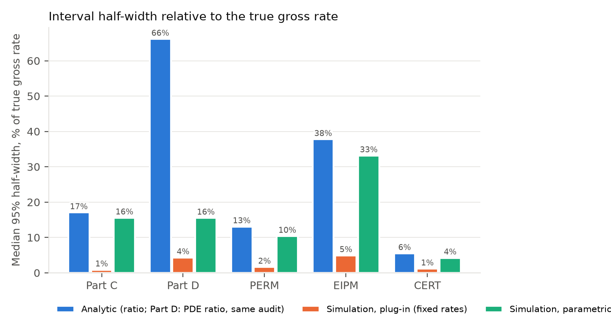

**Affiliation:** [to be completed by the author]. **Corresponding author:** andrewcistola@pm.me

**Running title:** Comparative accuracy of improper payment estimation methods

**Word count:** about 7,400 (main text, excluding tables and references); abstract about 350; 5 tables, 2 figures; Appendices A–D.

## Abstract

**Background.** The Centers for Medicare & Medicaid Services (CMS) estimates improper payments in Medicare Part C, Medicare Part D, Medicaid (PERM), Marketplace advance premium tax credits (EIPM), and Medicare fee-for-service (CERT) from audited samples, each with a 95% confidence interval. The available projection methods are the design-based expansion, ratio, and regression estimators and audit-finding simulation, which assigns audited findings across the population and reruns the payment rules. These methods have not been compared against a known truth.

**Purpose.** The purpose of this study is to compare the point and interval accuracy of available methods for estimating improper payments in federal health programs.

**Methods.** Five synthetic populations with fabricated errors were calibrated to public FY 2025 aggregates, and each program's production-like audit (990 to 37,651 units) was drawn in 25 independent audit years, with 100 for interval calibration. Expansion, ratio, and regression estimators were compared with simulation that held audited error rates fixed (plug-in) or redrew them from their binomial sampling distributions (parametric bootstrap). Each population was then rebuilt with error probability rising, and falling, with payment size within strata.

**Results.** Plug-in intervals were 5–21% as wide as the analytic intervals and covered the true gross rate in 25% of audit years. Parametric-bootstrap intervals covered in 121 of 125 audit years and were 9–23% narrower than the ratio interval in four programs, but were 5–12% narrower than the estimator's own sampling variability in four programs over 100 audit years. When error probability depended on payment size, the simulation's estimate was biased by 2% to 148% and its interval covered in 0 to 24 of 25 audit years; the ratio estimator remained unbiased with coverage of 22 to 25.

**Conclusions.** Plug-in simulation intervals are invalid. The parametric-bootstrap simulation restores coverage and is more precise in Part D, PERM, and CERT, but both rest on error incidence being independent of payment size within strata. This study recommends the design-based ratio interval as the primary PIIA interval, with the parametric-bootstrap simulation alongside it, and a test of the independence assumption on real audit data before the simulation's precision is used to reduce audit sizes.

**Keywords:** improper payments; bootstrap; Monte Carlo simulation; survey sampling; Medicare; Medicaid; payment integrity; confidence intervals

## 1. Introduction

### 1.1 Background

The Payment Integrity Information Act of 2019 (PIIA) requires a statistically valid estimate of improper payments, with a confidence interval, for every federal program at risk of significant improper payments. Appendix C to Office of Management and Budget (OMB) Circular A-123 sets out how agencies produce this estimate and leaves the confidence level to the agency and its statistician (OMB 2021). The Centers for Medicare & Medicaid Services (CMS) runs five such measurements: the Medicare Part C Improper Payment Measure (IPM) for Medicare Advantage risk adjustment, the Medicare Part D IPM for prescription drug events (PDEs), the Payment Error Rate Measurement (PERM) for Medicaid and the Children's Health Insurance Program, the Exchange Improper Payment Measurement (EIPM) for Marketplace advance premium tax credits (APTC), and Comprehensive Error Rate Testing (CERT) for Medicare fee-for-service. Together, these programs reported more than $90 billion in improper payments for fiscal year (FY) 2025 (CMS 2026a). PIIA sets no confidence level; the CMS programs report two-sided 95% intervals.

Each measurement follows the same three steps. A probability sample of payments is drawn (the audit). The payment error of each sampled unit is established through medical or eligibility review. The sampled errors are then projected to the program as a whole and a confidence interval is attached. The interval has practical consequences. Inspectors General review each program's sampling and estimation plan every year, and the accuracy of the interval is an auditable item: the Department of Education Office of Inspector General, for example, has found estimates unreliable because their confidence intervals were inaccurate (ED OIG 2026). In addition, interval width sets the cost of measurement. Medical record review is the dominant cost of every program, and audit sizes are chosen to meet precision targets (for example, a 95% interval of ±3 percentage points for CERT; CMS 2026b).

### 1.2 Prior research

The projection methods in production are design-based estimators with normal-theory intervals (Cochran 1977). The expansion estimator weights each sampled error up to the population. The ratio estimator divides the weighted errors by the weighted payments. The regression estimator fits a model of the error on characteristics known for every unit, predicts the whole population, and adds the weighted sample residuals (Särndal et al. 1992). In Medicare integrity work, a 2011 study by Edwards compared ratio and expansion estimation under stratified designs, and a 2023 study by Edwards, Liu and Delage tested stratified designs on 166 real Medicare samples under an all-or-nothing error model and found that normal-theory bounds fail at high error rates. The intervals of all three estimators rely on a central limit argument that is weakest where improper payment data are found: errors are rare, zero-inflated, right-skewed, and often all-or-nothing (Neter and Loebbecke 1975; Cox and Snell 1979; Kvanli et al. 1998; Edwards et al. 2023). Variance augmentation (Rohrbach 1993) and bootstrap bounds (Howard 1994; Biddle et al. 1990) were proposed in the audit-sampling literature for exactly this problem, and the survey-sampling literature provides resampling methods that respect stratification and finite population corrections (Bickel and Freedman 1984; Rao and Wu 1988; Mashreghi et al. 2016).

A second family of methods simulates (as opposed to projects). The audit findings (which hierarchical condition categories, or HCCs, failed; which drug claims were wrong and by how much; which applications were ineligible) are assigned at random to the unaudited units of the whole population, and the program's payment function is rerun. Repeating this process many times produces a distribution of improper payments. This study calls this approach *audit-finding simulation*. Its attractions are three. The simulation reruns the actual payment rules, so nonlinear effects such as the Part D benefit phases, risk-score hierarchies, and the APTC schedule are handled exactly (as opposed to through a linear approximation). One set of iterations produces over-, under-, gross, and net payments along with any subgroup. In addition, every simulated dollar can be traced to an audited finding. CMS describes the Part D estimate as simulation-based and has changed the number of simulation iterations and the interval method, but the interval algorithm itself is not public (CMS 2023, 2025c).

Audit-finding simulation differs from the survey bootstrap in one important respect: it does not resample the audit. If the error rates estimated from the audit are reused in every iteration, the spread across iterations reflects only which unaudited units happen to receive errors, and the uncertainty in the rates themselves is not represented. This is the uncertainty a confidence interval is meant to express, namely what the audit would have found had a different sample been drawn. The same omission is well known in two neighboring literatures. In the imputation literature, single imputation understates variance because it omits the between-imputation component, and multiple imputation with parameters drawn from their posterior restores it (Rubin 1987). In the prediction approach to finite population inference, the variance of a predicted total for the unsampled units is dominated by the uncertainty in the fitted model parameters, not by the residual scatter of the units (Valliant, Dorfman and Royall 2000). A simulation that redraws the audited rates from their sampling distribution before each iteration is a parametric bootstrap of those rates (Efron and Tibshirani 1993, ch. 6) applied inside the simulation. This study calls the two versions *plug-in audit-finding simulation* (fixed rates) and *parametric-bootstrap audit-finding simulation* (parametric rates).

To the author's knowledge, the comparative accuracy of these methods, and in particular the validity of the simulation intervals, has not been tested against a known truth in the designs CMS uses. A companion narrative review describes the design of each program and the evidence on interval accuracy in detail (Cistola 2026).

### 1.3 Policy context

Three developments raise the stakes of interval accuracy. Beginning with FY 2030, P.L. 119-21 §71106 disallows federal matching funds on Medicaid eligibility improper payments above a 3% rate, so a state PERM eligibility estimate near 3% becomes a financial determination. State-based Exchange measurement begins in 2027 with small state samples (45 CFR 155.1605). In addition, CMS now audits every eligible Medicare Advantage contract for risk adjustment data validation (RADV), where an interval becomes a lower bound for recovery. Any method adopted for the national PIIA rate is likely to be proposed for these uses as well, so its validity should be established first in the setting where the truth can be known.

### 1.4 Study purpose

The purpose of this study is to compare the accuracy of available methods for estimating improper payments in federal health programs. The methods are the three design-based analytic estimators (expansion, ratio, and a model-assisted regression estimator) and audit-finding simulation in its plug-in and parametric-bootstrap versions. In this study, accuracy has two parts. *Point accuracy* is how close the point estimate is to the true improper payment. *Interval accuracy* is whether the 95% interval contains the truth in about 95% of repeated audits (coverage) and, among intervals that do, how narrow the interval is (width). A narrower valid interval is more accurate because the same precision can then be achieved with a smaller and less costly audit.

The specific aims of this study are to (1) measure the point and interval accuracy of each method in five synthetic populations designed after the five CMS measurements; (2) explain any failure of the simulation interval; (3) test the parametric-bootstrap alternative; (4) test whether the results depend on the assumption, built into the synthetic populations, that error probability is independent of payment size within strata; and (5) determine whether the most accurate method could support smaller audits. Recovery uses of extrapolation (contract-level RADV demands and provider overpayment demands) are out of scope.

## 2. Methods

### 2.1 Study design

This study is a Monte Carlo evaluation against a known truth, in the spirit of the design-testing approach of Edwards et al. (2023) and reported following the structure recommended by Morris, White and Crowther (2019). For each program, a synthetic population is built and errors are fabricated on it with stated probabilities, so that the true improper payment is known to the cent. The program's production-like audit design is then applied 25 times, each time drawing an independent sample. Each draw is an *audit year*, and the 25 draws show how each estimator behaves when the audit is repeated. Each audit year has exactly one audit, and every method uses only that audit: the analytic methods estimate their variance from it, and the simulation assigns the audit findings exactly as audited.

All methods are scored on the same 25 audit years. An interval is counted as containing the truth if *lower* ≤ *θ* ≤ *upper*. With 25 audit years, 24 of 25 is the nearest count to the nominal 95% (23.75), and the Monte Carlo standard error of a coverage estimate at the nominal level is 4.4 percentage points, so counts of 23, 24, and 25 cannot be distinguished. Given that limitation, two further checks are reported in Appendix D: the gross rate is re-estimated over 100 audit years on the same populations, and each interval's half-width is compared with the empirical standard deviation of its point estimate across those audit years (the ratio should be close to one for a valid interval); and each population is rebuilt with error probability rising, and then falling, with payment size (Section 2.8).

This study uses no real data. Populations are calibrated only to public aggregate results (Appendix A). Every number in this paper can be regenerated from the public repository (Data and code availability).

### 2.2 Synthetic populations

Table 1 summarizes the five populations, and Appendix B provides every assumption.

**Table 1. Populations, audits and true gross improper payment rates**

| Program | Unit (synthetic count; scale) | Payment function | Errors fabricated | Production-like audit per audit year | True gross rate |
|---|---|---|---|---|---|
| Part C | Enrollee (330,253; ×100) | Risk score × county rate × months, with HCC hierarchies | HCCs deleted or moved down the hierarchy, missing documentation (all HCCs lost), HCCs supported but not coded (underpayments) | 990 enrollees, 330 per risk-score tercile | 6.06% |
| Part D | Beneficiary and PDE (108,000; 4.5M PDEs; ×500) | CY 2025 post-IRA standard benefit: reinsurance and low-income cost sharing | Gross drug cost errors on PDEs: 90% full, 10% partial in either direction; 10% of long-term-care PDEs, 2.5% of others | 5,000 PDEs (3 strata, Neyman); ratio and regression use 990 beneficiaries with every PDE reviewed (about 41,000 PDEs) | 1.38% |
| PERM | Payment (3.09M in 9 states; ×200) | Federal share of FFS claims and capitations | Claims-review errors (all-or-nothing or partial) and beneficiary eligibility errors (true state rates 2–4%) | 520 payments per state, payment type × 5 payment quintiles, Neyman, systematic | 6.09% |
| EIPM | Application (142,152; ×100) | APTC under the enhanced applicable-percentage schedule | Overpayments only: technically improper (whole APTC) and monetary (income understated) | 2,000 applications, 5 APTC quintiles, Neyman | 0.92% |
| CERT | Claim (5.34M; ×200) | Claim payment by claim type | Whole-claim and partial overpayments and coding underpayments, calibrated by claim type | 37,651 claims (FY 2025 count per claim type), 5 payment quintiles per type, Neyman | 6.50% |

Each population is calibrated to its FY 2025 public results where those results exist: Part C to 6.09% with overpayments of $21.43B and underpayments of $2.23B (CMS 2025d); Medicaid to 6.12% (CMS 2026a); EIPM to 0.89%, of which 0.43 points was technically improper (CMS 2026c); and CERT to 6.55% overall with each of the four claim types matched (CMS 2025b). Part D is set below its published 4.00% so that the methods are tested in a lower-error setting. Strata and audit sizes that CMS does not publish are illustrative and labeled as such; these include the EIPM strata, the Part C IPM strata and audit size, the Part D PDE strata and both Part D audit sizes, and the CERT service-level strata.

Within each stratum, every population fabricates errors independently of payment size. This is a modeling choice, not a finding, and it is also the implicit model of the simulation methods (Section 2.5). Section 2.8 describes how this study tests it.

### 2.3 Estimands

For each program, the payment error is first netted within the payment unit (the enrollee, beneficiary, payment, application, or claim). Overpayments are the sum of the positive netted errors, underpayments the sum of the negative ones, gross their sum, and net their difference. Every measure is estimated in dollars with its interval and then divided by the known total payments *X*. The gross rate is the PIIA estimand and the primary outcome. Because PERM and EIPM errors are all overpayments, their components are reported instead of over and under (eligibility and claims for PERM; technically improper and monetary for EIPM). CERT also reports gross by claim type.

### 2.4 Analytic estimators

The three analytic estimators use the program's stratified design. Let *N_h*, *n_h*, and *w_h = N_h/n_h* be the stratum sizes and weights, and let *T̂_y = Σ_h w_h Σ y* and *T̂_x* be the weighted totals. The expansion estimator is *θ̂ = T̂_y / X* and the ratio estimator is *θ̂ = T̂_y / T̂_x*. For the model-assisted regression estimator, within each model stratum *m* the audited *y* is regressed by design-weighted least squares on an intercept and the unit's predictors **z** (basic beneficiary variables plus the amount paid); the fitted models predict every population unit, and the estimate adds the weighted audit residuals, *θ̂ = [Σ_U ŷ + Σ_s w (y − ŷ)] / X*. The predictors are payment, demographic score, months enrolled, and number of HCCs within risk-score terciles (Part C); Medicare payment, gross drug cost, number of PDEs, and reaching the catastrophic phase within post-strata of long-term care, low-income subsidy, and other beneficiaries (Part D); amount paid, month, and the beneficiary's number of payments and total paid (PERM); APTC, age, household size, income, and months (EIPM); and amount paid alone (CERT, whose claims carry no beneficiary variables). The model is fit on the same audit as the ratio estimator (for Part D, the 990-beneficiary audit). A stratum with fewer than 10 audited errors in any measure, or with too few units for the model, uses an intercept-only model, which is equivalent to expansion within that stratum; the same design matrix is used for every measure so that gross equals over plus under exactly. This approach follows model-assisted estimation as used in forest inventory (McConville et al. 2020) and model-based extrapolation of random audits in tax-gap estimation (Johns and Rosenbaum 2024).

Variances use the stratified-SRS formula with a finite population correction applied to *y* (expansion), to the ratio residual *y − θ̂x* (ratio), or to the model residual *y − ŷ* (regression), all from the single audit. Expansion and ratio report *θ̂ ± 1.96·SE*. Regression uses a *t* multiplier with degrees of freedom equal to the audited units less the model terms fitted (one intercept per model stratum plus the slopes). In PERM, the systematic sample drawn after sorting by payment is treated as a stratified simple random sample for variance estimation, which is conservative.

Two program-specific forms apply. Part C expansion works in risk-score units: the mean audited over- and under-risk-score error in each tercile is multiplied by the tercile's size and by the national mean of county rate times months. In Part D, four estimators use the 5,000-PDE audit. The *plug-in expansion* applies each stratum's audited dollar-weighted error rate as a uniform reduction to every PDE in the stratum, reruns the benefit, and uses a delta-method interval obtained by moving each stratum's rate by ±1 SE and rerunning the benefit each way. Because a uniform reduction of every PDE is not the same as the removal of discrete PDEs under a nonlinear benefit, this estimator is biased, and its delta-method interval does not reflect its own sampling variability; it is retained because it is the kind of estimator a program might reach for first. The *PDE expansion* and *PDE ratio* estimators are design-based estimators on the same audit. For each audited PDE, the marginal Medicare-payment effect of correcting that PDE alone is computed by rerunning the beneficiary's benefit, and the stratified expansion and ratio estimators, with the same variance formulas as the other programs, are applied to these PDE-level values. For these two estimators the measures are defined at the PDE level (over is the sum of positive marginal effects, and so on), since netting within beneficiaries is not available to a PDE-level audit.

### 2.5 Plug-in audit-finding simulation (fixed rates)

Within each donor kind *k*, take the *n_k* audited units from the audit, of which *f_k* are in error and *g_k* of those errors are partial, with audited partial sizes *s_1, …, s_{g_k}*. The donor kind is the sampling stratum; in Part C, the donor kind is the HCC (20 HCC failure rates and 10 family addition rates).

In each of 1,000 iterations, every non-audited unit of kind *k* is in error with probability *p_k = f_k/n_k*. Given an error, the unit's error is partial with probability *q_k = g_k/f_k*, with its size drawn uniformly from the audited partial sizes; otherwise the error is whole (the full payment, or in EIPM the whole APTC). In Part C, a failed HCC instance loses the HCC's mean audited loss (the coefficient of a deleted HCC, or the difference between severity levels of a moved one), and an enrollee receives an additional HCC only if it received no failure in that iteration, which is the rule under which the population was built. Audited units keep their own findings. The payment function is then rerun for every unit and the measures are summed. These steps touch only units that receive an error, so a 5-million-claim iteration takes milliseconds. The estimate is the mean of the iteration rates, and the interval is their 2.5th and 97.5th percentiles. When every unit is audited, every iteration returns the exact true rate (this property is tested). In Part D, all PDEs of the full population are simulated and the benefit is rerun for every beneficiary.

The simulation uses more than the audit. It assigns audited findings to units whose payments, HCCs, benefit positions, or APTC inputs are read from the population, so its error sizes are those of the receiving units, not of the audited ones. It is in this sense a model-based estimator: it is unbiased when error probability within a donor kind is independent of those unit characteristics, which is true in the synthetic populations by construction.

### 2.6 Parametric-bootstrap audit-finding simulation (parametric rates)

The parametric version changes one thing. Before each iteration, the error count and the partial count are redrawn from their sampling distributions given the audit, *f̃_k ~ Binomial(n_k, p_k)* and *g̃_k ~ Binomial(f̃_k, q_k)*, and the iteration uses *p̃_k = f̃_k/n_k* and *q̃_k = g̃_k/f̃_k*. Each iteration therefore represents a different plausible audit outcome in addition to a different assignment. Rates with no audited failures stay at zero, so no failures are extrapolated to HCCs or strata the audit never observed. Partial sizes and the Part C mean losses are still taken from the audited list, and the rates of different donor kinds are redrawn independently. This version is a parametric bootstrap of the rate parameters (Efron and Tibshirani 1993, ch. 6) and is the analogue of proper multiple imputation (Rubin 1987); it is not a Bayesian bootstrap (Rubin 1981) and requires no prior.

### 2.7 Outcomes

For each program, measure, and method, the following outcomes are calculated over the 25 audit years: coverage, as the number of intervals containing the truth and how many lie entirely above or entirely below it; width, as the median 95% half-width in percentage points of payments and in national dollars; and point accuracy, as the median point estimate and the mean absolute and mean signed error relative to the true rate. To address the audit-size question, this study compares the parametric interval with the analytic interval from the same audit: the ratio estimator for Part C, PERM, EIPM, and CERT, and the PDE ratio estimator for Part D. If interval width scales with 1/√*n*, the audit size at which the parametric method would match the analytic width is (*w_parametric / w_analytic*)² of the current audit.

### 2.8 Calibration and robustness checks

Two checks address the limits of 25 audit years and of the independence assumption. First, the gross rate is re-estimated over 100 independent audit years on each base population with every method (the simulation at 500 iterations per audit year), and for each method the mean half-width is divided by 1.96 times the empirical standard deviation of its point estimates. A ratio near one means the interval is as wide as the estimator's own sampling variability; a ratio below one means the interval is too narrow, whatever its coverage count in 25 audit years happened to be. Second, each population is rebuilt with a single additional parameter, *size_beta*, so that a unit's error probability is multiplied by (payment / stratum mean payment)^*size_beta*, capped at 0.95, before calibration to the same public targets. Values of +0.5 (errors more likely on large payments) and −0.5 (more likely on small payments) are run, and every design and method is re-estimated over 25 audit years. Part D, whose error rates are stated count rates with no dollar target, uses ±0.25 with the count rates rescaled so that its true gross rate stays at 1.38% (at ±0.5 its heavy-tailed drug costs would move the gross rate to 6.8% and 0.6%). The simulation's implicit model is wrong in both, and the analytic estimators' is not. The results are in Appendix D.

## 3. Results

Table 2 provides, for each program, the median point estimate, median interval half-width, and coverage of the gross rate under every method over 25 audit years. Figures 1 and 2 summarize width and coverage. National-dollar equivalents are in Appendix Table C1, and the 100-audit-year calibration and the size-dependent error scenarios are in Appendix D.

**Table 2. Gross improper payment rate: median estimate, median 95% interval half-width and coverage over 25 audit years**

| Program (audit) | True rate | Method | Median estimate | Median half-width (points) | Truth inside (above / below) |
|---|---|---|---|---|---|
| Part C (990 enrollees, 330 per risk-score tercile) | 6.06% | Expansion | 6.15% | ±1.05 | 25/25 (0/0) |
|  |  | Ratio | 6.13% | ±1.03 | 24/25 (1/0) |
|  |  | Regression | 6.10% | ±1.02 | 23/25 (1/1) |
|  |  | Simulation (plug-in, fixed rates) | 6.14% | ±0.05 | 3/25 (14/8) |
|  |  | Simulation (parametric rates) | 6.18% | ±0.94 | 25/25 (0/0) |
| Part D (5,000 PDEs (Neyman, 3 strata); ratio and regression: 990 beneficiaries, every PDE reviewed) | 1.38% | Expansion | 1.22% | ±0.60 | 18/25 (0/7) |
|  |  | Ratio | 1.41% | ±0.67 | 18/25 (1/6) |
|  |  | Regression | 1.44% | ±0.58 | 15/25 (4/6) |
|  |  | PDE expansion (same audit) | 1.33% | ±0.91 | 16/25 (0/9) |
|  |  | PDE ratio (same audit) | 1.34% | ±0.91 | 17/25 (0/8) |
|  |  | Simulation (plug-in, fixed rates) | 1.38% | ±0.06 | 10/25 (8/7) |
|  |  | Simulation (parametric rates) | 1.38% | ±0.21 | 25/25 (0/0) |
| PERM (9 states x 520 payments (Neyman, 10 strata per state)) | 6.09% | Expansion | 6.04% | ±0.80 | 23/25 (0/2) |
|  |  | Ratio | 6.00% | ±0.80 | 23/25 (0/2) |
|  |  | Regression | 6.03% | ±0.79 | 23/25 (0/2) |
|  |  | Simulation (plug-in, fixed rates) | 5.97% | ±0.10 | 3/25 (9/13) |
|  |  | Simulation (parametric rates) | 5.98% | ±0.63 | 24/25 (0/1) |
| EIPM (2,000 applications (Neyman, 5 APTC quintiles)) | 0.92% | Expansion | 0.83% | ±0.35 | 22/25 (0/3) |
|  |  | Ratio | 0.83% | ±0.35 | 22/25 (0/3) |
|  |  | Regression | 0.84% | ±0.34 | 23/25 (0/2) |
|  |  | Simulation (plug-in, fixed rates) | 0.82% | ±0.04 | 7/25 (5/13) |
|  |  | Simulation (parametric rates) | 0.83% | ±0.30 | 22/25 (0/3) |
| CERT (37,651 claims (4 claim types x 5 quintiles, Neyman within type)) | 6.50% | Expansion | 6.56% | ±0.36 | 25/25 (0/0) |
|  |  | Ratio | 6.58% | ±0.36 | 24/25 (1/0) |
|  |  | Regression | 6.58% | ±0.36 | 24/25 (1/0) |
|  |  | Simulation (plug-in, fixed rates) | 6.55% | ±0.07 | 8/25 (11/6) |
|  |  | Simulation (parametric rates) | 6.55% | ±0.28 | 25/25 (0/0) |

### 3.1 Point accuracy

Every method estimated the gross rate closely in Part C, PERM, and CERT, with mean absolute errors of 1.5% to 6.3% of the true rate (Table 3). The simulation's point estimate was as accurate as the best analytic estimator in Part C (6.1% against 5.7%) and more accurate in PERM (4.4% against 5.3%) and CERT (1.5% against 2.2%). The plug-in and parametric versions produce the same point estimate to within 0.2 percentage points of relative error, because the binomial redraw is centered on the audited counts.

**Table 3. Accuracy of the gross point estimate: average absolute error, as % of the true rate (average signed error)**

| Program | Expansion | Ratio | Regression | PDE expansion (same audit) | PDE ratio (same audit) | Simulation (plug-in, fixed rates) | Simulation (parametric rates) |
|---|---|---|---|---|---|---|---|
| Part C | 5.7% (+1.1%) | 6.0% (+0.9%) | 6.3% (+1.2%) | — | — | 6.0% (+1.4%) | 6.1% (+1.5%) |
| Part D | 30.5% (-5.7%) | 23.4% (+0.1%) | 27.9% (+7.8%) | 42.0% (-4.2%) | 41.9% (-3.1%) | 6.6% (-0.4%) | 6.7% (-0.4%) |
| PERM | 5.5% (-1.4%) | 5.6% (-1.4%) | 5.3% (-1.5%) | — | — | 4.4% (-0.6%) | 4.4% (-0.6%) |
| EIPM | 17.7% (-5.5%) | 17.6% (-5.6%) | 18.1% (-5.4%) | — | — | 16.2% (-6.8%) | 16.1% (-7.0%) |
| CERT | 2.2% (+0.6%) | 2.3% (+0.7%) | 2.3% (+0.7%) | — | — | 1.5% (+0.3%) | 1.5% (+0.3%) |

The Part D results show that the comparison is not only between estimators but between what each estimator borrows from the audit. On the 5,000-PDE audit, the plug-in expansion, which applies a uniform dollar-weighted reduction to every PDE and reruns the benefit, ran 5.7% low with a mean absolute error of 30.5%; the design-based PDE expansion and PDE ratio estimators on the same audit were unbiased to within 3–4% but had mean absolute errors of 42%; and the simulation, which borrows only the audited error and partial counts and takes every PDE's size from the population, had a mean absolute error of 6.7%. The difference is in the error dollars. Specialty PDEs are fewer than 1% of PDEs but carry about a third of the error dollars, so any estimator weighted by audited dollars is at the mercy of how many such PDEs the audit happens to contain, while a count-based rate is not. The ratio and regression estimators on the 990-beneficiary audit, which reviews about 41,000 PDEs, had mean absolute errors of 23% and 28%.

In EIPM every method ran 5% to 7% low. Technically improper errors are rare (about 9 per audit) and large (the whole APTC), so in most audit years the sample contains fewer than the expected number and the median estimate falls below the mean. This is a property of the data (as opposed to of any one method). The simulation's further 1–2% shortfall comes from assigning a monetary donor's income ratio to a recipient at a different point of the APTC schedule (Appendix B.4).

### 3.2 The plug-in simulation interval

The plug-in interval was far narrower than its own sampling variability in every program. Its median half-width was 5% to 21% of the half-width of the analytic interval from the same audit (Table 4), and it contained the true gross rate in 3 to 10 of 25 audit years (Figure 2). The misses fell on both sides in roughly equal numbers (in Part C, 14 intervals lay entirely above the truth and 8 entirely below), so the problem is not bias; the interval is centered correctly and is too short.

**Table 4. The fixed-rate interval problem and the parametric alternative (gross rate)**

| Program | Analytic comparator | Analytic half-width | Fixed-rate half-width (share of analytic) | Fixed-rate coverage | Parametric half-width (share of analytic) | Parametric coverage | Audit size giving the analytic width, if width ∝ 1/√n |
|---|---|---|---|---|---|---|---|
| Part C | Ratio | ±1.03 | ±0.05 (5%) | 3/25 | ±0.94 (91%) | 25/25 | 83% of the audit |
| Part D | PDE ratio (same audit) | ±0.91 | ±0.06 (7%) | 10/25 | ±0.21 (23%) | 25/25 | 6% of the audit |
| PERM | Ratio | ±0.80 | ±0.10 (13%) | 3/25 | ±0.63 (79%) | 24/25 | 63% of the audit |
| EIPM | Ratio | ±0.35 | ±0.04 (13%) | 7/25 | ±0.30 (88%) | 22/25 | 77% of the audit |
| CERT | Ratio | ±0.36 | ±0.07 (21%) | 8/25 | ±0.28 (77%) | 25/25 | 59% of the audit |

The cause is structural. The sampling variance of an estimated improper total *T̂* can be written by the law of total variance, conditioning on the audit *A*, as Var(*T̂*) = E[Var(*T̂* | *A*)] + Var(E[*T̂* | *A*]). The plug-in simulation holds the audit, and with it the rates *p_k* and *q_k*, fixed, so its iterations vary only in which unaudited units receive errors and its spread estimates only the first term, the *reassignment* variance. This term grows with the population size *N*, roughly as *N p*(1 − *p*) times the mean squared error size. The second term, the variance of the rates across possible audits, grows with *N*²/*n*; it is the term a confidence interval exists to express, and it is the between-imputation component that single imputation omits (Rubin 1987). The ratio of the two standard deviations is therefore roughly √(*n*/*N*): 5.5% in Part C (990 of 330,253 enrollees), 11.9% in EIPM (2,000 of 142,152), 8.4% in CERT (37,651 of 5.34 million), 3.9% in PERM (520 of about 343,000 per state), and 3.3% in Part D (5,000 of 4.5 million PDEs), against observed shares of 5%, 13%, 21%, 13%, and 7%. The share exceeds √(*n*/*N*) where error sizes vary most (CERT samples inpatient claims at 22%; PERM and Part D errors are whole payments of very different amounts under nonlinear rules). More iterations do not help: they estimate the reassignment spread more precisely but add nothing of the missing term. In addition, the plug-in interval becomes narrower as the population grows relative to the audit, which is the opposite of what a sampling interval should do.

### 3.3 The parametric-bootstrap simulation

Redrawing the audited counts from their binomial distributions before each iteration restores coverage of the gross rate in every program: 25, 25, 24, 22, and 25 of 25 audit years for Part C, Part D, PERM, EIPM, and CERT, 121 of 125 in all (96.8%), as opposed to 31 of 125 (25%) for the plug-in version and 111 of 125 for the ratio estimator. All four parametric misses lay below the truth.

The parametric intervals were narrower than the analytic intervals from the same audit (Table 4): 91% of the ratio half-width in Part C, 79% in PERM, 88% in EIPM, 77% in CERT, and 23% of the PDE ratio half-width in Part D. In dollars (Appendix Table C1), the parametric interval was ±$0.90B around a median of $8.49B in PERM against ±$1.13B for the ratio estimator, ±$1.21B around $28.83B in CERT against ±$1.57B, and ±$3.67B around $24.01B in Part C against ±$4.02B. With 25 audit years, however, the coverage counts of 22 to 25 are indistinguishable from one another and from 95% (Monte Carlo standard error 4.4 points), so whether these narrower intervals are narrower because the estimator is more efficient or because the interval understates its variability cannot be read from Table 2. Section 3.6 addresses this directly.

### 3.4 Components and sparse measures

Table 5 provides the coverage of every reported measure. For the large components the parametric interval matched or exceeded the analytic methods: Part C overpayments 24 and net 24 of 25; Part D overpayments 24 and net 23; PERM eligibility 24 (analytic 21) and claims 23; EIPM monetary 22; and CERT overpayments, net, and every claim type 23 to 25.

**Table 5. Coverage of every measure (truth inside the 95% interval, out of 25 audit years; above / below)**

| Program | Measure | True rate | Expansion | Ratio | Regression | PDE expansion (same audit) | PDE ratio (same audit) | Simulation (plug-in, fixed rates) | Simulation (parametric rates) |
|---|---|---|---|---|---|---|---|---|---|
| Part C | Overpayments | 5.49% | 25/25 (0/0) | 25/25 (0/0) | 24/25 (1/0) | — | — | 3/25 (15/7) | 24/25 (1/0) |
| Part C | Underpayments | 0.57% | 21/25 (0/4) | 21/25 (0/4) | 21/25 (0/4) | — | — | 3/25 (9/13) | 25/25 (0/0) |
| Part C | Gross | 6.06% | 25/25 (0/0) | 24/25 (1/0) | 23/25 (1/1) | — | — | 3/25 (14/8) | 25/25 (0/0) |
| Part C | Net | 4.91% | 25/25 (0/0) | 25/25 (0/0) | 25/25 (0/0) | — | — | 2/25 (15/8) | 24/25 (1/0) |
| Part D | Overpayments | 1.36% | 18/25 (0/7) | 18/25 (1/6) | 16/25 (4/5) | 16/25 (0/9) | 17/25 (0/8) | 9/25 (9/7) | 24/25 (0/1) |
| Part D | Underpayments | 0.02% | 0/25 (0/25) | 15/25 (0/10) | 13/25 (2/10) | 15/25 (0/10) | 15/25 (0/10) | 10/25 (12/3) | 20/25 (4/1) |
| Part D | Gross | 1.38% | 18/25 (0/7) | 18/25 (1/6) | 15/25 (4/6) | 16/25 (0/9) | 17/25 (0/8) | 10/25 (8/7) | 25/25 (0/0) |
| Part D | Net | 1.34% | 19/25 (0/6) | 19/25 (1/5) | 16/25 (4/5) | 16/25 (0/9) | 17/25 (0/8) | 11/25 (7/7) | 23/25 (0/2) |
| PERM | Gross | 6.09% | 23/25 (0/2) | 23/25 (0/2) | 23/25 (0/2) | — | — | 3/25 (9/13) | 24/25 (0/1) |
| PERM | Eligibility | 3.06% | 21/25 (0/4) | 21/25 (0/4) | 21/25 (0/4) | — | — | 8/25 (7/10) | 24/25 (0/1) |
| PERM | Claims | 3.13% | 23/25 (0/2) | 23/25 (0/2) | 23/25 (0/2) | — | — | 2/25 (11/12) | 23/25 (1/1) |
| EIPM | Gross | 0.92% | 22/25 (0/3) | 22/25 (0/3) | 23/25 (0/2) | — | — | 7/25 (5/13) | 22/25 (0/3) |
| EIPM | Technically improper | 0.43% | 19/25 (1/5) | 19/25 (1/5) | 19/25 (1/5) | — | — | 6/25 (5/14) | 19/25 (1/5) |
| EIPM | Monetary | 0.48% | 22/25 (0/3) | 22/25 (0/3) | 22/25 (0/3) | — | — | 8/25 (6/11) | 22/25 (1/2) |
| CERT | Overpayments | 6.30% | 24/25 (1/0) | 24/25 (1/0) | 24/25 (1/0) | — | — | 9/25 (10/6) | 25/25 (0/0) |
| CERT | Underpayments | 0.21% | 23/25 (0/2) | 23/25 (0/2) | 23/25 (0/2) | — | — | 13/25 (2/10) | 21/25 (0/4) |
| CERT | Gross | 6.50% | 25/25 (0/0) | 24/25 (1/0) | 24/25 (1/0) | — | — | 8/25 (11/6) | 25/25 (0/0) |
| CERT | Net | 6.09% | 24/25 (1/0) | 24/25 (1/0) | 24/25 (1/0) | — | — | 8/25 (10/7) | 25/25 (0/0) |
| CERT | Gross: DMEPOS | 24.44% | 24/25 (0/1) | 24/25 (0/1) | 24/25 (0/1) | — | — | 14/25 (2/9) | 25/25 (0/0) |
| CERT | Gross: Part A IPPS | 3.02% | 24/25 (1/0) | 24/25 (1/0) | 24/25 (1/0) | — | — | 18/25 (6/1) | 23/25 (2/0) |
| CERT | Gross: Part A excl. IPPS | 6.62% | 24/25 (1/0) | 23/25 (2/0) | 24/25 (1/0) | — | — | 9/25 (11/5) | 25/25 (0/0) |
| CERT | Gross: Part B | 8.45% | 25/25 (0/0) | 23/25 (0/2) | 23/25 (0/2) | — | — | 5/25 (6/14) | 25/25 (0/0) |

The sparse measures, those built from a handful of audited errors, were undercovered by most methods, with the misses mainly below the truth: Part D underpayments (0.02% of payments; parametric 20 of 25, ratio 15, plug-in expansion 0), EIPM technically improper payments (0.43%; 19 of 25 under the analytic methods and the parametric simulation alike), and CERT underpayments (0.21%; parametric 21, ratio 23). The interval lies under the truth in audit years whose sample happened to contain few of the rare errors. This is the zero-inflated, right-skewed setting in which normal-theory intervals are known to fail (Cox and Snell 1979; Kvanli et al. 1998; Hesterberg 2015), and the parametric bootstrap does not avoid it because a binomial redraw centered on a low audited count stays low. Part C underpayments (0.57%) are the exception: the parametric interval covered in 25 of 25 audit years against 21 for the analytic methods, because the simulation's addition rates are estimated for each HCC family from the full audit rather than from the few enrollees whose netted error is negative. The gross rate is protected because the sparse component is a small share of it.

### 3.5 Regression with beneficiary variables

Fitting models within strata on basic beneficiary variables plus the amount paid changed little in Part C, PERM, EIPM, and CERT: coverage of the gross rate was 23, 23, 23, and 24 of 25, and width and point accuracy were within a few percent of the ratio estimator's. In Part D, drug cost and reaching the catastrophic phase explain part of the beneficiary payment error, and the interval narrowed from ±0.67 (ratio) to ±0.58 points; however, coverage fell to 15 of 25 and the point estimate ran 7.8% high on average. With few large errors in a 990-beneficiary audit, a better-fitting model leaves residuals that understate the true sampling variance, the overfitting risk of model-assisted estimation with small samples (McConville et al. 2020). In PERM, all but the largest-payment fee-for-service stratum had too few audited errors for a model and used the intercept-only fallback. Across the five programs, regression covered the true gross rate in 108 of 125 audit years.

### 3.6 Interval calibration over 100 audit years

Appendix Table D1 compares each interval's mean half-width with the empirical standard deviation of its point estimate over 100 independent audit years on the base populations. These results show that the parametric interval is somewhat too narrow for its own estimator in four programs and too wide in one: the half-width was 0.94, 0.95, 0.93, 0.88, and 1.13 times 1.96 standard deviations in Part C, Part D, PERM, EIPM, and CERT, and coverage over the 100 audit years was 95, 95, 92, 90, and 99 (Monte Carlo standard error 2.2 points). The ratio estimator's interval was calibrated at 1.05, 0.94, 0.97, and 0.98 in Part C, PERM, EIPM, and CERT, with coverage of 97, 91, 92, and 95; in Part D all analytic intervals undercovered (ratio 0.83 and 82 of 100; PDE ratio 0.70 and 68 of 100), because the audited error dollars are heavy-tailed and the normal interval does not reflect it.

The same table separates efficiency from calibration. The standard deviation of the simulation's point estimate was 3% below the ratio estimator's in Part C (0.500 against 0.518 points), 4% below in EIPM (0.184 against 0.191), 23% below in PERM (0.345 against 0.446), 72% below in Part D (0.114 against 0.410 for the ratio estimator on the beneficiary audit, and 0.93 for the PDE ratio on the same audit), and 35% below in CERT (0.125 against 0.192). In Part C and EIPM, therefore, most of the narrower interval in Table 4 reflects an interval that is too short rather than an estimator that is more precise; in PERM, Part D, and CERT the efficiency gain is real, and in CERT the parametric interval is in fact conservative.

### 3.7 Robustness to size-dependent errors

Appendix Tables D2 and D3 rebuild each population so that a unit's error probability rises (D2, *size_beta* = +0.5) or falls (D3, −0.5) with its payment relative to the stratum mean, calibrated to the same public targets, and re-estimate every method over 25 audit years. The design-based estimators were unaffected: the ratio estimator's mean estimate stayed within 2% of the truth in Part C, PERM, and CERT in both scenarios, ran 5–6% low in EIPM as it does in the base population, and was within 5% and 8% in Part D, and it covered the truth in 23 to 25 of 25 audit years in every program except Part D (22 of 25), where the beneficiary-level ratio covered as well as it had in the base population.

The simulation was not. With errors concentrated on large payments its point estimate ran low by 3% in Part C, 8% in EIPM, 14% in PERM, 22% in CERT, and 65% in Part D, and its interval covered the truth in 24, 21, 6, 0, and 0 of 25 audit years. With errors concentrated on small payments it ran high by 9% in Part C, 7% in PERM, 12% in CERT, and 148% in Part D (EIPM was within 2%), with coverage of 18, 24, 18, 0, and 0. The direction follows from what the simulation borrows: it takes the audited *count* of errors in a stratum and assigns it to unaudited units whose sizes are typical of the stratum, so if the audited errors sat on larger (smaller) units than average, the simulated error dollars are too small (too large). The width-to-standard-deviation ratio of the simulation's interval stayed near one in these scenarios (0.87 to 1.52), so its failure is one of bias, not of width, and a narrow interval around a biased estimate is the least desirable outcome of the four. The effect is smallest where payments vary least within a donor kind (EIPM's APTC quintiles; Part C's HCC coefficients, which do not depend on the enrollee's payment) and largest where a stratum spans a heavy-tailed payment distribution (Part D's "other non-LTC" stratum holds 90% of PDEs and all of the specialty drugs).

These results show that the simulation's point accuracy and its narrower interval in Sections 3.1 and 3.3 are consequences of the independence assumption built into the base populations, not properties of the method as such, and that the design-based ratio estimator does not share this exposure.

## 4. Discussion

### 4.1 Principal findings

In five synthetic populations designed after the five CMS improper payment measurements, this study compared the expansion, ratio, and model-assisted regression estimators with audit-finding simulation in its plug-in and parametric-bootstrap versions. Four findings stand out.

First, the plug-in simulation interval is invalid in every program. Because the audit is never resampled, the interval measures only how the audited rates scatter across the population, as opposed to how much those rates would change with a different audit; it covered the true gross rate in 25% of audit years when 95% was intended, and its width shrinks toward zero as the population grows relative to the audit. This is the single-imputation problem of Rubin (1987) in a new setting, and it is not a tuning problem that more iterations can fix.

Second, redrawing the audited error and partial counts from their binomial sampling distributions before each iteration restores coverage of the gross rate: 121 of 125 audit years over the five programs, and 90 to 99 of 100 in the longer calibration run. The correction is a few lines of code and requires no additional record review. In Part C, Part D, PERM, and EIPM the resulting interval is still 5–12% narrower than the simulation estimator's own sampling variability, because the error sizes are held fixed and the rates of different donor kinds are redrawn independently; in CERT it is 13% wider.

Third, the simulation's narrower interval is partly efficiency and partly under-coverage, and the balance differs by program. Over 100 audit years, the standard deviation of the simulation's point estimate was 3% below the ratio estimator's in Part C and 4% below in EIPM, so in those programs most of the narrower interval in Table 4 is an interval that is too short. In PERM (23%), CERT (35%), and Part D (72%) the efficiency gain is real. It comes from the simulation using the payments, HCCs, benefit positions, and APTC inputs of every population unit, which makes it a model-based estimator in the sense of Valliant, Dorfman and Royall (2000): it borrows only the audited error counts and takes every unit's error size from the population.

Fourth, and most important for policy, that model is a condition, not a convenience. When the populations were rebuilt so that error probability rises with payment size within strata, the simulation's point estimate ran low by 3% in Part C, 8% in EIPM, 14% in PERM, 22% in CERT, and 65% in Part D, and its interval covered the truth in 24, 21, 6, 0, and 0 of 25 audit years. When error probability falls with payment size, the estimate ran high by 9% in Part C, 7% in PERM, and 148% in Part D, with coverage of 18, 18, and 0. The design-based estimators were unaffected: the ratio estimator covered in 22 to 25 of 25 audit years in every scenario, and its bias stayed within 2% except in EIPM (where every method runs 5–6% low in every scenario) and Part D (5–8%). The simulation's advantage therefore depends on an assumption the analytic estimators do not need, and in the programs where the advantage is largest (Part D, CERT, PERM) the penalty for the assumption failing is also largest. Whether real audit findings satisfy the assumption is an empirical question that the public record does not answer. Pricing discrepancies on specialty drugs, documentation failures on high-cost inpatient stays, and eligibility errors on high-utilization beneficiaries are all plausible mechanisms by which they would not.

### 4.2 Policy implications

**Recommendation 1 – Discontinue plug-in simulation intervals.** Any CMS measurement whose interval comes from a simulation that reuses the audited error rates in every iteration should replace it. The Part D interval algorithm is not public; its Sampling and Estimation Methodology Plan should be checked for this feature, and if present the interval should be recomputed with parametric rates for the current cycle. This change costs nothing in record review and can be verified by the census check used here (auditing every unit must return the true rate exactly).

**Recommendation 2 – Report the design-based ratio interval as the primary PIIA interval, with the parametric-bootstrap simulation alongside it.** The ratio estimator was within 2% of the truth and held close to nominal coverage in every population and every robustness scenario, because its validity rests on the sampling design alone. The parametric-bootstrap simulation should be reported with it where a program already simulates, so that the two can be compared: a simulation estimate that drifts from the ratio estimate is itself evidence that error incidence depends on unit characteristics within strata. A program that reports the simulation as its only estimate has no such check.

**Recommendation 3 – Treat the simulation's precision gain as conditional, and test the condition before relying on it.** The gain is real in PERM, CERT, and Part D under the stated model. Before it is used to justify a smaller audit, three things should be done: (a) compare audited error rates across payment quantiles within each stratum, which the audit data already permit; (b) stratify or post-stratify the simulation's donor kinds finely enough on payment that the within-stratum dependence is small; and (c) confirm coverage directly at the reduced audit size with a Monte Carlo study on a population built to match the observed dependence. If interval width scales with 1/√*n*, the parametric interval would match the current ratio interval at about 83% of the Part C audit, 63% of PERM, 77% of EIPM, and 59% of CERT (Table 4); from the calibrated standard deviations these shares are about 93%, 60%, 93%, and 42%. These figures are projections (as opposed to demonstrated results), apply only to the gross rate, and hold only where the independence assumption does.

**Recommendation 4 – Protect sparse components.** Components that CMS reports separately and that rest on few audited errors (underpayments, technically improper payments) were undercovered by every method, with the misses below the truth. They need their own precision check under any method, and a reduction in audit size for the gross rate should not be taken to extend to them.

### 4.3 Future research

Future research should first identify the audit size at which each program's interval still covers the truth at the nominal rate, by rerunning each design at reduced sizes (for example 50%, 65%, and 80% of current) with at least 200 audit years, for the gross rate and for the components CMS reports. Allocation should be reconsidered at the same time: Neyman allocation minimizes the variance of the analytic estimator (as opposed to the simulation), and the cost of review differs by stratum, so cost-weighted allocation (*n_h* ∝ *N_h S_h* / √*c_h*) belongs in the same study.

Second, future research should replace the simulation's independence assumption with a model. A unit-level error model (logistic or zero-inflated regression of error probability and size on payment, provider type, drug class, or HCC count), fit on the audit and used to assign findings in the simulation, would retain the simulation's use of population structure while removing the assumption that Appendix D shows to be decisive; its coverage should be tested on populations built with size-dependent errors. Hierarchical models that pool rates across strata, HCCs, or states would give zero-failure strata a plausible nonzero rate, and resampling the partial-size list within each iteration, together with a joint rather than independent redraw of correlated rates, would address the 5–12% under-coverage found in the calibration run. BCa or double-bootstrap calibration (Efron 1987; Hall 1988) could be applied to the iteration distribution for sparse components.

Third, the same design should be extended to the settings where interval accuracy carries dollar consequences: state-level PERM eligibility rates, which carry federal match consequences beginning in FY 2030 (P.L. 119-21); State-based Exchange measurement beginning in 2027; and contract-level RADV, where the interval becomes a one-sided lower bound for recovery. Finally, under an appropriate data use agreement, the two assumptions this study had to make, the share of partial errors and the independence of error probability from payment size within strata, should be checked against held-out real audit samples.

### 4.4 Limitations

The major limitation of this study is that its populations are synthetic. They are calibrated only to public aggregates, and the error mechanisms, partial-error shares, and, in the main results, the independence of errors from payment size within strata are assumptions. Appendix D shows that the last assumption decides the comparison, and the real degree of dependence is unknown. Strata and audit sizes that the agencies do not publish (EIPM, Part C IPM, both Part D audits, and CERT's service-level and jurisdiction strata) are illustrative; MAC jurisdictions, denied claims, and the CERT Part A-to-B rebilling adjustment are not modeled; PERM is one cycle of nine states rather than a three-year rotation of seventeen; Part D's underpayments are structurally sparser than in production.

Second, the main results rest on 25 audit years per program, for which the Monte Carlo standard error of a coverage estimate is 4.4 points, so coverage counts of 22 to 25 cannot be distinguished. The 100-audit-year calibration run (standard error 2.2 points) and the width-to-standard-deviation ratio are the stronger evidence, and they show the parametric interval to be 5–12% too narrow in four programs.

Third, review is assumed to be error-free and final, with no appeals, and every method is given the same perfect findings.

Fourth, the Part D comparison mixes designs and estimators. The ratio and regression comparators use a different audit that reviews about 41,000 PDEs, the plug-in expansion is biased by construction, and the design-based PDE estimators on the same audit, while unbiased, inherit heavy-tailed audited error dollars that make their normal intervals undercover. No analytic method on the 5,000-PDE audit is a clean benchmark, and the Part D width figures should be read with that in mind.

Fifth, the parametric version redraws the rates of different donor kinds independently and holds the audited error sizes fixed, which is why its interval is somewhat too narrow; it is also only one of several ways the audit's uncertainty could be propagated.

Sixth, this study addresses two-sided PIIA rate intervals. Recovery uses rely on one-sided lower bounds, which were not tested, and no CMS program is shown here to use a plug-in simulation; the policy case for Recommendation 1 is conditional on that being so.

### 4.5 Conclusion

On the question of comparative accuracy, the answer has two parts. Audit-finding simulation with fixed rates produces point estimates as accurate as the analytic estimators but intervals far too narrow to be valid, because the audit is never resampled and the sampling error of the rates is omitted; redrawing the rates from their binomial sampling distribution restores nominal coverage for the gross rate. However, the simulation's accuracy and its narrower interval rest on error incidence being independent of payment size within strata, an assumption the populations satisfied by construction and the design-based estimators do not need; when it fails, the simulation is biased and its interval misses, while the ratio estimator does not. This study therefore recommends that CMS programs discontinue any plug-in simulation interval, report the design-based ratio interval as the primary PIIA interval with the parametric-bootstrap simulation alongside it, and treat the simulation's precision gain, which is real in Part D, PERM, and CERT under the stated model, as a reason to test the independence assumption on real audit data and to develop unit-level error models, rather than as a basis for smaller audits today.

## Data and code availability

All code, configuration, synthetic populations (or their SHA-256 manifests where a population is too large to commit), results, the robustness and calibration runs, and the scripts that build every table and figure in this paper are available in the public repository [andrewcistola/improper-payment-estimation-accuracy](https://github.com/andrewcistola/improper-payment-estimation-accuracy). The repository contains no protected health information, no unit-level data from any source, and no non-public CMS material. An independent re-run and review of the study, with the issues it raised and the changes made in response, is in the repository's `qa/` folder.

## Funding, conflicts of interest and disclaimer

[To be completed by the author before submission: funding source, employer and contract relationships, and a statement that the views are the author's own and do not represent CMS or any other organization.]

## References

- Biddle GC, Bruton CM, Siegel AF (1990). Computer-intensive methods in auditing: bootstrap difference and ratio estimation. *Auditing: A Journal of Practice & Theory* 9(3):92–114.
- Bickel PJ, Freedman DA (1984). Asymptotic normality and the bootstrap in stratified sampling. *Annals of Statistics* 12(2):470–482.
- CMS (2023). FY 2023 Medicare Part D Error Rate Findings and Results. Centers for Medicare & Medicaid Services.
- CMS (2025b). 2025 Medicare Fee-for-Service Supplemental Improper Payment Data. Centers for Medicare & Medicaid Services.
- CMS (2025c). FY 2025 Medicare Part D Error Rate Findings and Results. Centers for Medicare & Medicaid Services.
- CMS (2025d). FY 2025 Medicare Part C Error Rate Findings and Results. Centers for Medicare & Medicaid Services.
- CMS (2026a). Fiscal Year 2025 Improper Payments Fact Sheet (January 15, 2026). Centers for Medicare & Medicaid Services.
- CMS (2026b). Medicare Fee-for-Service Comprehensive Error Rate Testing (CERT) Methodology; Introduction to the Comprehensive Error Rate Testing Program. Centers for Medicare & Medicaid Services.
- CMS (2026c). Exchange Improper Payment Measurement: Improper Payment Findings. Centers for Medicare & Medicaid Services.
- Cistola A (2026). Methods for estimating improper payments in federal health programs: a narrative review of their comparative accuracy. Companion review, `literature-review/` in the study repository.
- Cochran WG (1977). *Sampling Techniques*, 3rd ed. Wiley.
- Cox DR, Snell EJ (1979). On sampling and the estimation of rare errors. *Biometrika* 66(1):125–132.
- Department of Education Office of Inspector General (2026). U.S. Department of Education's Compliance with Payment Integrity Information Reporting Requirements for Fiscal Year 2025. ED-OIG/A26DC0288, August 4, 2026.
- Edwards D (2011). On stratified sampling and ratio estimation in Medicare and Medicaid benefit integrity investigations. *Health Services and Outcomes Research Methodology* 11:79–94.
- Edwards D, Liu P, Delage A (2023). Model-based stratification of payment populations in Medicare integrity investigations. *Survey Methodology* 49(2):607–626.
- Efron B (1987). Better bootstrap confidence intervals. *Journal of the American Statistical Association* 82(397):171–185.
- Efron B, Tibshirani RJ (1993). *An Introduction to the Bootstrap*. Chapman & Hall.
- Hall P (1988). Theoretical comparison of bootstrap confidence intervals. *Annals of Statistics* 16(3):927–953.
- Hesterberg TC (2015). What teachers should know about the bootstrap: resampling in the undergraduate statistics curriculum. *The American Statistician* 69(4):371–386.
- Howard RC (1994). A combined bound for errors in auditing based on Hoeffding's inequality and the bootstrap. *Journal of Business & Economic Statistics* 12(2):437–448.
- Johns D, Rosenbaum D (2024). *Distribution of Tax Year 2014–2015 Individual Income Tax and Self-Employment Tax Underreporting Tax Gap*. Internal Revenue Service, Research, Applied Analytics & Statistics.
- Kvanli AH, Shen YK, Deng LY (1998). Construction of confidence intervals for the mean of a population containing many zero values. *Journal of Business & Economic Statistics* 16(3):362–368.
- Mashreghi Z, Haziza D, Léger C (2016). A survey of bootstrap methods in finite population sampling. *Statistics Surveys* 10:1–52.
- McConville KS, Moisen GG, Frescino TS (2020). A tutorial on model-assisted estimation with application to forest inventory. *Forests* 11(2):244.
- Morris TP, White IR, Crowther MJ (2019). Using simulation studies to evaluate statistical methods. *Statistics in Medicine* 38(11):2074–2102.
- Neter J, Loebbecke JK (1975). *Behavior of Major Statistical Estimators in Sampling Accounting Populations: An Empirical Study*. Auditing Research Monograph No. 2. AICPA.
- OMB (2021). Memorandum M-21-19, Appendix C to Circular A-123: Requirements for Payment Integrity Improvement (March 5, 2021). Office of Management and Budget.
- Payment Integrity Information Act of 2019, Pub. L. 116-117.
- P.L. 119-21 (2025), §71106.
- Rao JNK, Wu CFJ (1988). Resampling inference with complex survey data. *Journal of the American Statistical Association* 83(401):231–241.
- Rohrbach KJ (1993). Variance augmentation to achieve nominal coverage probability in sampling from audit populations. *Auditing: A Journal of Practice & Theory* 12(2):79–97.
- Rubin DB (1981). The Bayesian bootstrap. *Annals of Statistics* 9(1):130–134.
- Rubin DB (1987). *Multiple Imputation for Nonresponse in Surveys*. Wiley.
- Särndal CE, Swensson B, Wretman J (1992). *Model Assisted Survey Sampling*. Springer.
- Valliant R, Dorfman AH, Royall RM (2000). *Finite Population Sampling and Inference: A Prediction Approach*. Wiley.
- 45 CFR §155.1605 (State Exchange improper payment measurement, applicability).

## Appendix A. Data process

Every number in this study comes from synthetic populations built from stated probability distributions. This study used no protected health information, no unit-level data from any source, and no non-public CMS material (for example, contractor methodology plans or internal error data). Populations are calibrated only to public aggregate results, namely the FY 2025 figures in the CMS improper payments fact sheet and the program-specific CMS result documents cited in Appendix B.

### A.1 Pipeline

Each program folder has two stages, run by one YAML-driven runner (`ipsim`). The `errors/` stage builds an error-free population, applies fabricated errors, records the truth, and checks it against public figures. The candidate error for each unit is drawn first and then turned on with a stated probability; where a public aggregate is used as a target, the probability comes from one closed-form multiplier (the target dollars divided by the expected dollars of the candidates), and no iterative tuning is used. The true improper amount *y* and payment *x* of every unit, and the true over, under, gross, and net totals, are recorded, and each population is compared with the public aggregates it is calibrated to (`checks.json`). The `estimation/` stage draws the audits and estimates with each method: the strata, the allocation (Neyman where stated), and the sample size; 25 independent production audits; the expansion and ratio estimators with normal 95% intervals, written once in `shared/sql/lib/02_estimators.sql` and tested against an independent numpy implementation; the regression estimator (`shared/ipsim/regression.py`, predictors from each program's `30_regression.sql`, tested in `shared/tests/test_regression.py`); the Part D PDE-level estimators (`part-d-ipm/estimation/simulation.py`); the plug-in and parametric simulations, 1,000 iterations per audit year, run by the shared loop in `shared/ipsim/simulation.py` with each program's kernel; and scoring against the truth. The Part C risk-score expansion and the Part D plug-in expansion are program-specific and are not covered by the shared estimator tests.

The file `shared/report.yaml` joins every estimate to the truth (`shared/results/report/by_scenario.csv`, `by_audit_year.parquet`). `manuscripts/scripts/build_tables.py` produces every table and figure in the main text from the parametric-rate results (`<program>/estimation/results/`, the configs' default) and the fixed-rate results from the same audits (`<program>/estimation/results_fixed/`). `robustness/run.py` and `robustness/summarize.py` produce Appendix D.

### A.2 Reproducibility

In SQL, every random draw is a hash of `(seed, stream, key)`. In the simulation, draws come from PCG64 generators seeded by `SeedSequence([scenario seed, audit year])`. Money is stored as `DECIMAL`, and floating-point sums run in a fixed order. Reruns produce byte-identical files at any thread count within one pinned software environment: the simulation's random streams come from numpy and the regression from LAPACK, so `requirements-lock.txt` records the exact package versions used for the published results, and every `manifest.json` records a SHA-256 hash of each output together with the DuckDB, numpy, scipy, numba and BLAS versions. Thread-count invariance is tested for every program's population and for three estimation configs in `shared/tests/test_determinism.py`. Each program's numpy payment function is tested to reproduce the SQL improper amount to the cent for every unit when given that unit's own audit finding, and a census audit is tested: when every unit is audited, both simulation versions must return the exact true rates (`shared/tests/test_simulation.py`). The Part C kernel is additionally tested to be unbiased for over, under, gross, and net at the production audit size.

### A.3 Scale

Each synthetic unit stands for *w* real units: 100 in Part C, 500 in Part D, 200 in PERM, 100 in EIPM, and 200 in CERT. Rates are scale-free. Dollars are reported at national scale as rate × synthetic payments × *w*.

### A.4 Estimands and netting

Errors are first netted within the payment unit (the enrollee for Part C, the beneficiary for Part D, the payment for PERM, the application for EIPM, and the claim for CERT). Over = Σ max(*y*, 0), under = Σ max(−*y*, 0), gross = over + under, and net = over − under. Each total is estimated in dollars with its interval and then divided by the known total payments *X*. PERM and EIPM have only overpayments, so gross = over = net and their components are reported instead. The Part D PDE-level estimators define the measures at the PDE level (Section 2.4).

### A.5 Simulation, step by step

For one audit year and one iteration: (1) within each donor kind (the stratum, or the HCC for Part C), from the *n* audited units, *f* is how many are in error, *g* how many of those errors are partial, and the audited partial sizes (taints, income ratios) or mean HCC losses are listed; (2) parametric rates only: redraw *f̃* = Binomial(*n*, *f/n*) and *g̃* = Binomial(*f̃*, *g/f*), and set *p* = *f̃/n*, *q* = *g̃/f̃*; (3) every non-audited unit gets an error with probability *p*, drawn as a Bernoulli process over the unit list; (4) each error is partial with probability *q* and its size is drawn uniformly from the audited partial list, otherwise it is a whole error; in Part C a failed HCC loses that HCC's mean audited loss, and additions are applied only to enrollees with no failure in the iteration; (5) audited units keep their own findings; (6) the payment function is rerun for every unit, errors are netted per unit, summed to over, under, gross, and net, and divided by *X*. All four measures share one audit. The estimate is the mean of the 1,000 iteration rates, and the interval runs from the 2.5th to the 97.5th percentile (linear interpolation). The fixed and parametric runs share the scenario seed, so they use identical audits.

## Appendix B. Program designs and assumptions

Values marked *illustrative* are not published by CMS. These values are set to plausible levels and labeled as such in the configs. The population and error parameters below are stated in each program's `errors/config.yaml` and the headers of its SQL files.

### B.1 Medicare Part C (Medicare Advantage risk adjustment)

*Population* (330,253 enrollees × 100): 550 contracts with lognormal enrollment and a contract coding-intensity factor, lognormal(−0.08, 0.40), that multiplies every HCC's failure probability; HCCs from 10 illustrative families, each with a mild and a severe level, 35% of draws severe and 15% chart-review sourced; payment = risk score × county rate × months, scaled to $388.72B of payments subject to risk adjustment; 85% of enrollees full-year, the rest uniform over 1–11 months; demographic score 0.35 + 0.30 × Kumaraswamy(2, 3).

*Errors:* HCCs not supported by the record are deleted, or, for half of the unsupported severe HCCs, moved down the hierarchy to the mild level; chart-review HCCs have three times the failure probability; missing documentation (probability 0.003 × the coding-intensity multiplier, enrollees with at least one HCC) loses every coded HCC; HCCs supported by the record but not coded (underpayments) are added only to enrollees with no overpayment and no missing documentation; all probabilities are capped at 0.95. Calibrated to the FY 2025 Part C results (gross 6.09%, overpayments $21.43B, underpayments $2.23B, missing documentation 0.22%); the simulated truth is gross 6.06% ($23.57B).

*Audit:* 990 enrollees, 330 per national tercile of the submitted risk score (stratified SRS). The actual Part C IPM sample size and strata are not public, so the terciles follow the 2012 RADV design (illustrative).

*Estimators:* expansion works in risk-score units, within each tercile the mean over and under risk-score error × the tercile's size × one national mean of county rate × months over all enrollees; ratio uses the enrollee payment; regression uses payment, demographic score, months enrolled, and number of HCCs within each tercile. The simulation uses one failure rate per HCC (20) and one addition rate per family (10); a failed audited instance is one that was deleted, moved, or on a record with missing documentation, and it loses its HCC's mean audited loss; the addition rate's denominator is audited enrollees lacking the family with no overpayment finding; an HCC with no audited instance never fails; the 30 rates are redrawn independently in the parametric version, although the coding-intensity factor and missing documentation correlate them within an audit.

### B.2 Medicare Part D (prescription drug event errors)

*Population* (108,000 beneficiaries × 500; about 4.5 million PDEs): gross drug cost (GDC) = ingredient cost + dispensing fee + sales tax + vaccine administration fee; PDE counts lognormal(3.3, 0.9) over one plan year with no mid-year enrollment; 4% of beneficiaries in long-term care (LTC) fill about twice as many PDEs (illustrative); 25% receive the low-income subsidy (LIS); 15% of PDEs are brand and 3% of beneficiaries have specialty drugs, drawn independently, so most high-cost specialty PDEs are treated as generic for benefit purposes. The CY 2025 post-IRA standard benefit is run on submitted and corrected PDEs: $590 deductible, 25% initial coinsurance, $2,000 out-of-pocket cap, manufacturer discount program (10% initial, 20% catastrophic, affecting plan liability only and never Medicare's payment), reinsurance of 20% (applicable drugs) and 40% (non-applicable) in the catastrophic phase, and LIS copays of $4.90/$12.15 for every LIS enrollee (the $1.60/$4.80 and $0 tiers are not modeled). Payments are a constant direct subsidy per beneficiary (no risk adjustment, DIR or risk corridors) plus reinsurance plus low-income cost sharing, $105.56B in all.

*Errors:* one candidate per PDE; 90% are full errors (GDC → 0) and 10% are partial, with the error share uniform on [−100%, 100%); the activation probability is 10% for LTC PDEs and 2.5% for other PDEs (illustrative) and does not depend on GDC, brand or specialty. This population is not calibrated; the truth is 1.38% gross ($1.46B), below the FY 2025 result of 4.00%, with underpayments of $0.02B (FY 2025: $0.52B), so underpayments are structurally sparser than in production.

*Audits* (both illustrative; CMS publishes neither): a PDE audit of 5,000 in three strata (LTC; non-LTC in the lowest decile of GDC; other non-LTC) with Neyman allocation, used by the plug-in expansion, the PDE expansion and PDE ratio, and the simulation; the lowest-decile stratum receives about 4 PDEs under Neyman, so its audited rate is usually zero. A beneficiary audit, an SRS of 990 beneficiaries with every PDE reviewed (about 41,000 PDEs), used by ratio and regression. The beneficiary audit therefore reviews about eight times as many PDEs as the PDE audit.

### B.3 Medicaid PERM (fee-for-service and managed care, claims and eligibility)

*Population* (9 states, 3.09 million payments × 200; 264,565 beneficiaries): FFS claims and monthly managed-care capitations (380 × lognormal(0, 0.45)); one FMAP per state; no denied or zero-paid claims. Rates are measured at federal share, Σ*y*·FMAP / Σ*x*·FMAP, with $142.0B in federal payments.

*Errors:* claims-review errors on 6.5% of FFS payments (70% all-or-nothing, 30% partial with taint Kumaraswamy(2, 2)) and 0.3% of MC payments, independent of payment size within stratum; eligibility errors set beneficiary by beneficiary as a whole-year attribute, with each state's true rate on a grid from 2.00% to 4.00%; gross is the whole payment if the beneficiary is ineligible, otherwise the claims error. Calibrated to the Medicaid FY 2025 rate of 6.12%; the simulated truth is 6.09%. Real PERM measures 17 states per cycle on a three-year rotation with state-specific, precision-driven sample sizes and claim-level FMAP; this population stands in for one cycle.

*Audit:* within each state, payment type (FFS, MC) × five equal-count payment quintiles (10 strata); Neyman allocation of 520 payments per state-year with systematic selection after sorting by amount within stratum; the variance formula treats the systematic sample as a stratified SRS (conservative). National pooling adds the state dollar totals and variances for the analytic methods and sums the states' iteration totals iteration by iteration for the simulation. Within-beneficiary clustering of payments is ignored (a few same-beneficiary pairs per 520-payment sample).

*Simulation:* claims findings are matched within the payment stratum. The eligibility error rate is taken from the audited beneficiaries of the state, who are selected in proportion to their number of payments, and an audited beneficiary's whole-year eligibility status is applied to all of that beneficiary's payments; this is consistent with the population but differs from real PERM, which determines eligibility as of the sampled payment's month.

### B.4 Marketplace APTC (EIPM, Federally-facilitated Exchange)

*Population* (142,152 applications × 100): households with income (100% + lognormal(4.6, 0.75) percent of FPL, capped at 600%), size (1 + ⌊4u^1.6⌋), age (21–64, uniform), and an age-rated benchmark premium; 75% full-year; APTC under the enhanced applicable-percentage schedule for 2021–2025 (8.5% above the top band); APTC recipients only.

*Errors:* because the FY 2023–2025 public results report no underpayments, every error is an overpayment. Technical errors (a required data match was not run, so the whole APTC is improper) are 48% of improper dollars, matching FY 2025 (0.43 of 0.89 points). Monetary errors raise the supported income by a factor max(*r*, 1/*r*) with *r* ~ lognormal(0, 0.35), capped at 600% FPL, and APTC is recomputed; a candidate whose recomputed APTC is not lower than the APTC paid is not an error. Both are independent of APTC within stratum. The simulated truth is 0.92% gross, including technical 0.43%.

*Audit:* stratified SRS of 2,000 applications, matching CMS's "approximately 2,000"; strata are five equal-count quintiles of annual APTC (illustrative) with Neyman allocation from the population gross *y* (largest-remainder rounding, minimum two per stratum).

*Simulation:* within each quintile, an error is technical or monetary at the audited shares; a monetary error transfers the donor's ratio of supported to used income, and APTC is recomputed for the recipient, clipped to 100–600% FPL.

### B.5 Medicare fee-for-service (CERT)

*Population* (5.34 million claims × 200) in four claim types: Part A hospital IPPS (40,000 synthetic claims; $118.5B), Part A excluding IPPS (900,000; $197.9B), Part B (4,000,000; $114.1B), and DMEPOS (400,000; $9.4B). Amounts are lognormal within type (illustrative spread), scaled to FY 2025 payments ($439.9B in all). MAC jurisdictions and denied claims are not modeled.

*Errors:* at most one error per claim, with probability independent of claim size and of stratum within type. Whole-claim overpayments (no or insufficient documentation, medical necessity, other) are 92% of overpayment dollars; partial coding overpayments are 8%, sized 5–60% of the payment; underpayments are all partial coding errors sized 5–50% of the payment. Per-type rates are closed form from the FY 2025 overpayment and underpayment dollars (Supplemental Improper Payment Data, Tables A1 and A4). The simulated truth is 6.50% gross (FY 2025: 6.55%), with $0.92B in underpayments (FY 2025: $1.0B).

*Audit:* 37,651 claims, the FY 2025 count of claims reviewed per claim type (IPPS 8,750; Part A excluding IPPS 8,651; Part B 11,600; DMEPOS 8,650), with Neyman allocation across five equal-count payment quintiles within each type. These stand in for CERT's service-level strata within claim type and its MAC-jurisdiction strata, which cannot be rebuilt from public data. The production estimator reduces nationally to a separate ratio estimator (CMS 2026b). The Part A-to-B rebilling adjustment is out of scope.

### B.6 Assumptions common to all programs

1. *Review is perfect.* The audit finding equals the truth, with no reviewer error and no appeals.
2. *One audit per year.* Each audit year has one audit, and every method uses only that audit.
3. *Errors are independent of selection and of payment size within strata.* Within a stratum, error probability does not depend on whether a unit is sampled, and in every program it does not depend on the unit's payment, GDC, APTC or other characteristics except through the strata definitions. This assumption is relaxed in Appendix D.
4. *Neyman inputs.* Allocations use the stratum standard deviations of the true errors in the population as a stand-in for prior-year data, which favors the analytic estimators whose variance Neyman allocation minimizes.
5. *Gross is the reported rate.* PIIA gross rates are the primary estimand. Recovery, contract-level RADV extrapolation, and provider demands are out of scope.
6. *Unknown payments count as improper,* following CMS practice (for example, missing documentation in Part C).
7. *The regression fallback* to an intercept-only model is decided by the number of audited errors in any measure, so that the same model serves every measure.

## Appendix C. Additional results

**Table C1. Gross improper payments in national dollars (medians over 25 audit years)**

| Program | True gross | Method | Estimated gross | Lower bound | Upper bound |
|---|---|---|---|---|---|
| Part C | $23.57B | Expansion | $23.92B | $19.69B | $27.96B |
|  |  | Ratio | $23.82B | $19.83B | $27.81B |
|  |  | Regression | $23.70B | $19.97B | $27.64B |
|  |  | Simulation (plug-in, fixed rates) | $23.85B | $23.65B | $24.05B |
|  |  | Simulation (parametric rates) | $24.01B | $20.47B | $27.73B |
| Part D | $1.46B | Expansion | $1.28B | $0.57B | $1.95B |
|  |  | Ratio | $1.49B | $0.74B | $2.22B |
|  |  | Regression | $1.52B | $0.89B | $2.19B |
|  |  | PDE expansion (same audit) | $1.41B | $0.28B | $2.37B |
|  |  | PDE ratio (same audit) | $1.42B | $0.31B | $2.48B |
|  |  | Simulation (plug-in, fixed rates) | $1.46B | $1.39B | $1.52B |
|  |  | Simulation (parametric rates) | $1.46B | $1.23B | $1.70B |
| PERM | $8.65B | Expansion | $8.57B | $7.42B | $9.74B |
|  |  | Ratio | $8.52B | $7.38B | $9.70B |
|  |  | Regression | $8.57B | $7.43B | $9.67B |
|  |  | Simulation (plug-in, fixed rates) | $8.48B | $8.34B | $8.63B |
|  |  | Simulation (parametric rates) | $8.49B | $7.61B | $9.40B |
| EIPM | $0.75B | Expansion | $0.68B | $0.40B | $0.96B |
|  |  | Ratio | $0.68B | $0.40B | $0.96B |
|  |  | Regression | $0.69B | $0.41B | $0.96B |
|  |  | Simulation (plug-in, fixed rates) | $0.67B | $0.64B | $0.71B |
|  |  | Simulation (parametric rates) | $0.67B | $0.45B | $0.94B |
| CERT | $28.61B | Expansion | $28.85B | $27.22B | $30.47B |
|  |  | Ratio | $28.94B | $27.38B | $30.50B |
|  |  | Regression | $28.95B | $27.35B | $30.50B |
|  |  | Simulation (plug-in, fixed rates) | $28.83B | $28.49B | $29.16B |
|  |  | Simulation (parametric rates) | $28.83B | $27.59B | $30.02B |

Results for every program, measure, method, and audit year (including overpayments, underpayments, and net in dollars) are available in `shared/results/report/by_scenario.csv` and `by_audit_year.parquet` (analytic methods and parametric rates), and in `manuscripts/generated/results_long.csv` (all methods, including fixed rates). Each program's README reports the analytic methods and the parametric-rate simulation.

## Appendix D. Interval calibration and robustness to size-dependent errors

**Table D1. Interval calibration over 100 audit years (base populations, gross rate)**

| Program | Method | Audit years | True rate | Mean estimate | MAE (% of truth) | SD of estimate (pts) | Mean half-width (pts) | Half-width ÷ 1.96·SD | Coverage |
|---|---|---|---|---|---|---|---|---|---|
| Part C | Expansion | 100 | 6.06% | 6.06% | 7.0% | 0.540 | 1.068 | 1.01 | 95/100 |
|  | Ratio | 100 | 6.06% | 6.05% | 6.8% | 0.518 | 1.063 | 1.05 | 97/100 |
|  | Regression | 100 | 6.06% | 6.05% | 6.9% | 0.518 | 1.034 | 1.02 | 96/100 |
|  | Simulation (parametric rates) | 100 | 6.06% | 6.06% | 6.8% | 0.500 | 0.922 | 0.94 | 95/100 |
| Part D | Expansion | 100 | 1.38% | 1.37% | 32.6% | 0.579 | 0.828 | 0.73 | 76/100 |
|  | Ratio | 100 | 1.38% | 1.36% | 22.3% | 0.410 | 0.668 | 0.83 | 82/100 |
|  | Regression | 100 | 1.38% | 1.38% | 22.0% | 0.385 | 0.514 | 0.68 | 76/100 |
|  | PDE expansion (marginal) | 100 | 1.38% | 1.40% | 51.7% | 0.953 | 1.291 | 0.69 | 67/100 |
|  | PDE ratio (marginal) | 100 | 1.38% | 1.40% | 51.2% | 0.927 | 1.265 | 0.70 | 68/100 |
|  | Simulation (parametric rates) | 100 | 1.38% | 1.36% | 6.9% | 0.114 | 0.213 | 0.95 | 95/100 |
| PERM | Expansion | 100 | 6.09% | 6.00% | 6.0% | 0.449 | 0.830 | 0.94 | 91/100 |
|  | Ratio | 100 | 6.09% | 6.00% | 6.0% | 0.446 | 0.818 | 0.94 | 91/100 |
|  | Regression | 100 | 6.09% | 6.00% | 5.9% | 0.438 | 0.791 | 0.92 | 91/100 |
|  | Simulation (parametric rates) | 100 | 6.09% | 6.05% | 4.6% | 0.345 | 0.630 | 0.93 | 92/100 |
| EIPM | Expansion | 100 | 0.92% | 0.90% | 16.2% | 0.191 | 0.362 | 0.97 | 92/100 |
|  | Ratio | 100 | 0.92% | 0.90% | 16.1% | 0.191 | 0.362 | 0.97 | 92/100 |
|  | Regression | 100 | 0.92% | 0.90% | 16.4% | 0.193 | 0.361 | 0.95 | 92/100 |
|  | Simulation (parametric rates) | 100 | 0.92% | 0.89% | 16.2% | 0.184 | 0.316 | 0.88 | 90/100 |
| CERT | Expansion | 100 | 6.50% | 6.52% | 2.4% | 0.186 | 0.376 | 1.03 | 96/100 |
|  | Ratio | 100 | 6.50% | 6.53% | 2.5% | 0.192 | 0.370 | 0.98 | 95/100 |
|  | Regression | 100 | 6.50% | 6.53% | 2.5% | 0.194 | 0.368 | 0.97 | 93/100 |
|  | Simulation (parametric rates) | 100 | 6.50% | 6.52% | 1.6% | 0.125 | 0.276 | 1.13 | 99/100 |

*SD of estimate = standard deviation of the point estimate across audit years (percentage points). Half-width ÷ 1.96·SD near 1 means the interval matches the estimator's own sampling variability; below 1, the interval is too narrow. Monte Carlo SE of coverage at 95% with 100 audit years: 2.2 points. Bootstrap simulation run at 500 iterations per audit year.*

**Table D2. Size-dependent error probability, size_beta = +0.5 (25 audit years, gross rate)**

| Program | Method | Audit years | True rate | Mean estimate | MAE (% of truth) | SD of estimate (pts) | Mean half-width (pts) | Half-width ÷ 1.96·SD | Coverage |
|---|---|---|---|---|---|---|---|---|---|
| Part C | Expansion | 25 | 6.04% | 5.83% | 7.4% | 0.506 | 1.114 | 1.12 | 24/25 |
|  | Ratio | 25 | 6.04% | 6.05% | 6.7% | 0.526 | 1.140 | 1.11 | 25/25 |
|  | Regression | 25 | 6.04% | 6.07% | 7.1% | 0.556 | 1.058 | 0.97 | 23/25 |
|  | Simulation (parametric rates) | 25 | 6.04% | 5.86% | 6.5% | 0.468 | 0.916 | 1.00 | 24/25 |
| Part D | Expansion | 25 | 1.41% | 1.04% | 37.6% | 0.526 | 0.762 | 0.74 | 15/25 |
|  | Ratio | 25 | 1.41% | 1.52% | 30.4% | 0.567 | 0.846 | 0.76 | 22/25 |
|  | Regression | 25 | 1.41% | 1.58% | 34.2% | 0.597 | 0.667 | 0.57 | 18/25 |
|  | PDE expansion (marginal) | 25 | 1.41% | 1.18% | 45.0% | 0.744 | 1.225 | 0.84 | 17/25 |
|  | PDE ratio (marginal) | 25 | 1.41% | 1.20% | 45.3% | 0.761 | 1.220 | 0.82 | 17/25 |
|  | Simulation (parametric rates) | 25 | 1.41% | 0.49% | 64.9% | 0.071 | 0.130 | 0.94 | 0/25 |
| PERM | Expansion | 25 | 6.10% | 6.18% | 6.4% | 0.511 | 1.045 | 1.04 | 25/25 |
|  | Ratio | 25 | 6.10% | 6.18% | 6.3% | 0.507 | 1.005 | 1.01 | 25/25 |
|  | Regression | 25 | 6.10% | 6.16% | 6.4% | 0.516 | 0.906 | 0.90 | 23/25 |
|  | Simulation (parametric rates) | 25 | 6.10% | 5.26% | 13.8% | 0.330 | 0.588 | 0.91 | 6/25 |
| EIPM | Expansion | 25 | 0.93% | 0.87% | 17.6% | 0.190 | 0.351 | 0.94 | 23/25 |
|  | Ratio | 25 | 0.93% | 0.87% | 17.6% | 0.190 | 0.350 | 0.94 | 23/25 |
|  | Regression | 25 | 0.93% | 0.87% | 17.6% | 0.190 | 0.350 | 0.94 | 23/25 |
|  | Simulation (parametric rates) | 25 | 0.93% | 0.85% | 17.8% | 0.179 | 0.307 | 0.87 | 21/25 |
| CERT | Expansion | 25 | 6.44% | 6.45% | 2.5% | 0.199 | 0.494 | 1.27 | 25/25 |
|  | Ratio | 25 | 6.44% | 6.45% | 2.5% | 0.199 | 0.474 | 1.22 | 25/25 |
|  | Regression | 25 | 6.44% | 6.46% | 2.5% | 0.206 | 0.452 | 1.12 | 25/25 |
|  | Simulation (parametric rates) | 25 | 6.44% | 5.05% | 21.5% | 0.084 | 0.250 | 1.52 | 0/25 |

*Each unit's error probability is multiplied by (payment / stratum mean payment)^+0.5, capped at 0.95, before calibration to the same public targets; designs, audit sizes and methods are unchanged. Bootstrap simulation run at 500 iterations per audit year.*

**Table D3. Size-dependent error probability, size_beta = -0.5 (25 audit years, gross rate)**

| Program | Method | Audit years | True rate | Mean estimate | MAE (% of truth) | SD of estimate (pts) | Mean half-width (pts) | Half-width ÷ 1.96·SD | Coverage |
|---|---|---|---|---|---|---|---|---|---|
| Part C | Expansion | 25 | 6.04% | 6.58% | 9.7% | 0.515 | 1.069 | 1.06 | 21/25 |
|  | Ratio | 25 | 6.04% | 6.14% | 6.9% | 0.504 | 1.028 | 1.04 | 23/25 |
|  | Regression | 25 | 6.04% | 6.15% | 6.8% | 0.508 | 1.016 | 1.02 | 23/25 |
|  | Simulation (parametric rates) | 25 | 6.04% | 6.60% | 10.9% | 0.548 | 0.954 | 0.89 | 18/25 |
| Part D | Expansion | 25 | 1.39% | 1.60% | 26.5% | 0.502 | 0.622 | 0.63 | 22/25 |
|  | Ratio | 25 | 1.39% | 1.32% | 16.4% | 0.295 | 0.489 | 0.85 | 22/25 |
|  | Regression | 25 | 1.39% | 1.47% | 20.0% | 0.347 | 0.405 | 0.60 | 19/25 |
|  | PDE expansion (marginal) | 25 | 1.39% | 1.36% | 40.2% | 0.698 | 0.810 | 0.59 | 16/25 |
|  | PDE ratio (marginal) | 25 | 1.39% | 1.37% | 38.9% | 0.695 | 0.817 | 0.60 | 16/25 |
|  | Simulation (parametric rates) | 25 | 1.39% | 3.45% | 148.4% | 0.189 | 0.322 | 0.87 | 0/25 |
| PERM | Expansion | 25 | 6.10% | 6.14% | 5.5% | 0.419 | 0.787 | 0.96 | 25/25 |
|  | Ratio | 25 | 6.10% | 6.14% | 5.4% | 0.424 | 0.779 | 0.94 | 25/25 |
|  | Regression | 25 | 6.10% | 6.15% | 5.5% | 0.433 | 0.746 | 0.88 | 23/25 |
|  | Simulation (parametric rates) | 25 | 6.10% | 6.55% | 7.3% | 0.300 | 0.640 | 1.09 | 18/25 |
| EIPM | Expansion | 25 | 0.91% | 0.87% | 16.1% | 0.174 | 0.348 | 1.02 | 24/25 |
|  | Ratio | 25 | 0.91% | 0.87% | 16.1% | 0.173 | 0.348 | 1.02 | 24/25 |
|  | Regression | 25 | 0.91% | 0.87% | 16.1% | 0.173 | 0.346 | 1.02 | 24/25 |
|  | Simulation (parametric rates) | 25 | 0.91% | 0.90% | 13.0% | 0.161 | 0.310 | 0.98 | 24/25 |
| CERT | Expansion | 25 | 6.52% | 6.57% | 1.9% | 0.155 | 0.294 | 0.97 | 23/25 |
|  | Ratio | 25 | 6.52% | 6.57% | 1.9% | 0.160 | 0.300 | 0.96 | 23/25 |
|  | Regression | 25 | 6.52% | 6.57% | 1.9% | 0.160 | 0.293 | 0.94 | 23/25 |
|  | Simulation (parametric rates) | 25 | 6.52% | 7.32% | 12.2% | 0.163 | 0.278 | 0.87 | 0/25 |

*Each unit's error probability is multiplied by (payment / stratum mean payment)^-0.5, capped at 0.95, before calibration to the same public targets; designs, audit sizes and methods are unchanged. Bootstrap simulation run at 500 iterations per audit year.*
