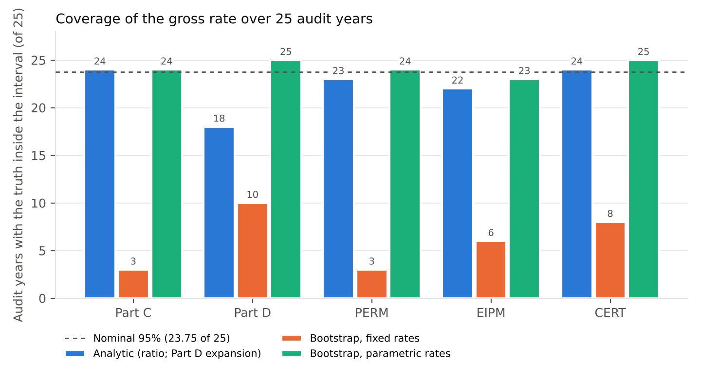

**Affiliation:** [to be completed by the author]. **Corresponding author:** andrewcistola@pm.me

**Running title:** Comparative accuracy of improper payment estimation methods

**Word count:** about 4,400 (main text, excluding tables and references); abstract about 330; 5 tables, 2 figures; Appendices A–C.

## Abstract

**Background.** CMS estimates improper payments in Medicare Part C, Part D, Medicaid (PERM), Marketplace APTC (EIPM) and Medicare fee-for-service (CERT) from audited samples, with 95% confidence intervals required by law. The available projection methods, the analytic expansion, ratio and regression estimators and audit-finding bootstrap simulation (which assigns audited findings across the population and reruns the payment rules), have not been compared against a known truth.

**Purpose.** To answer the question: what is the comparative accuracy of the available methods for estimating improper payments in federal health programs? Accuracy means point accuracy and interval accuracy (coverage at the nominal 95%, then width).

**Methods.** We built five synthetic populations, one per program, with fabricated errors and calibrated to public FY 2025 aggregates, and drew each program's production-like audit (990 to 37,651 units) in 25 independent audit years. We compared expansion and ratio estimators with normal intervals and a model-assisted regression estimator (models fit within strata on basic beneficiary variables and the amount paid, residual interval) against bootstrap simulation (1,000 iterations) with error rates held fixed at their audited values or redrawn each iteration from their binomial sampling distributions (parametric rates).

**Results.** Bootstrap point estimates were as accurate as or more accurate than the analytic estimates. Fixed-rate bootstrap intervals were 5–21% as wide as the analytic intervals and contained the true gross rate in 30 of 125 audit-years (24%), because they omit the sampling variance of the audited rates. Parametric-rate intervals contained it in 121 of 125 (96.8%; 23–25 of 25 in every program) and were 11–21% narrower than the ratio estimator's in four programs and 63% narrower than the same-audit expansion interval in Part D. Measures built from few errors, such as underpayments, were undercovered by every method.

**Conclusions.** Fixed-rate bootstrap intervals should not be used. Bootstrap simulation with parametric rates gives valid, narrower intervals, and we recommend it for PIIA improper payment rates. Its precision would permit audits roughly 20–38% smaller at current precision, reducing review costs without sacrificing accuracy, pending confirmation at reduced sizes.

**Keywords:** improper payments; bootstrap; Monte Carlo simulation; survey sampling; Medicare; Medicaid; payment integrity; confidence intervals

## 1. Background

### 1.1 Improper payment measurement in CMS programs

The Payment Integrity Information Act of 2019 (PIIA) requires a statistically valid estimate of improper payments for every federal program at risk of significant improper payments. OMB's Appendix C to Circular A-123 sets out how agencies produce it (OMB 2021). The Centers for Medicare & Medicaid Services (CMS) runs five such measurements:

- **Medicare Part C** (the Part C Improper Payment Measure, for Medicare Advantage risk adjustment);
- **Medicare Part D** (the Part D Improper Payment Measure, for prescription drug events);
- **Medicaid and CHIP** (Payment Error Rate Measurement, PERM);
- **Marketplace advance premium tax credits** (Exchange Improper Payment Measurement, EIPM);
- **Medicare fee-for-service** (Comprehensive Error Rate Testing, CERT).

Together these programs reported more than $90 billion in improper payments for FY 2025 (CMS 2025a). Each measurement follows the same three steps:

1. Draw a probability sample (the audit).
2. Establish each sampled unit's payment error by medical or eligibility review.
3. Project the sample errors to the program and attach a 95% confidence interval.

The interval is not a formality. Inspectors General review sampling and estimation plans every year, and interval accuracy is an auditable item: the Department of Education OIG has found estimates unreliable because their confidence intervals were inaccurate (ED OIG 2025). Interval width also sets the cost of measurement. Medical record review is the dominant cost of every program, and audit sizes are chosen to meet precision targets, for example ±3 percentage points at 95% confidence for CERT (CMS 2025b).

### 1.2 Analytic estimators and bootstrap simulation

The standard projection methods are design-based estimators with normal-theory intervals (Cochran 1977):

- **Expansion** weights each sampled error up to the population.
- **Ratio** divides the weighted errors by the weighted payments.
- **Regression** fits a model of the error on characteristics known for every unit, predicts the whole population, and adds the weighted sample residuals (model-assisted estimation; Särndal et al. 1992).

Their intervals rely on a central limit argument that is weakest exactly where improper payment data live. Errors are rare, zero-inflated and right-skewed, and often all-or-nothing (Neter and Loebbecke 1975; Kvanli et al. 1998; Edwards et al. 2023).

A second family of methods simulates instead of projecting. The audit's findings (which HCCs failed, which drug claims were wrong and by how much, which applications were ineligible) are assigned at random to the unaudited units of the whole population, and the program's payment function is rerun. Repeating this many times gives a distribution of improper payments. We call this **audit-finding bootstrap simulation**. Part D's published interval is already simulation based (CMS 2023, 2025c).

The approach is attractive for three reasons:

- **Nonlinear payments.** It reruns the actual payment rules, so effects such as the Part D benefit phases, risk-score hierarchies and the APTC schedule are handled exactly rather than through a linear approximation.
- **Every measure at once.** It gives over-, under-, gross and net payments, and any subgroup, from one set of iterations.
- **Traceability.** Every simulated dollar can be traced to an audited finding.

To our knowledge, the comparative accuracy of these methods, and in particular the validity of the simulation's intervals, has not been tested against a known truth. A companion narrative review sets out each program's design and the evidence on interval accuracy in detail (Cistola 2026).

### 1.3 Why validity is in question

The audit-finding bootstrap differs from the textbook bootstrap (Efron and Tibshirani 1993; Mashreghi et al. 2016) in one respect that matters. It never resamples the audit. Each iteration reuses the same audited findings, and the error rates estimated from them, so the spread across iterations reflects only which unaudited units happen to receive errors. The uncertainty in the rates themselves is not represented, and that is the uncertainty a confidence interval is meant to express: what the audit would have found had a different sample been drawn. Section 4.1 shows that this omission is large and predictable.

## 2. Purpose

This study asks: **what is the comparative accuracy of the available methods for estimating improper payments in federal health programs?** The methods are:

- three design-based analytic estimators (expansion, ratio and a model-assisted regression estimator);
- audit-finding bootstrap simulation.

Accuracy has two parts:

- **Point accuracy:** how close the point estimate is to the true improper payment.
- **Interval accuracy:** whether the 95% interval contains the truth in about 95% of repeated audits (coverage) and, among intervals that do, how narrow it is (width). A narrower valid interval is more accurate, because the same precision can then be bought with a smaller, cheaper audit.

The specific aims are to:

1. measure the point and interval accuracy of each method in five synthetic populations designed after the five CMS measurements;
2. explain any failure of the bootstrap simulation interval;
3. test a parametric alternative that corrects it;
4. judge whether the most accurate method could support smaller audits.

Recovery uses of extrapolation (contract-level RADV demands and provider overpayment demands) are out of scope.

## 3. Methods

### 3.1 Study design

This is a Monte Carlo validation study in the design of Edwards et al. (2023):

1. **Population.** For each program, a synthetic population is built and errors are fabricated on it with stated probabilities. The true improper payment is therefore known to the cent.
2. **Audit years.** The program's production audit design is then applied 25 times, each time drawing an independent sample. Each draw is an **audit year**, so the 25 draws show how each estimator behaves when the audit is repeated.
3. **One audit per year.** Each audit year has exactly one audit, and every method gets only that audit. The analytic methods estimate their variance from it. The bootstrap simulation assigns its findings exactly as audited.

All methods are scored on the same 25 audit years. An interval is counted as containing the truth if *lower* ≤ *θ* ≤ *upper*. With 25 audit years, 24 of 25 is the nearest count to the nominal 95% (23.75), and the Monte Carlo standard error of a coverage estimate near 95% is about 4.4 percentage points.

No real data are used. Populations are calibrated only to public aggregate results (Appendix A). Every number in this paper can be regenerated from the public repository (Data and code availability).

### 3.2 Synthetic populations

Table 1 summarizes the five populations; Appendix B gives every assumption.

**Table 1. Populations, audits and true gross improper payment rates**

| Program | Unit (synthetic count; scale) | Payment function | Errors fabricated | Production-like audit per audit year | True gross rate |
|---|---|---|---|---|---|
| Part C | Enrollee (330,253; ×100) | Risk score × county rate × months, with HCC hierarchies | HCCs deleted or moved down the hierarchy, missing documentation (all HCCs lost), HCCs supported but not coded (underpayments) | 990 enrollees, 330 per risk-score tercile | 6.06% |
| Part D | Beneficiary and PDE (108,000; 4.5M PDEs; ×500) | CY 2025 post-IRA standard benefit: reinsurance and low-income cost sharing | Gross drug cost errors on PDEs: 90% full, 10% partial in either direction; 10% of long-term-care PDEs, 2.5% of others | 5,000 PDEs (3 strata, Neyman); ratio and regression use 990 beneficiaries | 1.38% |
| PERM | Payment (3.09M in 9 states; ×200) | Federal share of FFS claims and capitations | Claims-review errors (all-or-nothing or partial) and beneficiary eligibility errors (true state rates 2–4%) | 520 payments per state, payment type × 5 payment quintiles, Neyman, systematic | 6.09% |
| EIPM | Application (142,152; ×100) | APTC under the enhanced applicable-percentage schedule | Overpayments only: technically improper (whole APTC) and monetary (income understated) | 2,000 applications, 5 APTC quintiles, Neyman | 0.92% |
| CERT | Claim (5.34M; ×200) | Claim payment by claim type | Whole-claim and partial overpayments and coding underpayments, calibrated by claim type | 37,651 claims (FY 2025 count per claim type), 5 payment quintiles per type, Neyman | 6.50% |

Each population is calibrated to its FY 2025 public results where those exist:

- Part C: 6.09%; overpayments $21.43B and underpayments $2.23B.
- Medicaid: 6.12%.
- EIPM: 0.89%, of which 0.43 points was technically improper.
- CERT: 6.55% overall, with each of the four claim types matched.

Part D is set below its published 4.00% so that the method is tested in a lower-error regime. Strata that CMS does not publish are illustrative and labeled as such: the EIPM strata, the Part C IPM strata and CERT's service-level strata.

### 3.3 Estimands

**Netting and measures.** For each program the payment error is netted within the payment unit first: the enrollee, beneficiary, payment, application or claim. Then:

- over = Σ max(*y*, 0)
- under = Σ max(−*y*, 0)
- gross = over + under
- net = over − under

Every measure is estimated in dollars with its interval and then divided by the known total payments *X*. The gross rate is the PIIA estimand and the primary outcome. PERM and EIPM errors are all overpayments, so their components are reported instead of over and under: eligibility and claims for PERM, technically improper and monetary for EIPM. CERT also reports gross by claim type.

### 3.4 Analytic estimators

The three analytic estimators use the program's stratified design. Let *N_h*, *n_h* and *w_h = N_h/n_h* be stratum sizes and weights, and let *T̂_y = Σ_h w_h Σ y* and *T̂_x* be the weighted totals. Then:

- **Expansion:** *θ̂ = T̂_y / X*.
- **Ratio:** *θ̂ = T̂_y / T̂_x*.
- **Regression (model-assisted):** within each model stratum *m*, the audited *y* is regressed by design-weighted least squares on an intercept and the unit's predictors **z**: basic beneficiary variables plus the amount paid. The fitted models predict every population unit, and the estimate adds the weighted audit residuals: *θ̂ = [Σ_U ŷ + Σ_s w (y − ŷ)] / X*. The predictors are:
  - Part C: payment, demographic score, months enrolled and number of HCCs, within risk-score terciles.
  - Part D: Medicare payment, gross drug cost, number of PDEs and reaching the catastrophic phase, within post-strata (long-term care, low-income subsidy, other).
  - PERM: amount paid, month and the beneficiary's number of payments and total paid.
  - EIPM: APTC, age, household size, income and months.
  - CERT: amount paid (the claims carry no beneficiary variables).

  The model is fit on the same audit as the ratio estimator (for Part D, the 990-beneficiary audit). A stratum with fewer than 10 audited errors, or too few units for the model, uses an intercept-only model, which is expansion within that stratum. The approach follows model-assisted estimation as used in forest inventory (McConville et al. 2020) and model-based extrapolation of random audits in tax-gap estimation (Johns and Rosenbaum 2024).

Variances use the stratified-SRS formula with finite population correction on *y* (expansion), on the ratio residual *y − θ̂x* (ratio), or on the model residual *y − ŷ* (regression), all from the single audit. Expansion and ratio report *θ̂ ± 1.96·SE*; regression uses a *t* multiplier with degrees of freedom reduced by the strata and model terms fitted.

Two program-specific forms apply:

- **Part C expansion** works in risk-score units: the mean audited over- and under-risk-score error in each tercile × the tercile's size × the national mean county rate × months.
- **Part D expansion** applies each stratum's audited PDE error rate to every PDE in the population, reruns the benefit, and uses a delta-method interval: each stratum's rate is moved by ±1 SE and the benefit is rerun each way.

### 3.5 Audit-finding bootstrap simulation (fixed rates)

Within each donor kind *k*, take the audit's *n_k* audited units:

- *f_k* of them are in error;
- *g_k* of those errors are partial, with sizes *s_1, …, s_{g_k}*.

The donor kind is the sampling stratum. In Part C it is the HCC (20 HCC failure rates and 10 family addition rates).

In each of 1,000 iterations:

1. Every non-audited unit of kind *k* is in error with probability *p_k = f_k/n_k*.
2. Given an error, it is partial with probability *q_k = g_k/f_k*, with its size drawn uniformly from the audited partial sizes. Otherwise it is a whole error.
3. Audited units keep their own findings.
4. The payment function is rerun for every unit, and the measures are summed.

These two steps are the same as giving every unit the finding of a uniformly drawn audited donor of its kind. They only touch units that receive an error, so a 5-million-claim iteration takes milliseconds.

The estimate is the mean of the iteration rates, and the interval is their 2.5th and 97.5th percentiles. When every unit is audited, every iteration returns the exact true rate; this is tested. In Part D, all PDEs of the full population are simulated and the benefit is rerun for every beneficiary.

### 3.6 The parametric-rate alternative

The parametric version changes only one thing. Before each iteration, the rates are redrawn from their sampling distribution given the audit:

*p̃_k = Binomial(n_k, p_k)/n_k*, *q̃_k = Binomial(f_k, q_k)/f_k*

Steps 1–4 then run with *p̃_k* and *q̃_k*. Each iteration therefore represents a different plausible audit outcome as well as a different assignment. Rates with no audited failures stay at zero: no failures are extrapolated to HCCs the audit never saw. Partial sizes are still drawn from the audited list.

This is a parametric bootstrap of the rate parameters (Efron and Tibshirani 1993, ch. 6), applied inside the simulation. We call the two versions **bootstrap simulation (fixed rates)** and **bootstrap simulation (parametric rates)**. It is not a Bayesian bootstrap, and it needs no prior.

### 3.7 Outcomes

For each program, measure and method, over the 25 audit years:

- **Coverage:** the number of intervals containing the truth, and how many lie entirely above or entirely below it.
- **Width:** the median 95% interval half-width, in percentage points of payments and in national dollars.
- **Point accuracy:** the median point estimate, and the mean absolute and mean signed error relative to the true rate.

For the audit-size question, we compare the parametric interval with the analytic interval from the same audit:

- the ratio estimator for Part C, PERM, EIPM and CERT;
- expansion for Part D, the analytic method that uses the same PDE audit.

If interval width scales with 1/√*n*, the audit size at which the parametric method would match the analytic width is (*w_parametric / w_analytic*)² of the current audit.

## 4. Results

Table 2 gives, for each program, the gross rate's median point estimate, median interval half-width and coverage under every method. Figures 1 and 2 summarize width and coverage. National-dollar equivalents are in Appendix Table C1.

**Table 2. Gross improper payment rate: median estimate, median 95% interval half-width and coverage over 25 audit years**

| Program (audit) | True rate | Method | Median estimate | Median half-width (points) | Truth inside (above / below) |
|---|---|---|---|---|---|
| Part C (990 enrollees, 330 per risk-score tercile) | 6.06% | Expansion | 6.15% | ±1.05 | 25/25 (0/0) |
|  |  | Ratio | 6.13% | ±1.03 | 24/25 (1/0) |
|  |  | Regression | 6.10% | ±1.02 | 23/25 (1/1) |
|  |  | Bootstrap (fixed rates) | 6.06% | ±0.05 | 3/25 (12/10) |
|  |  | Bootstrap (parametric rates) | 6.08% | ±0.92 | 24/25 (0/1) |
| Part D (5,000 PDEs (Neyman, 3 strata); ratio and regression: 990 beneficiaries) | 1.38% | Expansion | 1.22% | ±0.60 | 18/25 (0/7) |
|  |  | Ratio | 1.41% | ±0.67 | 18/25 (1/6) |
|  |  | Regression | 1.44% | ±0.58 | 15/25 (4/6) |
|  |  | Bootstrap (fixed rates) | 1.38% | ±0.06 | 10/25 (8/7) |
|  |  | Bootstrap (parametric rates) | 1.38% | ±0.22 | 25/25 (0/0) |
| PERM (9 states x 520 payments (Neyman, 10 strata per state)) | 6.09% | Expansion | 6.04% | ±0.80 | 23/25 (0/2) |
|  |  | Ratio | 6.00% | ±0.80 | 23/25 (0/2) |
|  |  | Regression | 6.03% | ±0.79 | 23/25 (0/2) |
|  |  | Bootstrap (fixed rates) | 5.97% | ±0.10 | 3/25 (9/13) |
|  |  | Bootstrap (parametric rates) | 5.96% | ±0.63 | 24/25 (0/1) |
| EIPM (2,000 applications (Neyman, 5 APTC quintiles)) | 0.92% | Expansion | 0.83% | ±0.35 | 22/25 (0/3) |
|  |  | Ratio | 0.83% | ±0.35 | 22/25 (0/3) |
|  |  | Regression | 0.84% | ±0.34 | 23/25 (0/2) |
|  |  | Bootstrap (fixed rates) | 0.82% | ±0.05 | 6/25 (5/14) |
|  |  | Bootstrap (parametric rates) | 0.81% | ±0.31 | 23/25 (0/2) |
| CERT (37,651 claims (4 claim types x 5 quintiles, Neyman within type)) | 6.50% | Expansion | 6.56% | ±0.36 | 25/25 (0/0) |
|  |  | Ratio | 6.58% | ±0.36 | 24/25 (1/0) |
|  |  | Regression | 6.58% | ±0.36 | 24/25 (1/0) |
|  |  | Bootstrap (fixed rates) | 6.55% | ±0.07 | 8/25 (11/6) |
|  |  | Bootstrap (parametric rates) | 6.55% | ±0.28 | 25/25 (0/0) |

### 4.1 The bootstrap point estimate is accurate

Before turning to intervals, it is worth establishing what the bootstrap simulation does well. Its point estimate is at least as accurate as the best analytic estimator in every program: it ties in Part C and is more accurate in the other four (Table 3):

| Program | Bootstrap mean absolute error (% of truth) | Best analytic mean absolute error | Expansion |
|---|---|---|---|
| Part C | 5.6% | 5.7% | |
| PERM | 4.4% | 5.3% (regression) | |
| EIPM | 16.6% | 17.6% | |
| CERT | 1.5% | 2.2% | |
| Part D | 6.6% | 23.4% (ratio, on the 990-beneficiary audit) | 30.5% (on the same PDE audit) |

The Part D gap reflects the benefit. A PDE error changes Medicare's liability by an amount that depends on where the beneficiary sits in the benefit, and only rerunning the benefit captures it. Expansion's stratum-average rates run 5.7% low.

The fixed and parametric versions give the same point estimate to within 0.2 percentage points of relative error, because the binomial redraw is centered on the audited rates. Signed errors are within ±1% of the truth for the bootstrap in every program except EIPM.

In EIPM every method runs 5–8% low. Technically improper errors are rare (about 9 per audit) and large (the whole APTC), so in most audit years the sample holds fewer than the expected number and the median estimate falls below the mean. This is a small-sample property of the data, not of any one method. The bootstrap's further 2–3% shortfall in EIPM comes from moving a monetary error's income ratio to an application at a different point of the APTC schedule (Appendix B.4).

**Table 3. Accuracy of the gross point estimate: average absolute error, as % of the true rate (average signed error)**

| Program | Expansion | Ratio | Regression | Bootstrap (fixed rates) | Bootstrap (parametric rates) |
|---|---|---|---|---|---|
| Part C | 5.7% (+1.1%) | 6.0% (+0.9%) | 6.3% (+1.2%) | 5.6% (-0.1%) | 5.6% (-0.1%) |
| Part D | 30.5% (-5.7%) | 23.4% (+0.1%) | 27.9% (+7.8%) | 6.6% (-0.4%) | 6.6% (-0.4%) |
| PERM | 5.5% (-1.4%) | 5.6% (-1.4%) | 5.3% (-1.5%) | 4.4% (-0.6%) | 4.4% (-0.6%) |
| EIPM | 17.7% (-5.5%) | 17.6% (-5.6%) | 18.1% (-5.4%) | 16.6% (-7.9%) | 16.6% (-8.1%) |
| CERT | 2.2% (+0.6%) | 2.3% (+0.7%) | 2.3% (+0.7%) | 1.5% (+0.3%) | 1.5% (+0.3%) |

### 4.2 The bootstrap interval problem

The fixed-rate bootstrap interval is far too narrow in every program. Its median half-width is 5% to 21% of the analytic interval's from the same audit (Table 4), and it contains the true gross rate in only 3 to 10 of 25 audit years (Figure 2). The misses fall on both sides about equally: in Part C, 12 intervals lie entirely above the truth and 10 entirely below. So the problem is not bias. The interval is centered correctly and is simply too short.

**Table 4. The fixed-rate interval problem and the parametric alternative (gross rate)**

| Program | Analytic comparator | Analytic half-width | Fixed-rate half-width (share of analytic) | Fixed-rate coverage | Parametric half-width (share of analytic) | Parametric coverage | Audit size giving the analytic width, if width ∝ 1/√n |
|---|---|---|---|---|---|---|---|
| Part C | Ratio | ±1.03 | ±0.05 (5%) | 3/25 | ±0.92 (89%) | 24/25 | 79% of the audit |
| Part D | Expansion | ±0.60 | ±0.06 (10%) | 10/25 | ±0.22 (37%) | 25/25 | 13% of the audit |
| PERM | Ratio | ±0.80 | ±0.10 (13%) | 3/25 | ±0.63 (79%) | 24/25 | 63% of the audit |
| EIPM | Ratio | ±0.35 | ±0.05 (13%) | 6/25 | ±0.31 (89%) | 23/25 | 80% of the audit |
| CERT | Ratio | ±0.36 | ±0.07 (21%) | 8/25 | ±0.28 (79%) | 25/25 | 62% of the audit |

The cause is structural. Write the true sampling variance of an estimated improper total *T̂* by the law of total variance, conditioning on the audit *A*:

  Var(*T̂*) = E[Var(*T̂* | *A*)] + Var(E[*T̂* | *A*]).

The fixed-rate bootstrap holds the audit, and therefore the rates *p_k* and *q_k*, fixed. Its iterations vary only in which unaudited units receive errors. Its spread therefore estimates only the first term, the *reassignment* variance. That term grows with the population size *N*, roughly *N p(1 − p)* times the mean squared error size. The second term is the variance of the rates themselves across possible audits, the term a confidence interval exists to express. It grows with *N²/n*.

The ratio of the two standard deviations is therefore roughly √(*n*/*N*), and the observed ratios follow it:

| Program | √(*n*/*N*) | Observed fixed-rate width, share of analytic |
|---|---|---|
| Part C (990 of 330,253 enrollees) | 5.5% | 5% |
| EIPM (2,000 of 142,152 applications) | 11.9% | 13% |
| CERT (37,651 of 5.34 million claims) | 8.4% | 21% |
| PERM (520 of about 343,000 payments per state) | 3.9% | 13% |
| Part D (5,000 of about 4.5 million PDEs) | 3.3% | 10% |

The ratio is higher than √(*n*/*N*) in three programs:

- **CERT:** inpatient claims are sampled at 22%, which inflates the reassignment term there.
- **PERM and Part D:** error sizes vary more, because whole payments of very different amounts can be in error and the benefit is nonlinear.

None comes close to the analytic width.

More iterations do not help. They estimate the reassignment spread more precisely; they do not add the missing term. The interval also gets *narrower* as the population grows relative to the audit, the opposite of what a sampling interval should do. A larger program with the same audit would report greater precision than a smaller one.

### 4.3 The parametric alternative

The parametric version adds the missing term directly. Before each iteration, each rate is redrawn from its binomial sampling distribution given the audit (Section 3.6), so the iteration distribution spans plausible audit outcomes as well as plausible assignments.

The change restores coverage of the gross rate in every program: 24, 25, 24, 23 and 25 of 25 audit years for Part C, Part D, PERM, EIPM and CERT. That is 121 of 125 audit-years in all (96.8%), against 30 of 125 (24%) with fixed rates. No parametric interval for the gross rate lay entirely above the truth; the four misses were below.

The parametric intervals are also narrower than the analytic intervals from the same audit (Table 4, Figure 1):

| Program | Parametric half-width, share of analytic |
|---|---|
| Part C | 89% |
| EIPM | 89% |
| PERM | 79% |
| CERT | 79% |
| Part D (against expansion on the same PDE audit) | 37% |

They achieved equal or higher coverage than the analytic intervals in every program:

| Program | Parametric | Analytic |
|---|---|---|
| Part C | 24/25 | 24/25 (ratio), 25/25 (expansion) |
| PERM | 24/25 | 23/25 |
| EIPM | 23/25 | 22/25 |
| CERT | 25/25 | 24/25 (ratio), 25/25 (expansion) |
| Part D | 25/25 | 15–18/25 |

In dollars (Appendix Table C1):

- **PERM:** the parametric interval is ±$0.90B around a median $8.46B, against ±$1.13B for the ratio estimator.
- **CERT:** ±$1.24B around $28.81B, against ±$1.57B.
- **Part C:** ±$3.57B around $23.62B, against ±$4.02B.

The width gain has two sources:

- **The population's known structure.** The simulation reruns the payment function over every unit's known payment, HCCs, benefit position or APTC inputs. It is therefore a model-assisted estimator that uses the full population's auxiliary information, where the ratio estimator uses only total payments.
- **The partial-size list is held fixed.** The audited list of partial error sizes is reused rather than resampled, which leaves out some uncertainty in error size. The coverage results suggest this omission is small for the gross rate, but it is a reason to extend the method (Section 6).

The Part D gain is largest and the least certain. The only analytic method on the same PDE audit is expansion. Its delta-method interval is wide and its point estimate runs low, so the 37% understates what a well-specified analytic interval on that audit could achieve.

### 4.4 Components and sparse measures

Coverage of every reported measure is in Table 5. For the large components, the parametric version matched or exceeded the analytic methods:

**Table 5. Coverage of every measure (truth inside the 95% interval, out of 25 audit years; above / below)**

| Program | Measure | True rate | Expansion | Ratio | Regression | Bootstrap (fixed rates) | Bootstrap (parametric rates) |
|---|---|---|---|---|---|---|---|
| Part C | Overpayments | 5.49% | 25/25 (0/0) | 25/25 (0/0) | 24/25 (1/0) | 3/25 (13/9) | 24/25 (1/0) |
| Part C | Underpayments | 0.57% | 21/25 (0/4) | 21/25 (0/4) | 21/25 (0/4) | 2/25 (4/19) | 19/25 (0/6) |
| Part C | Gross | 6.06% | 25/25 (0/0) | 24/25 (1/0) | 23/25 (1/1) | 3/25 (12/10) | 24/25 (0/1) |
| Part C | Net | 4.91% | 25/25 (0/0) | 25/25 (0/0) | 25/25 (0/0) | 2/25 (15/8) | 24/25 (1/0) |
| Part D | Overpayments | 1.36% | 18/25 (0/7) | 18/25 (1/6) | 16/25 (4/5) | 9/25 (9/7) | 25/25 (0/0) |
| Part D | Underpayments | 0.02% | 0/25 (0/25) | 15/25 (0/10) | 13/25 (2/10) | 10/25 (12/3) | 20/25 (4/1) |
| Part D | Gross | 1.38% | 18/25 (0/7) | 18/25 (1/6) | 15/25 (4/6) | 10/25 (8/7) | 25/25 (0/0) |
| Part D | Net | 1.34% | 19/25 (0/6) | 19/25 (1/5) | 16/25 (4/5) | 11/25 (7/7) | 24/25 (0/1) |
| PERM | Gross | 6.09% | 23/25 (0/2) | 23/25 (0/2) | 23/25 (0/2) | 3/25 (9/13) | 24/25 (0/1) |
| PERM | Eligibility | 3.06% | 21/25 (0/4) | 21/25 (0/4) | 21/25 (0/4) | 8/25 (7/10) | 24/25 (0/1) |
| PERM | Claims | 3.13% | 23/25 (0/2) | 23/25 (0/2) | 23/25 (0/2) | 2/25 (11/12) | 23/25 (1/1) |
| EIPM | Gross | 0.92% | 22/25 (0/3) | 22/25 (0/3) | 23/25 (0/2) | 6/25 (5/14) | 23/25 (0/2) |
| EIPM | Technically improper | 0.43% | 19/25 (1/5) | 19/25 (1/5) | 19/25 (1/5) | 6/25 (5/14) | 20/25 (1/4) |
| EIPM | Monetary | 0.48% | 22/25 (0/3) | 22/25 (0/3) | 22/25 (0/3) | 7/25 (5/13) | 22/25 (1/2) |
| CERT | Overpayments | 6.30% | 24/25 (1/0) | 24/25 (1/0) | 24/25 (1/0) | 9/25 (10/6) | 25/25 (0/0) |
| CERT | Underpayments | 0.21% | 23/25 (0/2) | 23/25 (0/2) | 23/25 (0/2) | 13/25 (2/10) | 20/25 (0/5) |
| CERT | Gross | 6.50% | 25/25 (0/0) | 24/25 (1/0) | 24/25 (1/0) | 8/25 (11/6) | 25/25 (0/0) |
| CERT | Net | 6.09% | 24/25 (1/0) | 24/25 (1/0) | 24/25 (1/0) | 8/25 (10/7) | 25/25 (0/0) |
| CERT | Gross: DMEPOS | 24.44% | 24/25 (0/1) | 24/25 (0/1) | 24/25 (0/1) | 14/25 (2/9) | 25/25 (0/0) |
| CERT | Gross: Part A IPPS | 3.02% | 24/25 (1/0) | 24/25 (1/0) | 24/25 (1/0) | 18/25 (6/1) | 24/25 (1/0) |
| CERT | Gross: Part A excl. IPPS | 6.62% | 24/25 (1/0) | 23/25 (2/0) | 24/25 (1/0) | 9/25 (11/5) | 25/25 (0/0) |
| CERT | Gross: Part B | 8.45% | 25/25 (0/0) | 23/25 (0/2) | 23/25 (0/2) | 5/25 (6/14) | 25/25 (0/0) |

- **Part C:** overpayments 24/25 and net 24/25.
- **Part D:** overpayments 25/25 and net 24/25.
- **PERM:** eligibility 24/25 (analytic 21/25) and claims 23/25.
- **EIPM:** monetary 22/25.
- **CERT:** overpayments and net 25/25, and every claim type 24–25/25.

The exceptions are the sparse measures, those built from a handful of audited errors:

| Measure | True rate | Parametric | Ratio | Expansion |
|---|---|---|---|---|
| Part C underpayments | 0.57% | 19/25 | 21/25 | |
| Part D underpayments | 0.02% | 20/25 | 15/25 | 0/25 |
| EIPM technically improper | 0.43% | 20/25 | 19/25 | |
| CERT underpayments | 0.21% | 20/25 | 23/25 | |

Every method undercovers these measures, and the misses fall mainly below: the interval lies under the truth in audit years whose sample happened to contain few of the rare errors. This is the zero-inflated, right-skewed regime in which normal-theory intervals are known to fail (Kvanli et al. 1998; Hesterberg 2015). The parametric bootstrap does not escape it, because a binomial redraw centered on a low audited rate stays low. The gross rate is protected because the sparse component is a small share of it.

### 4.5 Regression with beneficiary variables

The regression estimator fits a least-squares model within each stratum on the ratio estimator's audit, using basic beneficiary variables and the amount paid. It then predicts every population unit and adds the weighted audit residuals. The extra variables changed little:
- **Part C, PERM, EIPM and CERT:** coverage of the gross rate was 23, 23, 23 and 24 of 25. Width and point accuracy were within a few percent of the ratio estimator's.
- **Part D:** drug cost and reaching the catastrophic phase explain part of the beneficiary payment error, and the interval narrowed from ±0.67 (ratio) to ±0.58 points. But coverage fell to 15 of 25, and the point estimate ran 7.8% high on average.

With few large errors in a 990-beneficiary audit, a better-fitting model leaves residuals that understate the true sampling variance: the overfitting risk of model-assisted estimation with small samples (McConville et al. 2020). In PERM, all but the largest-payment fee-for-service stratum had too few audited errors for a model and used the intercept-only fallback, which equals expansion within the stratum.

Across the five programs, regression covered the true gross rate in 108 of 125 audit years (86.4%), against 111 for the ratio estimator and 121 for the parametric bootstrap.

## 5. Discussion

### 5.1 Principal findings

In five synthetic populations designed after the five CMS improper payment measurements, audit-finding bootstrap simulation gave point estimates as accurate as, or more accurate than, the expansion, ratio and regression estimators. Its fixed-rate interval, however, was invalid in every program, covering the truth in 24% of audit years where 95% was intended. The failure is not a tuning problem. Because the audit is never resampled, the interval measures only how the audited rates scatter across the population, not how much those rates would change with a different audit. Its width shrinks toward zero as the population grows. Any production use of a fixed-rate audit-finding simulation for PIIA intervals should therefore be reviewed.

Redrawing the rates from their binomial sampling distribution before each iteration fixes the interval with a change of a few lines of code and no additional review. It covered the true gross rate in 96.8% of audit years. Its intervals were 11–21% narrower than the ratio estimator's in four programs, and much narrower than expansion's in Part D.

### 5.2 Recommendation

We recommend that CMS improper payment measurements adopt **bootstrap simulation with parametric rates** for the gross improper payment rate and its interval, with the analytic ratio interval reported alongside during a transition period. The recommendation rests on three findings:

1. **Validity:** coverage at the nominal level for the gross rate in every program.
2. **Accuracy:** the most accurate point estimates of the methods studied.
3. **Precision:** narrower intervals than the analytic methods from the same audit.

Precision is where the cost case lies. A narrower interval at the same coverage means the current precision can be reached with fewer records reviewed. If width scales with 1/√*n*, the parametric method would match the analytic interval's current width with about:

| Program | Share of the current audit | Audit size |
|---|---|---|
| Part C | 79% | about 780 enrollees instead of 990 |
| EIPM | 80% | about 1,600 applications instead of 2,000 |
| PERM | 63% | about 330 payments per state-year instead of 520 |
| CERT | 62% | about 23,300 claims instead of 37,651 |

That is a 20–38% reduction in medical record and eligibility reviews, which dominate the cost of each measurement. Part D's projected reduction is larger still but rests on a weaker comparator (Section 4.3).

These figures are projections, not demonstrated results, and they apply to the gross rate. Two conditions should precede any reduction:

- **Confirm coverage at the reduced size.** Coverage must be confirmed directly at the smaller audit sizes (Section 6).
- **Protect sparse components.** Components that CMS reports separately and that rest on few errors (underpayments, technically improper payments) need their own precision check, because their coverage was already below nominal under every method.

### 5.3 Implementation

The parametric version runs on the same audit data as the fixed version. It adds two binomial draws per stratum per iteration, and at 1,000 iterations it ran in seconds (EIPM, Part C) to minutes (CERT, 5.3 million claims) on a two-core machine.

The method is fully specified by the audit and the payment function, so it can be written into a Sampling and Estimation Methodology Plan and tested by an Inspector General with the same census check used here: auditing every unit must return the true rate exactly. Rates with no audited failures stay at zero, a conservative choice that keeps the simulation from inventing errors the audit never observed.

### 5.4 Limitations

1. **Number of audit years.** Coverage was estimated from 25 audit years per program. The Monte Carlo standard error is about 4.4 points, so 23/25 and 25/25 are not statistically distinguishable. The consistency across five programs and 22 measures is the stronger evidence, but a larger replication is needed.
2. **Synthetic populations.** The populations are synthetic and calibrated only to public aggregates:
   - Error mechanisms, partial-error shares and the independence of errors from payment size within strata are assumptions.
   - Strata the agencies do not publish (EIPM, Part C IPM, CERT service-level strata) are illustrative.
   - MAC jurisdictions and the CERT Part A-to-B rebilling adjustment are not modeled.
3. **Perfect review.** Review is assumed error-free and final, with no appeals.
4. **Part D design differences.** Part D's analytic comparators use a different audit (990 beneficiaries) or a different interval construction (delta method), so its comparisons mix design and estimator.
5. **Fixed error sizes.** The parametric version does not resample the distribution of error sizes. Coverage suggests this matters little for the gross rate, but it may contribute to the undercoverage of sparse components.
6. **Scope.** The study addresses two-sided PIIA rate intervals. Recovery uses rely on one-sided lower bounds, which were not tested.

## 6. Future research

1. **Optimal audit sizes.** The audit-size figures in Table 4 are projections from a 1/√*n* scaling. The direct test is to rerun each program's design at reduced audit sizes (for example 50%, 65% and 80% of current) with at least 200 audit years. This would find the smallest audit at which the parametric interval still covers the truth in 95% of audit years for the gross rate and for the components CMS reports. Allocation should be reconsidered at the same time. Neyman allocation minimizes the variance of the analytic estimator, not of the simulation. The cost of review differs by stratum (an inpatient record costs more to review than a Part B claim), so cost-weighted allocation (*n_h* ∝ *N_h S_h / √c_h*) belongs in the same study.
2. **Model + simulation alternatives.** The parametric version models only the rates. Several extensions are natural:
   - **Hierarchical Bayesian error models.** Beta-binomial rates pooled across strata, HCCs or states would give zero-failure HCCs and small strata a plausible nonzero rate instead of a fixed zero. Their posterior predictive draws would replace the binomial redraw.
   - **Unit-level error models.** Logistic or zero-inflated regression of error probability and error size on unit features (payment amount, provider type, drug class, HCC count) would feed the simulation. This model-assisted microsimulation would use the full population's auxiliary data and could narrow intervals further where the features predict error.
   - **Resampling the size distribution.** Partial sizes could be resampled with replacement within each iteration, so that uncertainty in error size enters alongside uncertainty in the rates.
   - **Calibrated intervals.** BCa or double-bootstrap calibration could be applied to the iteration distribution to correct remaining tail imbalance in sparse components (Efron 1987; Hall 1988).
3. **Settings beyond the PIIA national rate.** The study can be extended to:
   - state-level PERM eligibility rates, which carry federal match consequences from FY 2030 (P.L. 119-21);
   - State-based Exchange measurement from 2027;
   - contract-level RADV, where the interval becomes a lower bound for recovery and one-sided coverage matters.
4. **Validation on real audits.** Under an appropriate data use agreement, the synthetic results can be checked against held-out real audit samples, in particular the share of partial errors and whether error probability depends on payment size, which this study assumes away within strata.

## 7. Conclusion

On the question of comparative accuracy, the answer is consistent across the five programs studied. In every program, audit-finding bootstrap simulation with fixed rates produces point estimates as accurate as the analytic estimators, but intervals far too narrow to be valid. The cause is structural: the audit is never resampled, so the interval omits the sampling error of the rates. Redrawing the rates from their binomial sampling distribution before each iteration restores nominal coverage for the gross rate in every program. Those intervals are also narrower than the analytic intervals from the same audit in all five programs: 11–21% narrower than the ratio estimator in four, and much narrower than expansion in Part D. We recommend parametric-rate bootstrap simulation for improper payment rate estimation. Its precision gain gives CMS room to reduce audit sizes, and with them review costs, without losing accuracy, subject to direct confirmation at the reduced sizes.

## Data and code availability

All code, configuration, synthetic populations (or their SHA-256 manifests where a population is too large to commit), results and the scripts that build every table and figure in this paper are in the public repository [andrewcistola/improper-payment-estimation-accuracy](https://github.com/andrewcistola/improper-payment-estimation-accuracy). The repository contains no protected health information, no unit-level data from any source and no non-public CMS material.

## Funding, conflicts of interest and disclaimer

[To be completed by the author before submission: funding source, employer and contract relationships, and a statement that the views are the author's own and do not represent CMS or any other organization.]

## References

- Biddle GC, Bruton CM, Siegel AF (1990). Computer-intensive methods in auditing: bootstrap difference and ratio estimation. *Auditing: A Journal of Practice & Theory* 9(3):92–114.
- CMS (2023). FY 2023 Medicare Part D Error Rate Findings and Results. Centers for Medicare & Medicaid Services.
- CMS (2025a). Fiscal Year 2025 Improper Payments Fact Sheet. Centers for Medicare & Medicaid Services.
- CMS (2025b). 2025 Medicare Fee-for-Service Supplemental Improper Payment Data. Centers for Medicare & Medicaid Services.
- CMS (2025c). FY 2025 Medicare Part D Error Rate Findings and Results. Centers for Medicare & Medicaid Services.
- CMS (2025d). FY 2025 Medicare Part C Error Rate Findings and Results. Centers for Medicare & Medicaid Services.
- CMS (2026a). Exchange Improper Payment Measurement: Program Background and Improper Payment Findings. Centers for Medicare & Medicaid Services.
- CMS (2026b). Medicare Fee-for-Service Comprehensive Error Rate Testing (CERT) Methodology. Centers for Medicare & Medicaid Services.
- CMS (2024). Payment Error Rate Measurement, Supporting Statement Part B (OMB ICR 202408-0938-026).
- Cistola A (2026). Methods for estimating improper payments in federal health programs: a narrative review of their comparative accuracy. Companion review, `literature-review/` in the study repository.
- Cochran WG (1977). *Sampling Techniques*, 3rd ed. Wiley.
- Davison AC, Hinkley DV (1997). *Bootstrap Methods and Their Application*. Cambridge University Press.
- Department of Education OIG (2025). U.S. Department of Education's Compliance with Payment Integrity Information Act Reporting Requirements for Fiscal Year 2025.
- Edwards D, Liu P, Delage A (2023). Model-based stratification of payment populations in Medicare integrity investigations. *Survey Methodology* 49(2):607–626.
- Efron B (1987). Better bootstrap confidence intervals. *Journal of the American Statistical Association* 82(397):171–185.
- Efron B, Tibshirani RJ (1993). *An Introduction to the Bootstrap*. Chapman & Hall.
- Hall P (1988). Theoretical comparison of bootstrap confidence intervals. *Annals of Statistics* 16(3):927–953.
- Hesterberg TC (2015). What teachers should know about the bootstrap. *The American Statistician* 69(4):371–386.
- King B, Madansky A (2013). On sampling design issues when dealing with zeros. *Journal of Survey Statistics and Methodology* 1(2):144–170.
- Johns D, Rosenbaum D (2024). *Distribution of Tax Year 2014–2015 Individual Income Tax and Self-Employment Tax Underreporting Tax Gap*. Internal Revenue Service.
- Kvanli AH, Shen YK, Deng LY (1998). Construction of confidence intervals for the mean of a population containing many zero values. *Journal of Business & Economic Statistics* 16(3):362–368.
- Mashreghi Z, Haziza D, Léger C (2016). A survey of bootstrap methods in finite population sampling. *Statistics Surveys* 10:1–52.
- McConville KS, Moisen GG, Frescino TS (2020). A tutorial on model-assisted estimation with application to forest inventory. *Forests* 11(2):244.
- Neter J, Loebbecke JK (1975). *Behavior of Major Statistical Estimators in Sampling Accounting Populations: An Empirical Study*. AICPA.
- OMB (2021). Memorandum M-21-19, Appendix C to Circular A-123: Requirements for Payment Integrity Improvement. Office of Management and Budget.
- Payment Integrity Information Act of 2019, Pub. L. 116-117.
- Rao JNK, Wu CFJ (1988). Resampling inference with complex survey data. *Journal of the American Statistical Association* 83(401):231–241.
- Särndal CE, Swensson B, Wretman J (1992). *Model Assisted Survey Sampling*. Springer.
- Wolter KM (2007). *Introduction to Variance Estimation*, 2nd ed. Springer.

## Appendix A. Data process

Every number in this study comes from synthetic populations built from stated probability distributions. No protected health information, no unit-level data from any source and no non-public CMS material (contractor methodology plans, internal error data) were used. Populations are calibrated only to public aggregate results: FY 2025 HHS Agency Financial Report figures and the program-specific CMS result pages cited in Appendix B.

### A.1 Pipeline

Each program folder has two stages, run by one YAML-driven runner (`ipsim`):

1. **`errors/`** builds an error-free population, applies fabricated errors, records the truth and checks it against public figures.
   - Population. Units with their payment amounts and the fields each payment function needs: risk scores and HCCs, PDEs and benefit phases, APTC inputs, claims.
   - Errors. Each unit's candidate error is drawn first, then turned on with a stated probability. Where a public aggregate is used as a target, the probability comes from one closed-form multiplier: the target dollars divided by the expected dollars of the candidates. No iterative tuning is used.
   - Truth. The true improper amount *y* and payment *x* for every unit, and the true over, under, gross and net totals.
   - Checks. Each population is compared with the public aggregates it is calibrated to. Results are written to `checks.json`.
2. **`estimation/`** draws the audits and estimates with each method.
   - Frame and design. Strata, the allocation (Neyman where stated), and the sample size.
   - Audits. 25 independent production audits ("audit years").
   - Estimators. Expansion and ratio, with normal 95% intervals, written once in `shared/sql/lib/02_estimators.sql` and tested against an independent numpy implementation. Regression: models fit within strata on beneficiary variables plus the amount paid, predicted for the population, with a residual interval (`shared/ipsim/regression.py`, predictors from each program's `30_regression.sql`; tested in `shared/tests/test_regression.py`).
   - Bootstrap simulation. Fixed and parametric rates, 1,000 iterations per audit year, run by the shared loop in `shared/ipsim/simulation.py` with each program's kernel.
   - Scoring against the truth.

`shared/report.yaml` joins every estimate to the truth (`shared/results/report/by_scenario.csv`, `by_audit_year.parquet`). `manuscripts/scripts/build_tables.py` produces every table and figure in this manuscript from the parametric-rate results (`<program>/estimation/results/`, the configs' default) and the fixed-rate results from the same audits (`<program>/estimation/results_fixed/`).

### A.2 Reproducibility

- **Random numbers.** In SQL, every random draw is a hash of `(seed, stream, key)`. In the bootstrap simulation, draws come from PCG64 generators seeded by `SeedSequence([scenario seed, audit year])`.
- **Exact arithmetic.** Money is stored as `DECIMAL`, and floating-point sums run in a fixed order.
- **Identical reruns.** Reruns give byte-identical files at any thread count. This is tested in `shared/tests/test_determinism.py`, and `manifest.json` records a SHA-256 hash for every output.
- **Payment functions.** Each program's numpy payment function is tested to reproduce the SQL improper amount to the cent for every unit when given that unit's own audit finding. A census audit is also tested: when every unit is audited, both bootstrap versions must return the exact true rates (`shared/tests/test_simulation.py`).

### A.3 Scale

Each synthetic unit stands for *w* real units:

| Program | *w* |
|---|---|
| Part C | 100 |
| Part D | 500 |
| PERM | 200 |
| EIPM | 100 |
| CERT | 200 |

Rates are scale-free. Dollars are reported at national scale: rate × synthetic payments × *w*.

### A.4 Estimands and netting

- **Netting.** Errors are netted within the payment unit first: the enrollee (Part C), the beneficiary (Part D), the payment (PERM), the application (EIPM) and the claim (CERT).
- **Measures.**
  - Over = Σ max(*y*, 0)
  - Under = Σ max(−*y*, 0)
  - Gross = over + under
  - Net = over − under
- **Rates.** Each total is estimated in dollars with its interval first, then divided by the known total payments *X*.
- **Overpayment-only programs.** PERM and EIPM have only overpayments, so gross = over = net. Their components are reported instead: eligibility and claims for PERM, technically improper and monetary for EIPM.
- **Analytic estimators.** These estimate the rate directly as *T̂_y / X* (expansion), *T̂_y / T̂_x* (ratio) or *[Σ_U ŷ + Σ_s w (y − ŷ)] / X* (regression, with models fit within strata), using stratified-SRS variance formulas with finite population correction on *y* or on the residuals.

### A.5 Bootstrap simulation, step by step

For one audit year and one iteration:

1. **Rates from the audit.** Within each donor kind (the stratum, or the HCC for Part C), from the *n* audited units:
   - *f* = how many are in error;
   - *g* = how many of those errors are partial;
   - the list of audited partial sizes (taints, income ratios or HCC losses).
2. **Parametric rates only.** Redraw *p* = Binomial(*n*, *f/n*)/*n* and *q* = Binomial(*f*, *g/f*)/*f*.
3. **Assign errors.** Every non-audited unit gets an error with probability *p*, drawn as a Bernoulli process over the unit list.
4. **Partial or whole.** Each error is partial with probability *q*, and its size is drawn uniformly from the audited partial list. Otherwise it is a whole error: the full payment, or the full HCC coefficient.
5. **Audited units** keep their own findings.
6. **Rerun the payment function** for every unit: the risk score × county rate, the Part D benefit, APTC, or claim × taint. Net per unit, then sum to over, under, gross and net, and divide by *X*.

The estimate is the mean of the 1,000 iteration rates. The interval runs from the 2.5th to the 97.5th percentile of those rates.

## Appendix B. Program designs and assumptions

Values marked *illustrative* are not published by CMS. They are set to plausible levels and labeled as such in the configs.

### B.1 Medicare Part C (Medicare Advantage risk adjustment)

**Population** (330,253 enrollees × 100):

- 550 contracts with lognormal enrollment and a coding-intensity factor.
- HCCs from 10 illustrative families, each with a mild and a severe level.
- Payment = risk score × county rate × months, scaled to $388.72B of payments subject to risk adjustment.

**Errors:**

- HCCs not supported by the record: deleted, or moved down the hierarchy (severe to mild).
- Missing documentation: every coded HCC is lost.
- HCCs supported by the record but not coded: underpayments.
- Calibrated to the FY 2025 Part C results: gross 6.09%, overpayments $21.43B, underpayments $2.23B, missing documentation 0.22%.
- The simulated truth is gross 6.06% ($23.57B).

**Audit:** 990 enrollees, 330 per national tercile of the submitted risk score (stratified SRS). The real Part C IPM sample size and strata are not public. The terciles follow the 2012 RADV design.

**Estimators:**

- Expansion works in risk-score units: within each tercile, the mean over and under risk-score error × the tercile's size × the national mean county rate × months.
- Ratio uses the enrollee payment; regression uses payment, demographic score, months enrolled and number of HCCs within each tercile.

**Bootstrap simulation:**

- One failure rate per HCC (20). A failed audited instance is one that was deleted, moved, or on a record with missing documentation, and it loses its HCC's mean audited loss.
- One addition rate per family (10).
- An HCC with no audited instance never fails. Rates are not extrapolated to unaudited HCCs.

### B.2 Medicare Part D (prescription drug event errors)

**Population** (108,000 beneficiaries × 500; about 4.5 million PDEs):

- Gross drug cost (GDC) = ingredient cost + dispensing fee + sales tax + vaccine administration fee.
- 4% of beneficiaries are in long-term care (LTC) and fill about twice as many PDEs (illustrative).
- The CY 2025 post-IRA standard benefit is run on submitted and corrected PDEs:
  - $590 deductible and $2,000 out-of-pocket cap;
  - Manufacturer Discount Program;
  - 20% and 40% reinsurance;
  - low-income subsidy copays.
- Payments are direct subsidy + reinsurance + LICS, $105.56B in all.

**Errors:**

- One candidate per PDE. 90% are full errors (GDC → 0) and 10% are partial, with the error share uniform on [−100%, 100%).
- Error probability is 10% for LTC PDEs and 2.5% for other PDEs (illustrative).
- No calibration: the truth is 1.38% gross ($1.46B).
- The FY 2025 Part D result was 4.00%, so this population tests the method at a lower error rate than production.

**Audits:**

- PDE audit of 5,000, in three strata: LTC; non-LTC in the lowest decile of GDC; other non-LTC. Neyman allocation.
  - Used by expansion and by the bootstrap simulation.
  - Expansion applies each stratum's audited error rate to every PDE in the stratum and reruns the benefit. Its interval is a delta-method interval: each stratum rate is moved ±1 SE and the benefit rerun each way.
- Beneficiary audit: an SRS of 990 beneficiaries with every PDE reviewed. Used by ratio and regression.

The two audits differ, so the comparison between methods is between designs as well as estimators.

### B.3 Medicaid PERM (fee-for-service and managed care, claims and eligibility)

**Population** (9 states, 3.09 million payments × 200; 264,565 beneficiaries):

- FFS claims and monthly managed-care capitations.
- Rates are measured at federal share, Σ*y*·FMAP / Σ*x*·FMAP, with $142.0B in federal payments.

**Errors:**

- Claims-review errors: FFS 6.5% of payments (70% all-or-nothing, 30% partial); MC 0.3%.
- Eligibility errors, set beneficiary by beneficiary. Each state's true rate is set on a grid from 2.00% to 4.00%.
- Gross = the whole payment if eligibility is in error, otherwise the claims error.
- Calibrated to the Medicaid FY 2025 rate of 6.12%; the simulated truth is 6.09%.

**Audit:**

- Strata within each state: payment type (FFS, MC) × five equal-count payment quintiles (10 strata).
- Neyman allocation of 520 payments per state-year, with systematic selection after sorting by amount within stratum.
- National pooling:
  - Analytic methods add the state dollar totals and variances.
  - The bootstrap simulation sums the states' iteration totals iteration by iteration.

**Bootstrap simulation:**

- Claims findings are matched within the payment stratum.
- The eligibility error rate is taken from the audited beneficiaries of the state.

### B.4 Marketplace APTC (EIPM, Federally-facilitated Exchange)

**Population** (142,152 applications × 100):

- Households with income, size, age and benchmark premium.
- APTC under the enhanced applicable-percentage schedule for 2021–2025.
- APTC recipients only.

**Errors:**

- FY 2023–2025 public results report no underpayments, so every error is an overpayment.
- *Technical* errors: a required data match was not run, so the whole APTC is improper. 48% of improper dollars, matching FY 2025 (0.43 of 0.89 points).
- *Monetary* errors: the supported income is higher than the income used, by a lognormal factor, and APTC is recomputed. 52% of improper dollars.
- The simulated truth is 0.92% gross, including technical 0.43%.

**Audit:**

- Stratified SRS of 2,000 applications, matching CMS's "approximately 2,000".
- Strata are five equal-count quintiles of annual APTC (illustrative; the EIPM strata are not public), with Neyman allocation.

**Bootstrap simulation:**

- Within each quintile, an error is technical or monetary at the audited shares.
- A monetary error transfers the donor's ratio of supported to used income, and APTC is recomputed for the recipient, clipped to 100–600% FPL.

### B.5 Medicare fee-for-service (CERT)

**Population** (5.34 million claims × 200), in four claim types:

| Claim type | Synthetic claims | FY 2025 payments |
|---|---|---|
| Part A hospital IPPS | 40,000 | $118.5B |
| Part A excluding IPPS | 900,000 | $197.9B |
| Part B | 4,000,000 | $114.1B |
| DMEPOS | 400,000 | $9.4B |

- Amounts are lognormal within type (illustrative spread), scaled to FY 2025 payments ($439.9B in all).
- MAC jurisdictions are not modeled.

**Errors:**

- At most one error per claim.
- Whole-claim overpayments: no or insufficient documentation, medical necessity, other. These are 92% of overpayment dollars.
- Partial coding overpayments: 8% of overpayment dollars, sized 5–60% of the payment.
- Coding underpayments: 5–50% of the payment.
- Per-type rates are closed form, from FY 2025 overpayment and underpayment dollars (Supplemental Improper Payment Data, Tables A1 and A4).
- The simulated truth is 6.50% gross (FY 2025: 6.55%), with $0.92B in underpayments (FY 2025: $1.0B).

**Audit:**

- 37,651 claims, the FY 2025 count of claims reviewed per claim type: IPPS 8,750; Part A excluding IPPS 8,651; Part B 11,600; DMEPOS 8,650.
- Neyman allocation across five equal-count payment quintiles within each type. These stand in for CERT's roughly 100 service-level strata per type, which cannot be rebuilt from public data.
- The production estimator reduces nationally to a separate ratio estimator.
- The Part A-to-B rebilling adjustment is out of scope.

### B.6 Assumptions common to all programs

1. **Review is perfect.** The audit finding equals the truth. There are no reviewer errors and no appeals.
2. **One audit per year.** Each audit year has one audit, and every method gets only that audit.
3. **Errors are independent of selection.** Within a stratum, error probability does not depend on whether a unit is sampled. In PERM, CERT and EIPM it also does not depend on payment size, except through the strata definitions.
4. **Neyman inputs.** Allocations use the population's stratum standard deviations, standing in for prior-year data, which production designs have but this study does not.
5. **Gross is the reported rate.** PIIA gross rates are the primary estimand. Recovery, contract-level RADV extrapolation and provider demands are out of scope.
6. **Unknown payments count as improper,** following CMS practice (for example, missing documentation in Part C).

## Appendix C. Additional results

**Table C1. Gross improper payments in national dollars (medians over 25 audit years)**

| Program | True gross | Method | Estimated gross | Lower bound | Upper bound |
|---|---|---|---|---|---|
| Part C | $23.57B | Expansion | $23.92B | $19.69B | $27.96B |
|  |  | Ratio | $23.82B | $19.83B | $27.81B |
|  |  | Regression | $23.70B | $19.97B | $27.64B |
|  |  | Bootstrap (fixed rates) | $23.56B | $23.35B | $23.76B |
|  |  | Bootstrap (parametric rates) | $23.62B | $20.09B | $27.23B |
| Part D | $1.46B | Expansion | $1.28B | $0.57B | $1.95B |
|  |  | Ratio | $1.49B | $0.74B | $2.22B |
|  |  | Regression | $1.52B | $0.89B | $2.19B |
|  |  | Bootstrap (fixed rates) | $1.46B | $1.39B | $1.52B |
|  |  | Bootstrap (parametric rates) | $1.46B | $1.23B | $1.69B |
| PERM | $8.65B | Expansion | $8.57B | $7.42B | $9.74B |
|  |  | Ratio | $8.52B | $7.38B | $9.70B |
|  |  | Regression | $8.57B | $7.43B | $9.67B |
|  |  | Bootstrap (fixed rates) | $8.48B | $8.34B | $8.63B |
|  |  | Bootstrap (parametric rates) | $8.46B | $7.59B | $9.39B |
| EIPM | $0.75B | Expansion | $0.68B | $0.40B | $0.96B |
|  |  | Ratio | $0.68B | $0.40B | $0.96B |
|  |  | Regression | $0.69B | $0.41B | $0.96B |
|  |  | Bootstrap (fixed rates) | $0.67B | $0.63B | $0.71B |
|  |  | Bootstrap (parametric rates) | $0.66B | $0.43B | $0.94B |
| CERT | $28.61B | Expansion | $28.85B | $27.22B | $30.47B |
|  |  | Ratio | $28.94B | $27.38B | $30.50B |
|  |  | Regression | $28.95B | $27.35B | $30.50B |
|  |  | Bootstrap (fixed rates) | $28.83B | $28.49B | $29.16B |
|  |  | Bootstrap (parametric rates) | $28.81B | $27.47B | $30.02B |

Results for every program, measure, method and audit year, including overpayments, underpayments and net in dollars, are in `shared/results/report/by_scenario.csv` and `by_audit_year.parquet` (analytic methods and parametric rates), and in `manuscripts/generated/results_long.csv` (all five methods, including fixed rates). Each program's README reports the analytic methods and the parametric-rate bootstrap.
